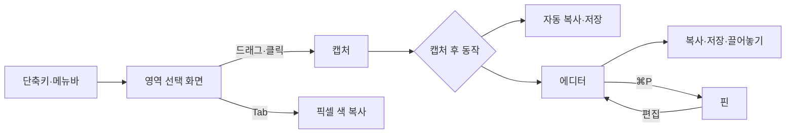

# mCapture 사용 설명서
화면을 캡처하고 주석을 달아 복사·저장·공유하는 방법을 기능별로 정리한다.

> ℹ️ 대상 독자: 사용자 | 최종 수정: 2026-10-16

## 개요

mCapture는 메뉴바에 상주하는 스크린샷 앱이다. 단축키를 누르면 화면을 멈춘 채 영역을 고르고, 캡처 결과를 클립보드에 복사하거나 파일로 저장하거나 에디터에서 꾸민다.

- 메뉴바의 카메라 아이콘에서 모든 캡처와 설정을 시작할 수 있다
- Dock 아이콘은 에디터 창이 열려 있을 때만 보인다
- 단축키는 한글 입력 상태에서도 동작한다
- ⌘Q를 눌러도 앱은 종료되지 않고 앞 창만 닫힌다. 종료는 메뉴바 아이콘 › mCapture 종료(또는 에디터가 열려 있을 때 mCapture 메뉴 › 종료)로 한다



## 사전 준비

| 항목 | 내용 |
|---|---|
| 설치 | `./scripts/make-dmg.sh`로 만든 DMG에서 Applications로 옮겨 실행 ([설치 안내](../docs/설치-안내.md)) |
| 화면 기록 권한 | 첫 캡처 때 시스템이 요청한다. 허용하지 않으면 캡처 대신 안내 창이 뜬다. 설정 › 일반 › 화면 기록 권한에서 상태 확인과 "시스템 설정 열기" |
| 그 밖의 권한 | 텍스트 인식·창 캡처·전역 단축키는 추가 권한이 필요 없다 |

## 1. 캡처

### 캡처 시작

| 동작 | 기본 단축키 | 메뉴바 | 결과 |
|---|---|---|---|
| 영역 캡처 | ⌃⇧4 | 영역 캡처 | 고른 영역 |
| 전체 화면 캡처 | ⌃⇧1 | 전체 화면 캡처 | 커서가 있는 디스플레이 전체 (선택 화면 없이 바로) |
| 창 캡처 | ⌃⇧3 | 창 캡처 | 클릭한 창 (배경 투명) |
| 텍스트 인식 | ⌃⇧5 | 텍스트 인식 | 고른 영역의 글자를 클립보드로 |

단축키는 [설정](#4-설정)에서 바꾼다. 메뉴바 메뉴를 열면 항목 옆에 지금 단축키가 보인다.

### 영역 선택 화면

단축키를 누르면 모든 디스플레이가 멈춘 화면으로 바뀐다. 커서 옆 확대경에 위치(pt)와 가운데 픽셀 색이 보이고, 선택 영역 옆에 크기(pt)가 보인다.

| 하고 싶은 것 | 조작 |
|---|---|
| 영역 고르기 | 드래그 |
| 정사각형으로 고르기 | 드래그 중 ⇧ |
| 크기를 유지한 채 영역 옮기기 | 드래그 중 Space를 누른 채 이동 |
| 그 디스플레이 전체 캡처 | 드래그 없이 클릭 |
| 확대경 가운데 픽셀 색 복사 | Tab (`#RRGGBB`가 복사되고 선택 화면이 닫힘) |
| 취소 | Esc 또는 우클릭 |

선택 화면이 닫히고 에디터가 열리지 않으면 캡처 전에 쓰던 앱으로 포커스가 돌아간다.

### 창 캡처

1. ⌃⇧3을 누른다. 선택 화면에서 커서 아래 창이 파란 테두리로 강조된다
2. 원하는 창 위에서 클릭한다. 다른 창에 가려진 부분까지 온전히 캡처된다

- 배경은 투명하고, 설정의 "그림자 포함"이 켜져 있으면 창 그림자가 함께 담긴다
- 창이 없는 곳을 클릭하면 디스플레이 전체, 드래그하면 영역 캡처와 같다

### 텍스트·QR 인식

1. ⌃⇧5를 누르고 글자가 있는 영역을 드래그한다 (클릭하면 디스플레이 전체)
2. 인식한 텍스트가 클립보드에 복사되고, 토스트에 첫 줄 앞부분이 보인다

- 한국어와 영어를 함께 인식한다
- 영역 안에 QR 코드(바코드)가 있으면 글자 대신 QR 내용만 복사한다
- 설정 › 텍스트 인식 › "줄바꿈 제거"를 켜면 여러 줄을 공백으로 이어 한 줄로 복사한다. 연속된 공백은 항상 하나로 줄인다

> ℹ️ **참고**: 컴퓨터를 켠 뒤 첫 인식은 시스템이 인식 모델을 읽느라 몇 초에서 십수 초 걸릴 수 있다. 늦어지면 "텍스트 인식 중…" 토스트가 뜨고, 다음부터는 빠르다.

### 캡처 후 동작

설정 › 캡처 후에서 세 가지를 각각 켜고 끈다. 기본값은 모두 켜짐이다.

| 동작 | 내용 |
|---|---|
| 클립보드에 복사 | PNG로 복사 |
| 파일로 저장 | 저장 폴더(기본 `~/Pictures/mCapture`)에 `mCapture_2026-10-16_11-05-32.png` 형식으로 저장. 같은 이름이 있으면 `_2`, `_3`을 붙임 |
| 에디터 열기 | 캡처를 에디터 창으로 연다 |

> 💡 **팁**: 같은 캡처는 같은 파일에 저장된다. 캡처 직후 자동 저장한 뒤 에디터에서 주석을 달고 ⌘S를 누르면 그 파일을 덮어쓴다. 새 파일이 필요하면 ⇧⌘S를 쓴다.

## 2. 에디터

### 화면 구성

툴바는 왼쪽부터 다음 순서다.

| 영역 | 내용 |
|---|---|
| 도구 | 선택·사각형·타원·선·화살표·형광펜·텍스트·카운터·가리기 |
| 색상 | 8색. 창이 좁으면 현재 색 버튼 하나로 접히고, 누르면 팔레트가 뜬다 |
| 크기 | 슬라이더 1~20 (오른쪽 숫자가 현재 값). 선 굵기, 글자 크기, 카운터 크기, 가리기 강도에 쓰인다. 주석을 고르면 그 주석의 크기로 맞춰지고, 끌면 고른 주석에 바로 적용된다 (한 번 끈 것이 실행 취소 한 단계) |
| 도구 옵션 | 텍스트일 때 글꼴(Aa)·배경 상자, 가리기일 때 픽셀화·블러 |
| 크기·배율 | 이미지(또는 선택 영역) 크기와 배율. 배율을 누르면 화면에 맞춤 |
| 동작 버튼 | 실행 취소, 다시 실행, 복사, 저장, 핀, 끌어놓기 손잡이(✋) |

버튼에 마우스를 올리면 0.3초 뒤 이름과 단축키가 툴팁으로 뜬다.

### 도구

| 도구 | 키 | 사용법 |
|---|---|---|
| 선택 | V | 드래그로 선택 영역을 만들고 크롭·부분 복사·범위 안 주석 지우기에 쓴다. 이미지·가리기·형광펜을 고를 때도 이 도구를 쓴다 |
| 사각형 | R | 드래그. ⇧ 정사각형 |
| 타원 | O | 드래그. ⇧ 원 |
| 선 | L | 드래그. ⇧ 45° 단위 |
| 화살표 | A | 드래그. ⇧ 45° 단위 |
| 형광펜 | H | 드래그한 상자를 반투명하게 덮는다 |
| 텍스트 | T | 클릭한 자리에 글자를 입력한다 |
| 카운터 | N | 클릭한 자리에 다음 번호를 놓는다. 누른 채 끌면 위치를 정할 수 있다 |
| 가리기 | B | 드래그한 영역을 픽셀화 또는 블러로 가린다 |

### 선택 영역과 크롭

| 동작 | 조작 |
|---|---|
| 선택 영역 만들기 | 선택 도구(V)로 드래그, 전체 선택 ⌘A |
| 크기 조절 | 모서리·변 핸들 드래그 (⇧ 정사각형), ⌘ + 방향키 |
| 이동 | 영역 안을 드래그, 방향키 (1pt, ⇧ 10pt) |
| 크롭 | Enter |
| 크롭 되돌리기 | ⇧⌘R (원래 캡처 전체로 돌아감) |
| 선택 영역만 복사 | ⌘C |
| 범위 안 주석 지우기 | 주석을 고르지 않은 상태에서 Delete. 범위 안에 완전히 들어간 주석(점선으로 표시)만 지우고 배경은 그대로 둔다. 영역이 가장자리에 닿으면 가장자리에 걸친 주석도 들어간다 |
| 선택 해제 | Esc |

> 💡 **팁**: 영역 캡처는 디스플레이 전체를 보관하고 고른 영역만 크롭해 보여 준다. 영역을 좁게 잡았어도 ⇧⌘R로 다시 넓힐 수 있다.

### 주석 다루기

| 동작 | 조작 |
|---|---|
| 고르기 | 클릭 (그리기 도구에서는 이미지·가리기·형광펜을 건너뛰고 그 위에 바로 그린다) |
| 옮기기 | 드래그, 방향키 (1pt, ⇧ 10pt) |
| 크기·끝점 조절 | 핸들 드래그. 이미지는 비율 유지, 텍스트는 글자 크기가 바뀐다 |
| 스타일 바꾸기 | 고른 상태에서 색상·크기·글꼴·배경·가리기 방식을 누른다 |
| 지우기 | Delete. 여러 개는 선택 도구로 범위를 끈 뒤 Delete |
| 실행 취소 / 다시 실행 | ⌘Z / ⇧⌘Z |

### 텍스트

| 동작 | 조작 |
|---|---|
| 새 텍스트 | 텍스트 도구(T)로 클릭 후 입력 |
| 확정 | Enter 또는 Esc (빈 텍스트는 사라진다) |
| 줄바꿈 | ⇧Enter |
| 다시 편집 | 텍스트를 더블클릭, 또는 텍스트 도구로 클릭 |
| 글꼴 | 툴바 Aa: 시스템·둥근 글꼴·세리프·고정폭·손글씨 |
| 배경 상자 | 툴바 배경 버튼. 주석 색 상자 위에 대비되는 글자색으로 쓴다 |
| 글자 크기 | 크기 슬라이더, 또는 모서리 핸들을 끌어 0.25~8배. 핸들 배율은 슬라이더를 움직여도 유지된다 (슬라이더 값이 같아도 핸들로 키운 글자는 더 크다) |

### 가리기

1. 가리기 도구(B)를 고른다
2. 툴바 옵션에서 픽셀화 또는 블러를 고른다 (마지막 선택을 기억한다)
3. 가릴 영역을 드래그한다

- 강도는 크기 슬라이더로 정한다. 픽셀화 블록은 크기×2+2pt, 블러 반경은 크기×2pt다. 작게 해도 글자가 읽히지 않도록 블록 6pt, 반경 4pt 아래로는 내려가지 않는다
- 만든 뒤에도 선택 도구로 골라 방식·강도·크기·위치를 바꿀 수 있다
- 원본 이미지는 바뀌지 않는다. 가리기를 지우면 원래 화면이 다시 보인다
- 배경의 글자나 물체를 감출 때도 가리기(블러)를 쓴다. ⌘A 후 Delete는 가리기까지 모두 지우므로 주의한다

> ⚠️ **주의**: 가리기는 원본 캡처만 흐리게 한다. 붙여넣은 이미지 위에 겹쳐도 그 이미지는 흐려지지 않는다. 민감한 정보에는 블러보다 픽셀화가 안전하다.

### 카운터

- 다음 번호는 지금 있는 카운터 중 가장 큰 번호 + 1이다
- 카운터를 지워도 남은 번호를 다시 매기지 않는다
- 크기는 크기 슬라이더로 바꾼다 (핸들 없음)

### 이미지 붙여넣기·열기

| 동작 | 조작 |
|---|---|
| 클립보드 이미지 겹치기 | ⌘V. 보이는 영역 가운데에 원래 크기로 놓고, 90%를 넘으면 줄인다. 다른 주석 아래에 깔린다 |
| 이미지 파일 열기 | ⇧⌘O, 메뉴바 "이미지 열기…", Finder에서 PNG 우클릭 → 다음으로 열기 → mCapture. ⌘S는 원본이 아니라 저장 폴더에 새 파일로 저장하고, 원본에 덮어쓰려면 ⇧⌘S로 고른다 |
| 새 에디터로 열기 | 이미지 파일을 캔버스에 끌어다 놓기 |

### 보기

| 동작 | 조작 |
|---|---|
| 화면에 맞춤 / 100% / 선택 영역으로 확대 | ⌘1 / ⌘0 / ⌘2 |
| 확대 / 축소 | ⌘= / ⌘-, 핀치, 마우스 휠, ⌘ + 트랙패드 스크롤 (커서 위치 기준) |
| 이동 | 트랙패드 스크롤, Space + 드래그, 우클릭 드래그 |

### 내보내기

| 동작 | 조작 |
|---|---|
| 복사 | ⌘C (선택 영역이 있으면 그 부분만) |
| 저장 | ⌘S (자동 저장 파일 또는 마지막 저장 파일에 덮어씀) |
| 다른 이름으로 저장 | ⇧⌘S (이후 ⌘S는 이 파일에 덮어씀) |
| 다른 앱으로 끌어놓기 | 툴바 맨 오른쪽 손잡이(✋)를 Finder·메신저·브라우저 입력창으로 끌면 편집 결과가 PNG 파일로 들어간다. 손잡이를 클릭만 하면 사용법이 뜬다. 같은 에디터 안에는 놓이지 않는다 |
| 화면에 고정 | ⌘P 또는 툴바 핀 버튼 ([핀](#3-핀) 참고) |
| 설정된 동작 후 닫기 | Esc (기본: 클립보드에 복사) |
| 동작 없이 닫기 | ⌘W, ⌘Q (앱은 계속 실행) |

Esc는 단계적으로 동작한다: 텍스트 편집 확정 → 주석 선택 해제 → 선택 영역 해제 → 설정된 동작 후 창 닫기.

## 3. 핀

에디터에서 ⌘P(또는 툴바 핀 버튼)를 누르면 결과 이미지가 항상 위에 떠 있는 작은 창으로 바뀌고 에디터는 닫힌다. 참고 자료를 띄워 두거나 화면과 겹쳐 비교할 때 쓴다.

| 동작 | 조작 |
|---|---|
| 옮기기 | 끌기 |
| 크기 조절 | 스크롤(한 칸 10%), 핀치. 커서 위치 기준, 짧은 변 48pt ~ 원래 크기 4배 |
| 50% / 100% / 200% | 우클릭 메뉴 |
| 반투명 | 우클릭 메뉴 › 반투명 (그림자도 꺼져 아래 화면과 겹쳐 보기 좋다) |
| 복사 / 저장 | ⌘C / ⌘S, 우클릭 메뉴 (저장은 같은 캡처 파일에 덮어씀) |
| 에디터로 돌아가기 | 우클릭 메뉴 › 편집 (주석이 그대로 남아 있다) |
| 닫기 | Esc, ⌘W, ⌘Q, 우클릭 메뉴 › 닫기 |

- 핀을 눌러도 쓰던 앱의 포커스를 빼앗지 않는다. 키 입력은 핀을 한 번 클릭한 뒤 받는다
- 모든 데스크톱(Space)과 전체 화면 앱 위에 보인다
- 처음에는 화면 가운데에 원래 크기로 뜨고, 화면의 80%보다 크면 줄여서 뜬다

## 4. 설정

메뉴바 › 설정…(⌘,)에서 연다. 바꾸면 바로 반영된다.

| 구역 | 항목 | 기본값 | 설명 |
|---|---|---|---|
| 저장 | 저장 폴더 | `~/Pictures/mCapture` | "변경…"으로 고르고 "열기"로 Finder에서 연다 |
| 저장 | 파일 이름 | `mCapture_{date}_{time}` | 아래 "파일 이름 형식" 참고. 입력하면 바로 아래에 미리보기가 보인다 |
| 캡처 후 | 클립보드에 복사 / 파일로 저장 / 에디터 열기 | 모두 켜짐 | [캡처 후 동작](#캡처-후-동작) 참고 |
| 에디터 | Esc로 닫을 때 | 클립보드에 복사 | 복사 / 저장 / 복사하고 저장 / 아무것도 안 함 |
| 창 캡처 | 그림자 포함 | 켜짐 | 끄면 창 테두리에 딱 맞게 캡처 |
| 텍스트 인식 | 줄바꿈 제거 | 꺼짐 | 켜면 여러 줄을 공백으로 이어 복사 |
| 단축키 | 동작별 단축키 | ⌃⇧4 / ⌃⇧1 / ⌃⇧3 / ⌃⇧5 | 아래 "단축키 바꾸기" 참고 |
| 일반 | 로그인 시 실행 | 꺼짐 | Mac에 로그인하면 자동 실행 |
| 일반 | 화면 기록 권한 | - | 허용 상태 표시와 시스템 설정 열기 |

### 파일 이름 형식

새로 저장하는 파일 이름을 `{토큰}`으로 정한다. 캡처 자동 저장, ⌘S, 다른 이름으로 저장의 기본 이름, 끌어놓기, 핀 저장에 모두 쓰인다. 확장자 `.png`는 자동으로 붙는다.

| 토큰 | 값 (예) |
|---|---|
| `{date}` | 2026-10-16 |
| `{time}` | 11-05-32 |
| `{yyyy}` `{yy}` | 2026, 26 |
| `{MM}` `{dd}` | 월, 일 (10, 16) |
| `{HH}` `{mm}` `{ss}` | 시, 분, 초 (11, 05, 32) — `{MM}` 월과 `{mm}` 분은 대소문자로 구분한다 |
| `{app}` | 캡처한 앱. 창 캡처는 고른 창의 앱, 영역·전체 화면은 캡처 전에 쓰던 앱. 파일에서 열었으면 `mCapture` |

- 예: `{app} {date} {HH}.{mm}.{ss}` → `Safari 2026-10-16 11.05.32.png`
- 모르는 토큰은 글자 그대로 남는다. 미리보기에서 오타를 확인한다
- `/`, `:`, 줄바꿈은 `-`로 바뀌고, 앞의 `.`은 빠진다. 아주 긴 이름은 잘린다. 비워 두면 기본 형식을 쓴다
- 같은 이름이 있으면 `_2`, `_3`을 붙인다

### 단축키 바꾸기

1. 바꿀 동작의 단축키 버튼을 누른다 (녹화 중에는 기존 단축키가 잠시 꺼진다)
2. 새 조합을 누른다. ⌘·⌃·⌥ 중 하나 이상과 영문자 또는 숫자를 함께 눌러야 한다
3. 버튼에 새 조합이 보이면 적용된 것이다. 취소는 Esc 또는 버튼을 다시 누른다

- 다른 동작과 같은 조합은 거부된다
- 터미널에서도 바꿀 수 있다

```bash
defaults write com.motolies.mcapture hotkeyArea "cmd+shift+4"
```

## 5. URL로 실행

터미널이나 자동화 도구(단축어, Raycast 등)에서 `open` 명령으로 실행한다.

| URL | 동작 |
|---|---|
| `mcapture://grab/area` | 영역 캡처 |
| `mcapture://grab/fullscreen` | 커서가 있는 디스플레이 전체 캡처 |
| `mcapture://grab/window` | 창 캡처 |
| `mcapture://ocr` | 텍스트 인식 |
| `mcapture://settings` | 설정 창 열기 |
| `mcapture://open?path=/abs/path.png` | 이미지 파일을 에디터로 열기 |

```bash
open "mcapture://grab/window"
```

## 문제 해결

| 증상 | 해결 |
|---|---|
| 캡처하면 권한 안내 창이 뜬다 | 시스템 설정 › 개인정보 보호 및 보안 › 화면 및 시스템 오디오 녹음에서 mCapture를 허용한다 |
| 다시 빌드할 때마다 권한을 또 묻는다 | `./scripts/create-signing-identity.sh`를 한 번 실행해 같은 인증서로 서명한다. 이미 꼬였다면 시스템 설정에서 mCapture 항목을 지우고 다시 허용한다 |
| "단축키가 겹쳐 꺼짐" 토스트가 뜬다 | 두 동작에 같은 조합이 지정돼 뒤 동작이 꺼졌다. 설정에서 다른 조합으로 바꾼다 |
| "단축키 등록 실패" 토스트가 뜬다 | 다른 앱이 같은 조합을 쓰고 있다. 설정에서 다른 조합으로 바꾼다 |
| "인식된 텍스트가 없습니다" | 글자가 충분히 크게 들어가도록 영역을 다시 고른다. 아주 작은 글자는 인식이 어렵다 |
| "창을 찾지 못했습니다" | 클릭한 사이에 창이 닫혔거나 사라졌다. 다시 시도한다 |
| 그리기 도구로 형광펜·가리기·붙인 이미지가 안 골라진다 | 그 위에 바로 그릴 수 있도록 일부러 건너뛴다. 선택 도구(V)로 고른다 |
| 붙여넣은 이미지 위의 블러가 안 먹는다 | 가리기는 원본만 흐리게 한다. 원본 위에서 가리거나, 이미지를 붙이기 전에 가린다 |
| 에디터 창을 좁히는 데 한계가 있다 | 툴바 최소 폭(약 900pt)이 창 최소 폭이다. 좁아지면 색상 팔레트가 먼저 접힌다 |
| 툴팁이 너무 빨리(또는 늦게) 뜬다 | `defaults write com.motolies.mcapture NSInitialToolTipDelay -int <밀리초>` 후 mCapture를 다시 실행한다. 기본값 300 |
