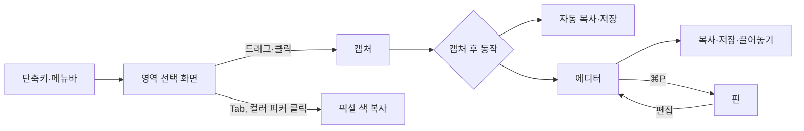

# mCapture 사용 설명서
화면을 캡처하고 주석을 달아 복사·저장·공유하는 방법을 기능별로 정리한다.

> ℹ️ 대상 독자: 사용자 | 최종 수정: 2026-10-22

## 개요

mCapture는 메뉴바에 상주하는 스크린샷 앱이다. 단축키를 누르면 화면을 멈춘 채 영역을 고르고, 캡처 결과를 클립보드에 복사하거나 파일로 저장하거나 에디터에서 꾸민다.

- 메뉴바의 카메라 아이콘에서 모든 캡처와 설정을 시작할 수 있다. 아이콘에 마우스를 올리면 앱 이름과 버전이 툴팁으로 뜬다
- 메뉴바 › 파일 찾기(⌃⇧F)로 Everything·Cling처럼 파일 이름을 바로 찾는다 ([파일 찾기](#7-파일-찾기))
- ⌃⇧C로 지금 쓰는 앱의 창을 마우스 커서가 있는 모니터 가운데로 옮긴다 ([창 가운데로 이동](#10-창-가운데로-이동))
- 메뉴바 메뉴에서 [잠자기 방지](#5-잠자기-방지)를 켜면 Mac이 저절로 잠들지 않고, 그동안 아이콘이 초록색이 된다
- 메뉴바의 CPU·MEM 항목이 CPU 사용률과 메모리 압력을 보여 주고, 누르면 상세 정보가 뜬다 ([시스템 모니터](#8-시스템-모니터))
- Dock 아이콘은 에디터 창(또는 빈 캔버스)이 열려 있을 때만 보인다
- 실행 중에 mCapture를 다시 실행하면(Finder·Spotlight·Launchpad, Dock 아이콘 클릭) [빈 캔버스](#빈-캔버스)가 뜬다
- 단축키는 한글 입력 상태에서도 동작한다
- ⌘Q를 눌러도 앱은 종료되지 않고 앞 창만 닫힌다. 종료는 메뉴바 아이콘 › mCapture 종료(또는 에디터가 열려 있을 때 mCapture 메뉴 › 종료)로 한다



## 사전 준비

| 항목 | 내용 |
|---|---|
| 설치 | `./scripts/make-dmg.sh`로 만든 DMG에서 Applications로 옮겨 실행 ([설치 안내](../docs/설치-안내.md)) |
| 화면 기록 권한 | 첫 캡처 때 시스템이 요청한다. 허용하지 않으면 캡처 대신 안내 창이 뜬다. 설정 › 일반 › 화면 기록 권한에서 상태 확인과 "시스템 설정 열기" |
| 파일 및 폴더 권한 | [파일 찾기](#7-파일-찾기) 인덱스를 처음 만들 때 데스크탑·문서·다운로드 폴더 접근을 묻는다. 거부하면 그 폴더만 검색되지 않는다 |
| 손쉬운 사용 권한 | [창 가운데로 이동](#10-창-가운데로-이동)과 제스처의 키 조합 보내기에 필요하다(macOS 27부터는 "기기 제어 및 데이터 접근"). 창 가운데로 이동을 처음 누르면 시스템이 묻고 시스템 설정이 열린다. 설정 › 일반 › 권한에서 상태 확인과 "시스템 설정 열기" |
| 그 밖의 권한 | 텍스트 인식·창 캡처·전역 단축키는 추가 권한이 필요 없다. 전체 디스크 접근은 선택(~/Library의 Mail·Messages 같은 보호 폴더까지 찾을 때) |

## 1. 캡처

### 캡처 시작

| 동작 | 기본 단축키 | 메뉴바 | 결과 |
|---|---|---|---|
| 영역 캡처 | ⌃⇧4 | 영역 캡처 | 고른 영역 |
| 전체 화면 캡처 | ⌃⇧1 | 전체 화면 캡처 | 커서가 있는 디스플레이 전체 (선택 화면 없이 바로) |
| 창 캡처 | ⌃⇧3 | 창 캡처 | 클릭한 창 (배경 투명) |
| 텍스트 인식 | ⌃⇧5 | 텍스트 인식 | 고른 영역의 글자를 클립보드로 |
| 컬러 피커 | ⌃⇧6 | 컬러 피커 | 클릭한 픽셀의 색(HEX 또는 RGB)을 클립보드로 |

단축키는 [설정](#4-설정)에서 바꾼다. 메뉴바 메뉴를 열면 항목 옆에 지금 단축키가 보인다.

### 영역 선택 화면

단축키를 누르면 모든 디스플레이가 멈춘 화면으로 바뀐다. 커서 옆 확대경에 위치(pt)와 가운데 픽셀 색이 보이고, 선택 영역 옆에 크기(pt)가 보인다.

| 하고 싶은 것 | 조작 |
|---|---|
| 영역 고르기 | 드래그 |
| 정사각형으로 고르기 | 드래그 중 ⇧ |
| 크기를 유지한 채 영역 옮기기 | 드래그 중 Space를 누른 채 이동 |
| 그 디스플레이 전체 캡처 | 드래그 없이 클릭 |
| 확대경 가운데 픽셀 색 복사 | Tab (`#RRGGBB`가 복사되고 선택 화면이 닫힘) |
| 취소 | Esc 또는 우클릭 |

선택 화면이 닫히고 에디터가 열리지 않으면 캡처 전에 쓰던 앱으로 포커스가 돌아간다.

### 창 캡처

1. ⌃⇧3을 누른다. 선택 화면에서 커서 아래 창이 파란 테두리로 강조된다
2. 원하는 창 위에서 클릭한다. 다른 창에 가려진 부분까지 온전히 캡처된다

- 배경은 투명하고, 설정의 "그림자 포함"이 켜져 있으면 창 그림자가 함께 담긴다
- 창이 없는 곳을 클릭하면 디스플레이 전체, 드래그하면 영역 캡처와 같다

### 텍스트·QR 인식

1. ⌃⇧5를 누르고 글자가 있는 영역을 드래그한다 (클릭하면 디스플레이 전체)
2. 인식한 텍스트가 클립보드에 복사되고, 토스트에 첫 줄 앞부분이 보인다

- 한국어와 영어를 함께 인식한다
- 영역 안에 QR 코드(바코드)가 있으면 글자 대신 QR 내용만 복사한다
- 설정 › 텍스트 인식 › "줄바꿈 제거"를 켜면 여러 줄을 공백으로 이어 한 줄로 복사한다. 연속된 공백은 항상 하나로 줄인다

> ℹ️ **참고**: 컴퓨터를 켠 뒤 첫 인식은 시스템이 인식 모델을 읽느라 몇 초에서 십수 초 걸릴 수 있다. 늦어지면 "텍스트 인식 중…" 토스트가 뜨고, 다음부터는 빠르다.

### 컬러 피커

화면 어디서든 픽셀 색을 집어 복사한다.

1. ⌃⇧6을 누르거나 메뉴바 › 컬러 피커를 고른다. 화면이 멈추지만 어두워지지 않는다
2. 커서 옆 확대경 가운데 칸이 집을 픽셀이다. 아래에 위치(pt), `#RRGGBB`, `rgb(r, g, b)`가 보인다
3. 클릭하면 HEX(`#FF3B30`), ⇧클릭하면 RGB(`rgb(255, 59, 48)`)가 복사되고 선택 화면이 닫힌다. 토스트에 복사한 값과 색 견본이 보인다

- Tab도 HEX로 복사한다. 취소는 Esc 또는 우클릭이다
- 값은 sRGB 기준이다
- 이미 연 에디터 안의 색은 이 방법으로 집을 수 없다(mCapture 자기 창은 화면 캡처에서 빠진다). 에디터의 [컬러 피커 도구(I)](#컬러-피커와-픽셀-자)를 쓴다

### 캡처 후 동작

설정 › 캡처 후에서 세 가지를 각각 켜고 끈다. 기본값은 모두 켜짐이다.

| 동작 | 내용 |
|---|---|
| 클립보드에 복사 | PNG로 복사 |
| 파일로 저장 | 저장 폴더(기본 `~/Pictures/mCapture`)에 `mCapture_2026-10-16_11-05-32.png` 형식으로 저장. 같은 이름이 있으면 `_2`, `_3`을 붙임 |
| 에디터 열기 | 캡처를 에디터 창으로 연다 |

> 💡 **팁**: 같은 캡처는 같은 파일에 저장된다. 캡처 직후 자동 저장한 뒤 에디터에서 주석을 달고 ⌘S를 누르면 그 파일을 덮어쓴다. 새 파일이 필요하면 ⇧⌘S를 쓴다.

## 2. 에디터

### 화면 구성

툴바는 왼쪽부터 다음 순서다.

| 영역 | 내용 |
|---|---|
| 도구 | 선택·사각형·타원·선·화살표·형광펜·텍스트·카운터·가리기, 구분선 뒤에 측정 도구(컬러 피커·픽셀 자) |
| 색상 | 8색. 창이 좁으면 현재 색 버튼 하나로 접히고, 누르면 팔레트가 뜬다 |
| 크기 | 슬라이더 1~20 (오른쪽 숫자가 현재 값). 선 굵기, 글자 크기, 카운터 크기, 가리기 강도에 쓰인다. 주석을 고르면 그 주석의 크기로 맞춰지고, 끌면 고른 주석에 바로 적용된다 (한 번 끈 것이 실행 취소 한 단계) |
| 도구 옵션 | 텍스트일 때 글꼴(Aa)·배경 상자, 가리기일 때 픽셀화·블러 |
| 크기·배율 | 이미지(또는 선택 영역) 크기와 배율. 배율을 누르면 화면에 맞춤 |
| 동작 버튼 | 실행 취소, 다시 실행, 복사, 저장, 핀, 끌어놓기 손잡이(✋) |

버튼에 마우스를 올리면 0.3초 뒤 이름과 단축키가 툴팁으로 뜬다.

### 도구

| 도구 | 키 | 사용법 |
|---|---|---|
| 선택 | V | 드래그로 선택 영역을 만들고 크롭·부분 복사·범위 안 주석 지우기에 쓴다. 이미지·가리기·형광펜을 고를 때도 이 도구를 쓴다 |
| 사각형 | R | 드래그. ⇧ 정사각형 |
| 타원 | O | 드래그. ⇧ 원 |
| 선 | L | 드래그. ⇧ 45° 단위 |
| 화살표 | A | 드래그. ⇧ 45° 단위 |
| 형광펜 | H | 드래그한 상자를 반투명하게 덮는다 |
| 텍스트 | T | 클릭한 자리에 글자를 입력한다 |
| 카운터 | N | 클릭한 자리에 다음 번호를 놓는다. 누른 채 끌면 위치를 정할 수 있다 |
| 가리기 | B | 드래그한 영역을 픽셀화 또는 블러로 가린다 |
| 컬러 피커 | I | 클릭한 픽셀의 색을 복사한다 (⇧클릭 RGB) |
| 픽셀 자 | M | 커서 아래 간격을 보이고, 끌면 두 점 거리를 잰다 |

### 컬러 피커와 픽셀 자

이미지를 살펴보기만 하는 측정 도구다. 주석을 만들거나 고르지 않고, 화면에만 보여 내보낸 이미지에는 들어가지 않는다. 둘 다 **원본 캡처의 픽셀**을 읽으므로 그린 주석은 무시한다.

**컬러 피커 (I)**

- 커서 옆 확대경에 위치(보이는 영역 왼쪽 위 기준 pt), `#RRGGBB`, `rgb(r, g, b)`가 보인다
- 클릭하면 HEX, ⇧클릭하면 RGB를 복사하고 색 견본 토스트로 알린다
- 반투명 픽셀(창 캡처 그림자 등)은 `#RRGGBBAA`, `rgba(r, g, b, 0.5)`로 복사한다. 완전히 투명한 픽셀은 복사하지 않는다
- 비활성 에디터를 처음 클릭하면 창만 앞으로 오고 복사하지 않는다. 확대경을 본 뒤 다시 클릭한다

**픽셀 자 (M)**

| 동작 | 조작 |
|---|---|
| 요소 사이 간격·요소 크기 | 커서를 올린다. 커서 아래 픽셀에서 상하좌우로 색이 바뀌는 경계까지 선을 긋고 `가로 × 세로`(pt)를 보인다 |
| 두 점 거리 | 드래그. `가로 × 세로 · 직선 거리`(pt)를 보이고 놓은 뒤에도 남는다 |
| 가로·세로·45° 고정 | 드래그 중 ⇧ |
| 측정 지우기 | 클릭, Esc, 다른 도구 고르기, 크롭 |

- 간격은 경계까지 색이 같은 구간이다. 아주 미세한 차이(채널별 6 이하)는 같은 색으로 보고, 그라디언트에서는 커서 아래 색과 가까운 부분까지만 잰다
- 크롭했으면 보이는 영역 끝에서 멈춘다
- 측정 도구에서 Esc는 측정 지우기 → 선택 도구로 돌아가기 순서로 동작해, 색을 복사한 직후 Esc로 창이 닫히며 클립보드가 이미지로 바뀌지 않는다

### 선택 영역과 크롭

| 동작 | 조작 |
|---|---|
| 선택 영역 만들기 | 선택 도구(V)로 드래그, 전체 선택 ⌘A |
| 크기 조절 | 모서리·변 핸들 드래그 (⇧ 정사각형), ⌘ + 방향키 |
| 이동 | 영역 안을 드래그, 방향키 (1pt, ⇧ 10pt) |
| 크롭 | Enter |
| 크롭 되돌리기 | ⇧⌘R (원래 캡처 전체로 돌아감) |
| 선택 영역만 복사 | ⌘C |
| 범위 안 주석 지우기 | 주석을 고르지 않은 상태에서 Delete. 범위 안에 완전히 들어간 주석(점선으로 표시)만 지우고 배경은 그대로 둔다. 영역이 가장자리에 닿으면 가장자리에 걸친 주석도 들어간다 |
| 선택 해제 | Esc |

> 💡 **팁**: 영역 캡처는 디스플레이 전체를 보관하고 고른 영역만 크롭해 보여 준다. 영역을 좁게 잡았어도 ⇧⌘R로 다시 넓힐 수 있다.

### 주석 다루기

| 동작 | 조작 |
|---|---|
| 고르기 | 클릭 (그리기 도구에서는 이미지·가리기·형광펜을 건너뛰고 그 위에 바로 그린다) |
| 옮기기 | 드래그, 방향키 (1pt, ⇧ 10pt) |
| 크기·끝점 조절 | 핸들 드래그. 이미지는 비율 유지, 텍스트는 글자 크기가 바뀐다 |
| 스타일 바꾸기 | 고른 상태에서 색상·크기·글꼴·배경·가리기 방식을 누른다 |
| 지우기 | Delete. 여러 개는 선택 도구로 범위를 끈 뒤 Delete |
| 실행 취소 / 다시 실행 | ⌘Z / ⇧⌘Z |

### 텍스트

| 동작 | 조작 |
|---|---|
| 새 텍스트 | 텍스트 도구(T)로 클릭 후 입력 |
| 확정 | Enter 또는 Esc (빈 텍스트는 사라진다) |
| 줄바꿈 | ⇧Enter |
| 다시 편집 | 텍스트를 더블클릭, 또는 텍스트 도구로 클릭 |
| 글꼴 | 툴바 Aa: 시스템·둥근 글꼴·세리프·고정폭·손글씨 |
| 배경 상자 | 툴바 배경 버튼. 주석 색 상자 위에 대비되는 글자색으로 쓴다 |
| 글자 크기 | 크기 슬라이더, 또는 모서리 핸들을 끌어 0.25~8배. 핸들 배율은 슬라이더를 움직여도 유지된다 (슬라이더 값이 같아도 핸들로 키운 글자는 더 크다) |

### 가리기

1. 가리기 도구(B)를 고른다
2. 툴바 옵션에서 픽셀화 또는 블러를 고른다 (마지막 선택을 기억한다)
3. 가릴 영역을 드래그한다

- 강도는 크기 슬라이더로 정한다. 픽셀화 블록은 크기×2+2pt, 블러 반경은 크기×2pt다. 작게 해도 글자가 읽히지 않도록 블록 6pt, 반경 4pt 아래로는 내려가지 않는다
- 만든 뒤에도 선택 도구로 골라 방식·강도·크기·위치를 바꿀 수 있다
- 원본 이미지는 바뀌지 않는다. 가리기를 지우면 원래 화면이 다시 보인다
- 배경의 글자나 물체를 감출 때도 가리기(블러)를 쓴다. ⌘A 후 Delete는 가리기까지 모두 지우므로 주의한다

> ⚠️ **주의**: 가리기는 원본 캡처만 흐리게 한다. 붙여넣은 이미지 위에 겹쳐도 그 이미지는 흐려지지 않는다. 민감한 정보에는 블러보다 픽셀화가 안전하다.

### 카운터

- 다음 번호는 지금 있는 카운터 중 가장 큰 번호 + 1이다
- 카운터를 지워도 남은 번호를 다시 매기지 않는다
- 크기는 크기 슬라이더로 바꾼다 (핸들 없음)

### 이미지 붙여넣기·열기

| 동작 | 조작 |
|---|---|
| 클립보드 이미지 겹치기 | ⌘V. 보이는 영역 가운데에 원래 크기로 놓고, 90%를 넘으면 줄인다. 다른 주석 아래에 깔린다 |
| 이미지 파일 열기 | ⇧⌘O, 메뉴바 "이미지 열기…", Finder에서 PNG 우클릭 → 다음으로 열기 → mCapture. ⌘S는 원본이 아니라 저장 폴더에 새 파일로 저장하고, 원본에 덮어쓰려면 ⇧⌘S로 고른다 |
| 새 에디터로 열기 | 이미지 파일을 캔버스에 끌어다 놓기 |
| 빈 캔버스에서 시작 | 실행 중에 mCapture를 다시 실행 ([빈 캔버스](#빈-캔버스) 참고) |

### 빈 캔버스

캡처 없이 다른 곳의 이미지를 가져와 꾸밀 때 쓴다. mCapture가 실행 중일 때 앱을 한 번 더 실행하면(Finder에서 더블클릭, Spotlight·Launchpad, Dock 아이콘 클릭) "빈 캔버스" 창이 뜬다.

| 동작 | 조작 |
|---|---|
| 클립보드 이미지로 시작 | ⌘V. 클립보드에 이미지가 없으면 토스트로 알린다 |
| 이미지 파일로 시작 | Finder 등에서 이미지 파일을 끌어다 놓는다. 여러 개를 놓으면 각각 에디터로 열린다 |
| 브라우저 이미지로 시작 | 브라우저에서 이미지를 끌어다 놓는다 (이미지 데이터를 주는 브라우저만) |
| 닫기 | Esc, ⌘W |

- 이미지가 들어오면 빈 캔버스는 닫히고 그 이미지의 에디터가 같은 화면에 열린다. 크롭·주석·저장은 파일에서 연 이미지와 같다
- 빈 캔버스는 하나만 뜬다. 이미 떠 있을 때 다시 실행하면 그 창을 앞으로 가져온다
- 처음 실행할 때(로그인 시 실행 포함)는 뜨지 않는다

### 보기

| 동작 | 조작 |
|---|---|
| 화면에 맞춤 / 100% / 선택 영역으로 확대 | ⌘1 / ⌘0 / ⌘2 |
| 확대 / 축소 | ⌘= / ⌘-, 핀치, 마우스 휠, ⌘ + 트랙패드 스크롤 (커서 위치 기준) |
| 이동 | 트랙패드 스크롤, Space + 드래그, 우클릭 드래그 |

### 내보내기

| 동작 | 조작 |
|---|---|
| 복사 | ⌘C (선택 영역이 있으면 그 부분만) |
| 저장 | ⌘S (자동 저장 파일 또는 마지막 저장 파일에 덮어씀) |
| 다른 이름으로 저장 | ⇧⌘S (이후 ⌘S는 이 파일에 덮어씀) |
| 다른 앱으로 끌어놓기 | 툴바 맨 오른쪽 손잡이(✋)를 Finder·메신저·브라우저 입력창으로 끌면 편집 결과가 PNG 파일로 들어간다. 손잡이를 클릭만 하면 사용법이 뜬다. 같은 에디터 안에는 놓이지 않는다 |
| 화면에 고정 | ⌘P 또는 툴바 핀 버튼 ([핀](#3-핀) 참고) |
| 설정된 동작 후 닫기 | Esc (기본: 클립보드에 복사) |
| 동작 없이 닫기 | ⌘W, ⌘Q (앱은 계속 실행) |

Esc는 단계적으로 동작한다: 텍스트 편집 확정 → 측정 지우기 → 측정 도구면 선택 도구로 → 주석 선택 해제 → 선택 영역 해제 → 설정된 동작 후 창 닫기.

## 3. 핀

에디터에서 ⌘P(또는 툴바 핀 버튼)를 누르면 결과 이미지가 항상 위에 떠 있는 작은 창으로 바뀌고 에디터는 닫힌다. 참고 자료를 띄워 두거나 화면과 겹쳐 비교할 때 쓴다.

| 동작 | 조작 |
|---|---|
| 옮기기 | 끌기 |
| 크기 조절 | 스크롤(한 칸 10%), 핀치. 커서 위치 기준, 짧은 변 48pt ~ 원래 크기 4배 |
| 50% / 100% / 200% | 우클릭 메뉴 |
| 반투명 | 우클릭 메뉴 › 반투명 (그림자도 꺼져 아래 화면과 겹쳐 보기 좋다) |
| 복사 / 저장 | ⌘C / ⌘S, 우클릭 메뉴 (저장은 같은 캡처 파일에 덮어씀) |
| 에디터로 돌아가기 | 우클릭 메뉴 › 편집 (주석이 그대로 남아 있다) |
| 닫기 | Esc, ⌘W, ⌘Q, 우클릭 메뉴 › 닫기 |

- 핀을 눌러도 쓰던 앱의 포커스를 빼앗지 않는다. 키 입력은 핀을 한 번 클릭한 뒤 받는다
- 모든 데스크톱(Space)과 전체 화면 앱 위에 보인다
- 처음에는 화면 가운데에 원래 크기로 뜨고, 화면의 80%보다 크면 줄여서 뜬다

## 4. 설정

메뉴바 › 설정…(⌘,)에서 연다. 바꾸면 바로 반영된다. 창 위쪽의 아이콘으로 **일반 · 캡처 · 파일 찾기 · 제스처 · 시스템 모니터** 탭을 고르고, 창 높이는 탭 내용에 맞춰 바뀐다. 다시 열면 마지막에 본 탭이 열린다.

| 탭 | 구역 | 항목 | 기본값 | 설명 |
|---|---|---|---|---|
| 일반 | 일반 | 로그인 시 실행 | 꺼짐 | Mac에 로그인하면 자동 실행 |
| 일반 | 권한 | 화면 기록 | - | 허용 상태 표시와 시스템 설정 열기. 캡처·텍스트 인식·컬러 피커에 필요하다 |
| 일반 | 권한 | 손쉬운 사용 (macOS 27부터 "기기 제어 및 데이터 접근") | - | 허용 상태 표시와 시스템 설정 열기(처음이면 시스템 요청 창도 뜬다). 창 가운데로 이동과 제스처의 키 조합 보내기에 필요하다. 허용하고 설정 창을 다시 누르면 "허용됨"으로 바뀐다 |
| 일반 | 창 | 창 가운데로 이동 | ⌃⇧C | 앞 앱의 창을 커서가 있는 화면 가운데로 ([창 가운데로 이동](#10-창-가운데로-이동)). 아래 "단축키 바꾸기" 참고 |
| 일반 | 정보 | 버전 | - | 앱 버전과 빌드한 커밋 (예: `0.1.1 (344637f)`). 커밋하지 않은 변경으로 빌드했으면 `-dirty`가 붙는다. 메뉴바 아이콘에 마우스를 올려도 보인다 |
| 일반 | 정보 | GitHub | - | 소스 저장소 [github.com/motolies/mCapture](https://github.com/motolies/mCapture). 누르면 기본 브라우저로 연다 |
| 캡처 | 저장 | 저장 폴더 | `~/Pictures/mCapture` | "변경…"으로 고르고 "열기"로 Finder에서 연다 |
| 캡처 | 저장 | 파일 이름 | `mCapture_{date}_{time}` | 아래 "파일 이름 형식" 참고. 입력하면 바로 아래에 미리보기가 보인다 |
| 캡처 | 캡처 후 | 클립보드에 복사 / 파일로 저장 / 에디터 열기 | 모두 켜짐 | [캡처 후 동작](#캡처-후-동작) 참고 |
| 캡처 | 에디터 | Esc로 닫을 때 | 클립보드에 복사 | 복사 / 저장 / 복사하고 저장 / 아무것도 안 함 |
| 캡처 | 창 캡처 | 그림자 포함 | 켜짐 | 끄면 창 테두리에 딱 맞게 캡처 |
| 캡처 | 텍스트 인식 | 줄바꿈 제거 | 꺼짐 | 켜면 여러 줄을 공백으로 이어 복사 |
| 캡처 | 단축키 | 영역 / 전체 화면 / 창 / 텍스트 인식 / 컬러 피커 | ⌃⇧4 / ⌃⇧1 / ⌃⇧3 / ⌃⇧5 / ⌃⇧6 | 아래 "단축키 바꾸기" 참고 |
| 파일 찾기 | 인덱스 | 파일 찾기 인덱스 사용 | 켜짐 | 앱 시작 때 인덱스를 만들고 바뀐 파일을 따라간다. 끄면 인덱스를 지운다 |
| 파일 찾기 | 인덱스 | 상태 | - | 항목 수와 갱신 시각, "다시 만들기" |
| 파일 찾기 | 검색 폴더 | 폴더 목록 | `~`, `/Applications`, `/System/Applications` | "폴더 추가…", ⊖로 빼기, "기본값" |
| 파일 찾기 | 제외 규칙 | 규칙, 숨김 파일 포함 | 아래 "파일 찾기" 참고 | 검색 폴더 안에서 내용을 색인하지 않을 폴더. 숨김 파일(.으로 시작)은 꺼짐 |
| 파일 찾기 | 권한 | 전체 디스크 접근 | - | 허용 상태와 시스템 설정 열기. 접근이 거부된 폴더가 있으면 주황색으로 알린다 |
| 파일 찾기 | 단축키 | 파일 찾기 | ⌃⇧F | 아래 "단축키 바꾸기" 참고 |
| 제스처 | 제스처 | 매직마우스 제스처 사용 | 켜짐 | 끄면 마우스를 듣지 않는다. 켜져 있어도 켜진 바인딩이 없으면(설정 창을 닫은 동안) 장치를 열지 않는다 |
| 제스처 | 제스처 | 상태 / 마지막 제스처 | - | 장치 연결 상태(동작 중·대기·찾는 중)와 마지막으로 인식된 제스처, 걸린 동작 |
| 제스처 | 권한 | 손쉬운 사용 (macOS 27부터 "기기 제어 및 데이터 접근") | - | "키 조합 보내기" 동작과 창 가운데로 이동에 필요. 허용 상태와 시스템 설정 열기(일반 탭의 행과 같은 권한). 허용하면 다시 실행하지 않아도 바로 "허용됨"으로 바뀐다 |
| 제스처 | 바인딩 | 바인딩 목록 | 없음 | 조건마다 켬·끔 스위치, 동작 메뉴, ✎로 조건 편집, ⊖로 빼기 ([제스처](#9-제스처)) |
| 제스처 | 새 바인딩 | 장치·손가락·종류·방향/버튼·녹음·동작·키 조합 | 매직마우스 3손가락 탭 → 영역 캡처 | 피커로 고르거나 "제스처 녹음"으로 채우고 "추가" |
| 시스템 모니터 | 메뉴바 | CPU 사용률 표시 / 메모리 압력 표시 | 켜짐 / 켜짐 | 메뉴바의 CPU·MEM 항목 ([시스템 모니터](#8-시스템-모니터)) |
| 시스템 모니터 | 임계값 | CPU 사용률 / 메모리 압력 | 80% / 80% | 이상이면 그 항목의 메뉴바 글자가 빨간색. 토글을 끄면 색이 바뀌지 않는다. 슬라이더 10~100%, 5 단위 |

### 파일 이름 형식

새로 저장하는 파일 이름을 `{토큰}`으로 정한다. 캡처 자동 저장, ⌘S, 다른 이름으로 저장의 기본 이름, 끌어놓기, 핀 저장에 모두 쓰인다. 확장자 `.png`는 자동으로 붙는다.

| 토큰 | 값 (예) |
|---|---|
| `{date}` | 2026-10-16 |
| `{time}` | 11-05-32 |
| `{yyyy}` `{yy}` | 2026, 26 |
| `{MM}` `{dd}` | 월, 일 (10, 16) |
| `{HH}` `{mm}` `{ss}` | 시, 분, 초 (11, 05, 32) — `{MM}` 월과 `{mm}` 분은 대소문자로 구분한다 |
| `{app}` | 캡처한 앱. 창 캡처는 고른 창의 앱, 영역·전체 화면은 캡처 전에 쓰던 앱. 파일에서 열었으면 `mCapture` |

- 예: `{app} {date} {HH}.{mm}.{ss}` → `Safari 2026-10-16 11.05.32.png`
- 모르는 토큰은 글자 그대로 남는다. 미리보기에서 오타를 확인한다
- `/`, `:`, 줄바꿈은 `-`로 바뀌고, 앞의 `.`은 빠진다. 아주 긴 이름은 잘린다. 비워 두면 기본 형식을 쓴다
- 같은 이름이 있으면 `_2`, `_3`을 붙인다

### 단축키 바꾸기

1. 바꿀 동작의 단축키 버튼을 누른다. 캡처 동작은 캡처 탭, 파일 찾기는 파일 찾기 탭, 창 가운데로 이동은 일반 탭에 있다 (녹화 중에는 기존 단축키가 잠시 꺼지고, 탭을 바꾸면 녹화가 취소된다)
2. 새 조합을 누른다. ⌘·⌃·⌥ 중 하나 이상과 영문자 또는 숫자를 함께 눌러야 한다
3. 버튼에 새 조합이 보이면 적용된 것이다. 취소는 Esc 또는 버튼을 다시 누른다

- 다른 동작과 같은 조합은 거부된다 (다른 탭의 동작도 포함)
- 터미널에서도 바꿀 수 있다

```bash
defaults write com.motolies.mcapture hotkeyArea "cmd+shift+4"
```

## 5. 잠자기 방지

메뉴바 › 잠자기 방지를 누르면 켜지고, 다시 누르면 꺼진다. 긴 다운로드·빌드·원격 작업 중에 Mac이 저절로 잠들지 않게 할 때 쓴다.

- 켜져 있으면 메뉴 항목에 체크 표시가 붙고 메뉴바 아이콘이 **초록색**이 된다. 아이콘 툴팁에도 "잠자기 방지 켜짐"이 보인다
- 터미널의 `caffeinate -i`와 같다. 시스템 유휴 잠자기만 막고 **화면은 평소대로 꺼진다**
- 앱을 종료하면 저절로 풀린다. 다시 실행하면 꺼진 상태로 시작한다
- 켜져 있는지는 터미널에서도 확인할 수 있다: `pmset -g assertions`에 `mCapture prevent idle sleep`이 보인다

## 6. URL로 실행

터미널이나 자동화 도구(단축어, Raycast 등)에서 `open` 명령으로 실행한다.

| URL | 동작 |
|---|---|
| `mcapture://grab/area` | 영역 캡처 |
| `mcapture://grab/fullscreen` | 커서가 있는 디스플레이 전체 캡처 |
| `mcapture://grab/window` | 창 캡처 |
| `mcapture://ocr` | 텍스트 인식 |
| `mcapture://color` | 컬러 피커 |
| `mcapture://window/center` | 지금 쓰는 앱의 창을 커서가 있는 화면 가운데로 ([창 가운데로 이동](#10-창-가운데로-이동)). 터미널에서 실행하면 그 터미널 창이 움직인다 |
| `mcapture://settings` | 설정 창 열기 (마지막에 본 탭) |
| `mcapture://settings?tab=capture` | 설정 창을 그 탭으로 열기. `general`(일반) · `capture`(캡처) · `find`(파일 찾기) · `gesture`(제스처) · `monitor`(시스템 모니터) |
| `mcapture://open?path=/abs/path.png` | 이미지 파일을 에디터로 열기 |
| `mcapture://find?q=검색어` | 파일 찾기 창을 열고 검색어를 채운다 (결과를 열지는 않는다). 한글·공백은 URL 인코딩 |

```bash
open "mcapture://grab/window"
```

## 7. 파일 찾기

Windows의 Everything이나 macOS의 Cling처럼 **파일·폴더 이름**으로 바로 찾는다. 메뉴바 › 파일 찾기, 파일 메뉴 › 파일 찾기, 또는 ⌃⇧F로 연다. 다시 누르면 닫힌다.

- 창은 마우스가 있는 화면의 위쪽 가운데에 뜬다. 글자를 칠 때마다 결과가 바뀐다(한글을 조합하는 중에도)
- 결과는 이름이 잘 맞는 순서다: 이름이 똑같음(확장자 제외) > 이름이 그 글자로 시작 > 단어 첫머리에서 일치 > 이름 중간에 포함 > 글자가 띄엄띄엄 순서대로(`mvs` → mainView.swift). 앱(.app)은 위로 올라온다
- 아래 상태 줄에 일치 개수와 걸린 시간이 보인다. 결과는 최대 200개까지 보여 준다

### 검색어 문법

| 쓰는 법 | 뜻 | 예 |
|---|---|---|
| 공백 | 모든 항이 맞아야 함 (AND) | `보고서 2026` |
| `"…"` | 공백을 포함한 한 항 | `"주간 보고"` |
| 초성 | 한글 초성만으로 찾기, 음절과 섞어도 됨 | `ㅂㄱㅅ` → 주간 보고서.pdf, `한ㄱ` → 한글 |
| `ext:` | 확장자 (여러 개는 `;`나 `,`) | `ext:pdf;hwp 계약` |
| `folder:` / `file:` | 폴더만 / 파일만 (뒤에 이름을 붙여도 됨) | `folder:` , `file:readme` |
| `/`가 들어간 항 | 전체 경로에 그 글자가 들어 있음. `~/`는 홈 | `proj/src main`, `~/Documents/` |
| `regex:` | 이름에 정규식 (대소문자 무시) | `regex:^IMG_\d+\.png$` |

영문은 대소문자를 가리지 않는다. 문법이 기억나지 않으면 검색 칸의 회색 안내 글자를 보거나 필터 메뉴(⌘F)를 쓴다.

### 필터 칩과 필터 메뉴

`ext:pdf`처럼 필터 항을 치고 Space를 누르면 검색 칸 왼쪽에 **칩**으로 바뀐다. 검색어는 그대로이고 보기만 나뉜다.

| 칩 | 바뀌는 항 | 색 |
|---|---|---|
| 위치 | `~/`나 `/`로 시작하는 경로 (그 폴더 아래만) | 파랑 |
| 경로 | 그 밖의 `/`가 든 항 (전체 경로에 포함) | 청록 |
| 확장자 | `ext:pdf;hwp` → `pdf·hwp` | 보라 |
| 종류 | `folder:` / `file:` → 폴더만 / 파일만 | 초록 |
| 정규식 | `regex:…` (잘못되면 빨간 테두리) | 주황 |

- 검색 칸 오른쪽 필터 단추(또는 ⌘F)를 누르면 메뉴로 고를 수 있다: 위치(홈 · 응용 프로그램 · **고른 결과의 폴더** · 직접 입력), 확장자 묶음(문서 · 이미지 · 동영상 · 오디오 · 압축), 종류, 정규식, 모두 지우기
- 칩 지우기: 칩에 마우스를 올려 ×를 누르거나, 검색 칸 맨 앞에서 ←로 칩을 고르고 ⌫
- 칩 고치기: 칩을 더블클릭하거나 검색 칸 맨 앞에서 ⌫를 누르면 다시 글자가 된다. 고친 뒤 끝에서 Space를 치면 다시 칩이 된다
- 창을 다시 열면 칩도 검색어와 함께 선택돼 있다. 바로 치면 칩까지 새 검색어로 바뀌고, →를 누르면 칩을 남긴 채 이어 쓴다

### 키

| 동작 | 키 |
|---|---|
| 결과 고르기 | ↑ ↓ (Page Up / Page Down은 8줄씩) |
| 열기 (파일은 기본 앱, 폴더는 Finder, 앱은 실행) | ↩, 더블클릭 |
| Finder에서 보기 | ⌘↩ |
| 전체 경로 복사 (창을 닫고 쓰던 앱으로 돌아감) | ⌘C |
| 체크하고 아래로 / 위로 | ⇥ / ⇧⇥ |
| 지나가며 체크 | ⇧↓ / ⇧↑ |
| 보이는 결과 모두 체크 (한 번 더 누르면 일치하는 모든 항목) | ⇧⌘A |
| 체크 모두 해제 | ⌥⌘A |
| 필터 메뉴 | ⌘F |
| 닫기 (쓰던 앱으로 돌아감) | Esc, ⌘W (칩을 골라 둔 상태면 Esc는 선택만 푼다) |

### 여러 개 체크하기

- ⇥를 누르거나 체크박스·⌘클릭으로 결과를 체크한다. 처음 체크하면 왼쪽에 체크박스 열이, 목록 아래에 **선택 막대**가 나타난다
- 체크가 있으면 ⌘↩(Finder에서 보기)와 ⌘C(경로 복사)는 체크한 항목 전체에 적용된다. 경로는 한 줄에 하나씩 복사된다. ↩(열기)는 언제나 커서가 있는 줄만 연다
- 체크는 검색어를 바꾸거나 창을 닫아도 남는다. 지금 목록에 없는 체크는 막대에 `목록 밖 N개`로 보이고, 누르면 체크한 항목만 모아 보여 준다
- 결과는 200개까지만 보이므로 ⇧⌘A는 먼저 보이는 결과를 체크하고, 한 번 더 누르면(또는 `일치하는 N개 모두 선택`) 일치하는 모든 항목을 목록에 불러와 체크한다. 최대 1만 개까지 고를 수 있다
- 폴더를 체크하면 그 안의 결과는 흐린 체크로 보인다(폴더와 함께 다뤄진다)
- 시스템 폴더, 홈의 기본 폴더(데스크탑·문서 등)와 `~/Library` 바로 아래, 검색 폴더, 앱(.app), iCloud·클라우드 폴더 안의 항목은 체크할 수 없다. 아래 상태 줄에 이유가 나온다
- 체크한 줄을 우클릭하면 메뉴의 동작이 체크한 항목 전체에 걸린다. "이 폴더 안에서 찾기"는 그 폴더를 위치 칩으로 넣는다

- 다시 열면 이전 검색어가 선택된 채로 보인다. 그대로 치면 새 검색어로 바뀐다
- 다른 앱이나 창을 누르면 저절로 닫힌다
- 열려는 파일이 그사이 지워졌으면 "파일이 없습니다"가 뜨고 목록에서 빠진다

### 검색 범위와 인덱스

- mCapture가 시작되고 몇 초 뒤 검색 폴더의 파일 이름을 모아 둔다(인덱스). 처음 한 번만 몇 초 걸리고, 그다음에는 바뀐 파일만 따라간다. 꺼져 있던 동안의 변경도 다시 실행하면 반영된다
- 인덱스는 이 Mac 안(`~/Library/Caches/com.motolies.mcapture/FileIndex`)에만 저장된다. 설정에서 파일 찾기를 끄면 지운다
- 기본 제외 규칙: 폴더 **자체는 검색되고 안은 모으지 않는다**

| 규칙 | 이유 |
|---|---|
| `node_modules`, `.git`, `.svn`, `.hg`, `DerivedData`, `__pycache__`, `.build` | 개발 도구가 만드는 파일이 수십만 개 |
| `Cache`, `Code Cache`, `CacheStorage`, `Service Worker`, `GPUCache` | 크롬·VS Code·Slack 같은 앱의 캐시 |
| `~/.Trash`, `~/Library/Caches`, `~/Library/Logs`, `~/Library/pnpm` | 휴지통·캐시·로그·패키지 저장소 |
| `~/Library/Containers`, `~/Library/Group Containers`, `~/Library/CloudStorage` | 다른 앱의 데이터, Google Drive·Dropbox 폴더. 들어가면 앱마다 허용 창이 뜬다 |

- 설정 › 파일 찾기 › 제외 규칙에서 한 줄에 하나씩 고친다. `/`나 `~`로 시작하면 그 경로 하나, 아니면 어디에 있든 그 이름의 폴더다. "기본값"으로 되돌릴 수 있다
- 제외된 폴더 안의 폴더도 **검색 폴더에 직접 추가하면 색인한다**. 예: OneDrive는 `~/Library/CloudStorage` 안이라 기본으로 빠지지만, 설정 › 파일 찾기 › 검색 폴더 › "폴더 추가…"로 `~/Library/CloudStorage/OneDrive-…`를 고르면 그 폴더만 색인한다(처음 한 번 macOS가 OneDrive 파일 접근 허용을 물을 수 있다). 제외 규칙 줄을 지우면 CloudStorage 안의 모든 공급자 폴더가 색인된다
- `.app` 같은 패키지는 안을 모으지 않는다
- 숨김 파일(`.zshrc`처럼 `.`으로 시작)은 기본으로 빠진다. 설정에서 켤 수 있다

## 8. 시스템 모니터

메뉴바에 CPU 사용률과 메모리 압력이 두 줄 글자(`CPU / 24%`, `MEM / 58%`)로 보인다. 1초마다 갱신되고, 설정한 임계값 이상이면 그 항목의 글자가 빨간색이 된다.

- **CPU**: 사용자 + 시스템 사용률 (코어 평균)
- **MEM**: 메모리 압력. 활성 상태 보기의 "메모리 압력" 그래프와 같은 의미로, 쓰고 있는 양이 아니라 시스템 여유가 얼마나 부족한지다. macOS는 캐시 때문에 사용률이 늘 높아서 부하 신호로는 압력이 낫다
- ⌘를 누른 채 끌면 자리를 옮기고, 메뉴바 밖으로 빼면 숨는다 (설정의 표시 토글도 함께 꺼진다)

항목을 누르면 상세 정보가 뜬다. 바깥을 누르거나 다른 항목을 누르거나 같은 항목을 다시 누르면 닫힌다.

| 항목 | 내용 |
|---|---|
| CPU | 온도(코어 센서 평균), 최근 1분 기록 막대(파랑 사용자·분홍 시스템), 코어별 링(분홍 효율 코어·파랑 성능 코어, 코어 수에 맞춰 줄을 나눔)과 그룹 평균, CPU를 많이 쓰는 앱 5개, GPU 링 3개(사용률, 메모리 = 전체 메모리 중 GPU에 할당된 비율, 온도)와 할당·사용 중 용량, 로드 평균(1·5·15분), 컴퓨터 가동 시간 |
| MEM | 압력 링(초록 보통·노랑 경고·빨강 위험)과 사용 링(파랑 앱·분홍 와이어드·노랑 압축됨), 내역(앱·와이어드·압축됨·여유), 메모리를 많이 쓰는 앱 5개, 페이지 입력·출력 속도, 사용된 스왑 공간 |

- 앱 목록은 같은 앱의 프로세스(브라우저 헬퍼 등)를 합쳐서 보인다. 값은 활성 상태 보기와 같은 기준이다 (CPU %는 코어 하나가 100%, 메모리는 "메모리" 열)
- 메모리 목록에는 내 계정의 프로세스만 보인다. kernel_task·WindowServer처럼 다른 사용자의 프로세스는 CPU 목록에만 나온다
- 온도는 읽히는 Mac에서만 보인다. 없으면 CPU 머리글에는 전체 사용률이 보이고 GPU 온도 링은 빠진다
- GPU의 FPS·클럭은 공개 API가 없어 보이지 않는다 (iStat Menus도 Apple Silicon에서 클럭을 0으로 보인다)

## 9. 제스처

매직마우스에서 두·세·네 손가락으로 탭·길게 탭·클릭·스와이프를 하면 정해 둔 동작이 실행된다. 설정 › 제스처 탭에서 바인딩(조건 → 동작)을 만든다. 처음에는 바인딩이 없고, 켜진 바인딩이 하나라도 있을 때만 마우스를 듣는다. 권한은 필요 없다.

### 바인딩 추가

1. 설정 › 제스처 탭을 연다. 상태가 "동작 중 · (마우스 이름)"이면 준비된 것이다. 마우스가 연결돼 있지 않으면 "찾는 중"으로 있다가 연결되면 저절로 시작한다
2. "새 바인딩"에서 장치·손가락 수·종류(탭·길게 탭·클릭·스와이프)·방향 또는 버튼을 고른다. 또는 **제스처 녹음**을 누르고 마우스에서 직접 제스처를 하면 값이 채워진다 (녹음하는 동안 다른 바인딩은 실행되지 않는다)
3. 동작을 고른다. 캡처(영역·전체 화면·창·텍스트 인식·컬러 피커), 도구(파일 찾기·창 가운데로 이동·이미지 열기·저장 폴더 열기·빈 캔버스·잠자기 방지 켜기·끄기·설정 열기), 또는 **키 조합 보내기**
4. 키 조합 보내기를 골랐으면 "키 조합"의 녹화 버튼을 누르고 보낼 키(예: ⌘W, ⇧⌘←, F11, Space)를 누른다
5. "추가"를 누른다. 바로 저장되고 바로 동작한다

- 목록에서는 스위치로 끄고 켜고, 동작 메뉴로 동작만 바꾸고, ✎로 조건을 편집기에 불러와 바꾸고("바꾸기"), ⊖로 뺀다
- 같은 조건은 하나만 둘 수 있다. "모든 장치"와 "매직마우스"처럼 범위만 다른 두 바인딩이 있으면 장치를 지정한 쪽이 실행된다
- 두 손가락 제스처, 클릭 제스처, 겹치는 바인딩, mCapture 단축키와 같은 키 조합을 고르면 주황색 경고가 보인다 (추가는 된다)

### 키 조합 보내기

지금 앞에 있는 앱에 키를 누른 것처럼 보낸다. 시스템 설정 › 개인정보 보호 및 보안 › **손쉬운 사용**(macOS 27부터는 **기기 제어 및 데이터 접근**)에서 mCapture를 허용해야 한다 (일반 탭이나 제스처 탭의 권한 행에서 연다. [창 가운데로 이동](#10-창-가운데로-이동)과 같은 권한이다). 허용하면 다시 실행하지 않아도 바로 되고, 제스처 탭의 표시도 1초 안에 "허용됨"으로 바뀐다. 권한이 없으면 제스처를 할 때 안내 토스트가 뜬다. 보낼 수 있는 키는 영문자·숫자·문장부호·Return·Tab·Space·Delete·Esc·Home·End·Page Up/Down·화살표·F1~F20이고 수식키는 없어도 된다. 실제 키보드처럼 수식키를 먼저 누르고 키를 눌렀다 뗀 뒤 수식키를 떼는 순서로 보낸다. 클릭 제스처에 묶었으면 마우스 버튼을 뗀 뒤에 보내고, 버튼을 1초 넘게 누르고 있으면(드래그) 보내지 않는다.

### 알아 둘 것

- macOS가 쓰는 한 손가락(스크롤·좌우 쓸기·두 번 탭 스마트 줌)과 두 손가락(좌우 쓸기·두 번 탭 Mission Control) 제스처와 겹치지 않게 **3·4손가락**을 권한다. 제스처를 가로채지는 못하므로 겹치면 둘 다 일어난다
- 클릭 제스처(예: 3손가락 클릭)는 클릭 자체도 앞 앱에 전달된다
- 캡처 화면이나 대화상자가 떠 있는 동안, 설정에서 키를 녹화하는 동안에는 동작을 실행하지 않는다
- 마우스가 끊겼다 붙거나(블루투스 마우스는 유휴 몇 분이면 끊긴다) 잠자기에서 깨면 몇 초 안에 저절로 다시 듣는다
- 터미널에서도 넣을 수 있다. 한 줄이 `조건=동작`이고 `#`으로 시작하면 꺼진 바인딩이다

```bash
defaults write com.motolies.mcapture gestureBindings -array "mouse+3+swipe+left=captureArea" "mouse+4+tap=keys:shift+cmd+left" "#any+2+tap=findFile"
```

조건은 `장치+손가락+종류[+방향|+버튼]`이다 (장치 `mouse`·`any`, 종류 `tap`·`longpress`·`click`·`swipe`, 방향 `left`·`right`·`up`·`down`, 버튼 `right`). 동작은 `captureArea`·`captureFullscreen`·`captureWindow`·`recognizeText`·`pickColor`·`findFile`·`centerWindow`·`openImage`·`openSaveFolder`·`showSettings`·`toggleSleepPrevention`·`blankCanvas` 또는 `keys:키조합`(`keys:cmd+w`, `keys:f11`)이다.

## 10. 창 가운데로 이동

⌃⇧C를 누르면 지금 쓰는 앱의 창(포커스 창)이 **마우스 커서가 있는 모니터**의 가운데로 옮겨진다. 모니터가 여러 개일 때 창을 커서 쪽 화면으로 보내는 가장 빠른 방법이다. 메뉴바 › 창 가운데로 이동, 윈도우 메뉴 › 창 가운데로 이동, `open "mcapture://window/center"`, 제스처 바인딩으로도 실행한다.

- 가운데는 메뉴 막대와 Dock을 뺀 사용 영역 기준이다. 창이 그 영역보다 크면 넘치는 쪽만 영역 크기로 줄인다(큰 모니터의 창을 노트북 화면으로 보낼 때). 앱이 줄이기를 거부하면 크기는 두고 왼쪽 위를 맞춰 제목 막대가 보이게 한다
- 처음 누르면 시스템이 **손쉬운 사용**(macOS 27부터 **기기 제어 및 데이터 접근**) 권한을 묻고 시스템 설정이 열린다. 허용하면 다시 실행하지 않아도 바로 된다. 설정 › 일반 › 권한에서 상태를 확인한다
- 전체 화면(또는 Split View) 창, 최소화된 창은 옮기지 않고 토스트로 알린다. 창이 없는 앱(바탕화면만 있는 Finder)도 마찬가지
- mCapture 자신의 창(에디터·빈 캔버스·설정 창)이 앞에 있으면 그 창이 움직인다. 권한은 필요 없다. 핀은 뒤의 앱에 포커스를 두므로 그 앱의 창이 움직인다
- 단축키는 설정 › 일반 › 창에서 바꾼다. 다른 동작과 같은 조합은 거부된다

## 문제 해결

| 증상 | 해결 |
|---|---|
| 캡처하면 권한 안내 창이 뜬다 | 시스템 설정 › 개인정보 보호 및 보안 › 화면 및 시스템 오디오 녹음에서 mCapture를 허용한다 |
| 다시 빌드할 때마다 권한을 또 묻는다 | `./scripts/create-signing-identity.sh`를 한 번 실행해 같은 인증서로 서명한다. 이미 꼬였다면 시스템 설정에서 mCapture 항목을 지우고 다시 허용한다 |
| "단축키가 겹쳐 꺼짐" 토스트가 뜬다 | 두 동작에 같은 조합이 지정돼 뒤 동작이 꺼졌다. 설정에서 다른 조합으로 바꾼다 |
| "단축키 등록 실패" 토스트가 뜬다 | 다른 앱이 같은 조합을 쓰고 있다. 설정에서 다른 조합으로 바꾼다 |
| "인식된 텍스트가 없습니다" | 글자가 충분히 크게 들어가도록 영역을 다시 고른다. 아주 작은 글자는 인식이 어렵다 |
| "창을 찾지 못했습니다" | 클릭한 사이에 창이 닫혔거나 사라졌다. 다시 시도한다 |
| 그리기 도구로 형광펜·가리기·붙인 이미지가 안 골라진다 | 그 위에 바로 그릴 수 있도록 일부러 건너뛴다. 선택 도구(V)로 고른다 |
| 붙여넣은 이미지 위의 블러가 안 먹는다 | 가리기는 원본만 흐리게 한다. 원본 위에서 가리거나, 이미지를 붙이기 전에 가린다 |
| 에디터 창을 좁히는 데 한계가 있다 | 툴바 최소 폭(약 905pt)이 창 최소 폭이다. 좁아지면 색상 팔레트가 먼저 접힌다 |
| 컬러 피커 값이 Digital Color Meter와 다르다 | mCapture는 sRGB 값을 복사한다. Digital Color Meter의 표시 색 공간을 sRGB로 바꿔 비교한다 |
| 색을 복사했는데 클립보드에 이미지가 들어 있다 | 에디터를 Esc로 닫으면 설정된 동작(기본: 복사)이 실행된다. 색을 복사한 뒤에는 ⌘W로 닫는다 |
| 잠자기 방지를 켰는데 잠들었다 | 덮개를 닫거나 메뉴에서 직접 잠자기를 고르면 잠든다. 잠자기 방지는 아무 조작이 없을 때 저절로 잠드는 것만 막는다 |
| 잠자기 방지를 켰는데 화면이 꺼진다 | 화면 꺼짐은 막지 않는다(`caffeinate -i`와 같음). 화면 보호기·디스플레이 끄기 시간은 시스템 설정에서 바꾼다 |
| 메뉴바에 CPU·MEM이 안 보인다 | 설정 › 시스템 모니터에서 표시를 켠다. 메뉴바가 꽉 차면 macOS가 왼쪽 항목부터 숨기므로 다른 항목을 줄이거나 ⌘-드래그로 옮긴다 |
| 팝오버에 온도가 안 보인다 | SMC 온도 센서를 못 읽는 Mac(또는 가상 머신)이다. 그 자리에 전체 사용률이 보인다 |
| 메모리 목록에 WindowServer가 없다 | 다른 사용자의 프로세스는 메모리를 읽을 권한이 없어 뺀다. CPU 목록에는 나온다 |
| 제스처를 해도 아무 일이 없다 | 설정 › 제스처의 상태를 본다. "대기"는 켜진 바인딩이 없는 것, "찾는 중"은 매직마우스가 연결되지 않은 것이다. "마지막 제스처" 줄로 어떻게 인식됐는지 본다. 3손가락이 2손가락으로 잡히면 손가락을 조금 띄워 동시에 댄다 |
| 키 조합 보내기가 안 되고 토스트가 뜬다 | 시스템 설정 › 개인정보 보호 및 보안 › 손쉬운 사용(macOS 27은 "기기 제어 및 데이터 접근")에서 mCapture를 허용한다. 서명이 바뀐 개발 빌드는 다시 허용해야 한다. 토글이 켜져 있는데도 안 되면 목록에서 mCapture를 ⊖로 지우고 다시 추가한다 (서명이 바뀐 옛 항목) |
| 클릭 제스처에 묶은 키 조합이 안 보내진다 | 키는 마우스 버튼을 뗀 뒤에 보낸다. 버튼을 1초 넘게 누르고 있으면 보내지 않으므로 짧게 클릭한다. 토스트 없이 안 되면 `/usr/bin/log stream --level info --predicate 'subsystem == "com.motolies.mcapture" && category == "gesture"'`로 본다(zsh에서는 `log`가 내장 명령이라 경로를 붙인다). 클릭하면 "키 보냄: … (Nms 대기, 눌림 확인)"이 나와야 하고, "보내지 않음"이면 너무 길게 누른 것이다 |
| 제스처와 함께 macOS 동작(페이지 넘기기 등)도 일어난다 | 제스처는 가로챌 수 없다. 겹치지 않는 3·4손가락 제스처로 바꾼다 |
| 파일 찾기에서 있는 파일이 안 나온다 | 상태 줄에 "인덱스를 만드는 중"이면 끝날 때까지 기다린다. 숨김 파일이거나 제외 규칙에 걸린 폴더 안인지, 검색 폴더 밖인지 확인한다. 설정 › 파일 찾기에 "접근이 거부된 폴더"가 보이면 시스템 설정 › 개인정보 보호 및 보안 › 파일 및 폴더에서 mCapture를 허용한다. 그래도 안 되면 "다시 만들기" |
| 파일 찾기를 처음 열었는데 데스크탑·문서 접근 허용 창이 뜬다 | 인덱스를 처음 만들 때 한 번 묻는다. 허용해야 그 폴더도 검색된다 |
| ⌃⇧F가 다른 앱(IDE 등)에서 원래 기능을 안 한다 | 전역 단축키가 먼저 가져간다. 설정 › 단축키에서 파일 찾기를 다른 조합으로 바꾼다 |
| ⌃⇧C를 눌렀는데 "권한이 없어 창을 옮기지 못했습니다" | 시스템 설정 › 개인정보 보호 및 보안 › 손쉬운 사용(macOS 27은 "기기 제어 및 데이터 접근")에서 mCapture를 허용한다. 서명이 바뀐 개발 빌드는 다시 허용해야 한다. 토글이 켜져 있는데도 안 되면 목록에서 mCapture를 ⊖로 지우고 다시 추가한다 |
| ⌃⇧C를 눌러도 창이 안 움직이고 "옮기지 못했습니다" 토스트 | 그 앱이 창 위치를 고정하거나 손쉬운 사용 API를 지원하지 않는다. "응답하지 않아"가 보이면 앱이 멈춘 것이다. `log stream --predicate 'subsystem == "com.motolies.mcapture" && category == "window"'`로 요청·실제 위치를 본다 |
| ⌃⇧C를 눌렀는데 "옮길 창이 없습니다" | 앞 앱에 창이 없거나(바탕화면만 있는 Finder) 창이 모두 최소화돼 있다. 옮길 창을 먼저 클릭한다 |
| 툴팁이 너무 빨리(또는 늦게) 뜬다 | `defaults write com.motolies.mcapture NSInitialToolTipDelay -int <밀리초>` 후 mCapture를 다시 실행한다. 기본값 300 |
