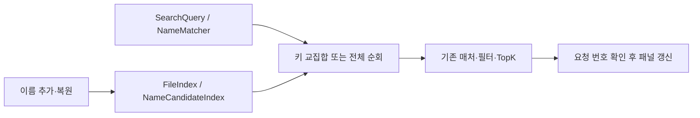

# 파일 검색 후보 인덱스 구현·성능 검증

2026-11-03, Apple M4 Pro / 24GiB, Swift 6.4.2, macOS arm64. 비교 기준은 변경 전 커밋 `a000ac5`의 별도 릴리스 빌드다. 설치 앱 교체·배포·제외 규칙 변경은 수행하지 않았다.

## 목표 판정

- 100만 항목 일반 검색 엔진 p95 최대 **4.08ms**: 20ms 목표 충족. 정규식은 별도 표에 기록했다.
- 앱 입력 콜백부터 패널 갱신 완료까지 p95 최대 **29.53ms**: 50ms 목표 충족. 실제 화면 프레임은 미측정이다.
- 실제 60만 항목 `한승우`: 중앙값 **14.026 → 0.008ms**, CPU **109.082 → 0.009ms**.
- 실제 60만 항목 `ㅎㅅㅇ`: 중앙값 **12.698 → 0.088ms**, CPU **108.698 → 0.091ms**. 두 검색 모두 중앙값·CPU 50% 절감 목표를 충족한다.
- 최종 반복 측정의 모든 영문·필터·정규식 중앙값 증가는 `max(기존의 20%, 0.5ms)` 이하였다.

측정 변동도 있었다. 같은 최종 코드의 직전 실행에서 ascii1m `main` 중앙값은 3.408ms로 원본 2.632ms 대비 허용치를 넘었으나, 소스 변경 없이 빌드 작업이 끝난 뒤 재측정한 값은 1.109ms였다. 앞선 조정 단계에서는 1.173ms였다. 위 표는 최종 반복 실행 결과이며, 한 실행의 성능을 모든 시스템 부하에서 보장하는 값으로 해석하지 않는다. 초기 4작업 제한의 재현되는 퇴행은 작업 분할 조정으로 해결했다.

## 구현과 검증 경계

1. `FileIndex`가 NFC 이름에서 일반 문자·초성·초성+중성 키를 만들어 `NameCandidateIndex`에 ID를 추가한다. graft도 같은 키를 반영한다.
2. `NameCandidateIndex`가 작은 posting부터 교집합을 구한다. 배열 또는 비트맵을 사용하며, 버린 키는 재구축 전까지 필터에 사용하지 않는다.
3. `FileSearcher`가 기존 매처·필터·TopK로 후보를 검증한다. 이름 항이 없거나 키를 모두 사용할 수 없으면 전체 순회한다. 점수·순서·하이라이트·전체 개수의 의미는 유지한다.
4. `FileIndex` 압축과 스냅샷 복원 때 파생 인덱스를 재구축한다. 이진 형식·설정 해시는 변경하지 않았다. 후보 저장소는 Swift 컬렉션 COW를 따른다.
5. `FindFileController`가 요청 번호와 취소 상태를 확인한 뒤 결과를 표시한다. 전체 선택을 위한 비동기 개수 조회에도 요청 번호를 적용한다.



| 주요 타입 | 변경 책임 |
|---|---|
| `FileIndex` | 후보 수명·COW·메모리 추정·추가/복원/압축 연결 |
| `NameCandidateIndex` | posting 표현·64MiB 예산·해제 키 관리·후보 교집합 |
| `NameMatcher` | 비ASCII 조건에서 순수 ASCII 이름 제외 |
| `FileSearcher` | 후보 기반 분할·기존 검증·취소 가능한 병합/정렬 |
| `FindFileController` | 오래된 요청 차단·스냅샷 대기 후 취소 확인·앱 진단 |

초기 `후보 수 / 25,000`, 최대 4 작업은 실제 큰 영문·퍼지 후보에서 지연을 늘렸다. 최종 정책은 이름 후보 5,000개당 작업 하나, 10만 후보 미만 최대 4개·이상 최대 8개다. 이름 후보 없는 일반 필터는 25,000개당 최대 4개, 정규식은 5,000개당 활성 CPU 수까지 사용한다. 모두 활성 CPU 수 이하이며 작업 하나면 TaskGroup을 만들지 않는다. 정규식에서 문자열 조건을 추출하지 않는다.

후보·순회·병합·결과 생성은 최대 1,024개 처리마다, 정렬은 최대 1,024회 비교마다 취소를 확인한다. 단일 정규식 호출 도중의 중단은 보장하지 않는다.

## 재현 명령

```bash
./scripts/test.sh
./scripts/test.sh -c release
MCAPTURE_BENCHMARK=1 MCAPTURE_BENCHMARK_HOME=1 ./scripts/test.sh -c release --skip-build --filter SearchBenchmarkTests

# 실제 컨트롤러·패널을 쓰는 격리된 릴리스 검증 실행 파일
swift build -c release -Xswiftc -DSEARCH_BENCHMARK_APP
"$(swift build -c release --show-bin-path)/mCapture"

# 검증 옵션 없이 일반 로컬 릴리스 앱으로 다시 빌드
./scripts/build-app.sh release
```

변경 전 측정은 `git archive a000ac5`를 임시 디렉터리에 풀고 현재의 `SearchBenchmarkTests.swift`만 복사한 뒤 다음 명령으로 실행한다. 저장된 앱 인덱스나 사용자 설정은 읽거나 변경하지 않는다.

```bash
MCAPTURE_BENCHMARK=1 MCAPTURE_BENCHMARK_HOME=1 ./scripts/test.sh -c release -Xswiftc -DSEARCH_BASELINE --filter SearchBenchmarkTests
```

고정 시드 42의 100만 항목에 영문 빌드 파일을 대부분 넣었다. `ascii1m`은 1,000개당 하나, `mixed1m`은 10개당 하나가 한글 PDF이고, 나머지 중 17개당 하나가 mainView 파일이다. 각 쿼리 준비 5회 후 30회를 측정했다. 중앙값은 정렬한 30개 중 상위 중앙값(16번째), p95는 29번째 값이며 CPU는 프로세스 user+system 시간의 회당 평균이다. 타이밍은 단위 테스트 실패 조건으로 사용하지 않는다.

홈 폴더는 기본 규칙과 메모리 내에서 `target`, `build`, Chrome 프로필 제외만 제거한 테스트 규칙으로 각각 읽기 전용 재스캔했다. 홈은 실행 사이 실제 파일이 변할 수 있어 항목 수가 소폭 다르다. 스캔 시간은 OS 캐시 영향이 있으므로 인덱스 구축 속도 개선으로 해석하지 않는다.

## 검색 측정

단위는 ms다. 각 셀의 `전 → 후`는 원본과 최종 구현이다. 후보 수에는 삭제·루트 필터 이전의 ID가 포함된다.

| 데이터 | 검색 | 중앙값 전 → 후 | p95 전 → 후 | CPU 전 → 후 | 후보 수 |
|---|---|---:|---:|---:|---:|
| ascii1m | `한승우` | 11.643 → 0.191 | 13.273 → 0.197 | 100.491 → 0.199 | 1,000 |
| ascii1m | `ㅎㅅㅇ` | 11.143 → 0.184 | 13.125 → 0.194 | 101.322 → 0.194 | 1,000 |
| ascii1m | `한` | 12.065 → 0.158 | 13.594 → 0.163 | 100.275 → 0.166 | 1,000 |
| ascii1m | `main` | 2.632 → 1.109 | 2.873 → 1.373 | 19.547 → 3.395 | 58,765 |
| ascii1m | `mvs` | 3.251 → 2.666 | 3.510 → 2.900 | 25.885 → 9.533 | 58,765 |
| ascii1m | `한 ext:pdf` | 0.500 → 0.166 | 0.564 → 0.174 | 2.717 → 0.175 | 1,000 |
| ascii1m | `ext:pdf` | 0.471 → 0.727 | 0.523 → 0.779 | 2.557 → 2.429 | 1,000,001 |
| ascii1m | `/src/ main` | 4.449 → 3.332 | 4.759 → 4.080 | 21.570 → 6.303 | 58,765 |
| ascii1m | `regex:^main` | 53.205 → 50.842 | 57.590 → 57.264 | 553.101 → 536.043 | 1,000,001 |
| mixed1m | `한승우` | 12.905 → 1.082 | 15.783 → 1.213 | 95.882 → 4.811 | 100,000 |
| mixed1m | `ㅎㅅㅇ` | 10.986 → 1.077 | 12.700 → 1.279 | 97.629 → 4.882 | 100,000 |
| mixed1m | `한` | 11.953 → 0.998 | 17.289 → 1.197 | 97.001 → 4.485 | 100,000 |
| mixed1m | `main` | 2.394 → 1.012 | 2.635 → 1.560 | 18.756 → 3.071 | 52,941 |
| mixed1m | `mvs` | 3.067 → 2.411 | 3.293 → 2.624 | 24.777 → 8.511 | 52,941 |
| mixed1m | `한 ext:pdf` | 1.102 → 1.045 | 1.140 → 1.279 | 7.075 → 4.747 | 100,000 |
| mixed1m | `ext:pdf` | 0.616 → 1.017 | 0.995 → 1.086 | 3.214 → 3.325 | 1,000,001 |
| mixed1m | `/src/ main` | 4.442 → 3.198 | 4.654 → 3.718 | 21.090 → 5.686 | 52,941 |
| mixed1m | `regex:^main` | 51.617 → 51.094 | 59.261 → 56.923 | 534.412 → 547.352 | 1,000,001 |
| homeDefault | `한승우` | 0.616 → 0.009 | 0.788 → 0.009 | 4.584 → 0.009 | 8 |
| homeDefault | `ㅎㅅㅇ` | 0.659 → 0.088 | 0.826 → 0.092 | 4.607 → 0.092 | 118 |
| homeDefault | `한` | 0.613 → 0.050 | 0.674 → 0.052 | 4.470 → 0.052 | 39 |
| homeDefault | `main` | 0.737 → 1.097 | 0.798 → 1.208 | 2.907 → 1.658 | 11,529 |
| homeDefault | `mvs` | 0.579 → 0.832 | 0.612 → 0.917 | 1.948 → 0.850 | 7,551 |
| homeDefault | `한 ext:pdf` | 0.124 → 0.019 | 0.226 → 0.041 | 0.536 → 0.022 | 39 |
| homeDefault | `ext:pdf` | 0.181 → 0.326 | 0.198 → 0.410 | 0.543 → 0.538 | 70,365 |
| homeDefault | `/src/ main` | 0.698 → 0.856 | 0.735 → 0.955 | 1.510 → 1.046 | 11,529 |
| homeDefault | `regex:^main` | 3.295 → 3.267 | 3.624 → 3.526 | 24.326 → 24.133 | 70,365 |
| homeExpanded | `한승우` | 14.026 → 0.008 | 17.046 → 0.009 | 109.082 → 0.009 | 8 |
| homeExpanded | `ㅎㅅㅇ` | 12.698 → 0.088 | 14.752 → 0.092 | 108.698 → 0.091 | 118 |
| homeExpanded | `한` | 12.864 → 0.049 | 13.887 → 0.050 | 108.435 → 0.051 | 39 |
| homeExpanded | `main` | 5.071 → 4.268 | 6.146 → 4.436 | 39.149 → 26.415 | 167,353 |
| homeExpanded | `mvs` | 5.706 → 5.265 | 5.893 → 5.640 | 44.403 → 31.327 | 142,265 |
| homeExpanded | `한 ext:pdf` | 0.351 → 0.019 | 0.374 → 0.020 | 2.166 → 0.020 | 39 |
| homeExpanded | `ext:pdf` | 0.403 → 0.857 | 0.505 → 0.934 | 2.277 → 2.115 | 601,502 |
| homeExpanded | `/src/ main` | 1.908 → 2.160 | 1.971 → 2.365 | 2.968 → 2.611 | 167,353 |
| homeExpanded | `regex:^main` | 26.351 → 25.605 | 31.756 → 28.540 | 237.773 → 233.351 | 601,502 |

## 구축·로드·메모리

| 데이터 | 구축/스캔 ms 전 → 후 | 스냅샷 로드 ms 전 → 후 | 후보 추정 MiB | 전체 인덱스 추정 MiB 후 |
|---|---:|---:|---:|---:|
| ascii1m (1,000,001개) | 191.2 → 1553.4 | 47.5 → 1388.2 | 5.49 | 59.93 |
| mixed1m (1,000,001개) | 226.8 → 1580.0 | 45.6 → 1341.0 | 7.32 | 61.75 |
| homeDefault (70,365개) | 1760.7 → 1779.4 | 2.2 → 68.3 | 0.68 | 3.78 |
| homeExpanded (601,502개) | 9699.8 → 7882.8 | 37.4 → 1168.9 | 5.14 | 49.34 |

배열 capacity, Dictionary capacity, 해제 키 Set capacity를 포함해 예산을 계산한다. 메타데이터는 보수적 추정이다. 메타데이터만으로 예산을 지킬 수 없으면 후보 필터 전체를 해제해 정확성을 유지한다.

첫 데이터 구축 시 실제 RSS 증가는 원본 47.19MiB, 수정본 53.64MiB로 차이는 6.45MiB였다. 이후 데이터의 RSS는 앞선 실행의 allocator 재사용에 영향을 받아 인덱스 단독 메모리로 해석하지 않는다. 64MiB는 후보 인덱스 한 벌의 추정 예산이며 전체 FileIndex·동시 스냅샷·작업 버퍼 예산이 아니다.

| 검색 스냅샷을 유지한 채 100개 추가 | 시간 ms 전 → 후 | 실제 RSS 추가 MiB 전 → 후 |
|---|---:|---:|
| ascii1m | 3.243 → 4.966 | 46.12 → 49.12 |
| mixed1m | 2.995 → 8.501 | 44.88 → 29.84 |
| homeDefault | 0.219 → 0.319 | 2.39 → 0.86 |
| homeExpanded | 3.164 → 3.669 | 40.25 → 36.33 |

COW 시 원본 이름·부모·연결 배열과 변경한 posting을 복사하므로 동시 스냅샷 메모리는 단일 인덱스 예산보다 크다. 후보 ID 작업 버퍼는 최대 약 4MiB/100만 ID이고, 경로 조건은 기존 Bool 배열들을 추가로 사용한다. 큰 limit의 TopK·병합·정렬·결과 문자열도 별도 임시 메모리다.

검색 가속의 대가는 구축·복원 비용이다. 후보는 저장 형식을 바꾸지 않고 이름에서 재생성하므로 100만 항목 로드가 약 1.5초로 늘었다. 콜드 스타트는 검색 지연 목표에서 제외했으며 이 비용을 숨기지 않는다.

## 앱·취소 검증

`SEARCH_BENCHMARK_APP`에서만 컴파일되는 검증 경로는 AppDelegate·스캔·이벤트 감시를 시작하지 않는다. 임의 이름의 설정 suite와 메모리 인덱스, 실제 FindFileController/FindFilePanel을 사용하며 패널은 화면에 띄우지 않는다. 입력 콜백 직전부터 `panel.show`·상태 갱신 완료 시점까지 측정한다. Task 대기에서 테스트 코드가 재개되는 시점은 제외한다. 실제 물리 키 입력→프레임 표시 지연은 측정하지 않았다.

| 검색 | 앱 중앙값 ms | 앱 p95 ms |
|---|---:|---:|
| `한승우` | 3.371 | 24.230 |
| `ㅎㅅㅇ` | 3.065 | 23.978 |
| `한` | 3.324 | 29.529 |
| `main` | 3.292 | 4.706 |
| `mvs` | 4.286 | 24.500 |
| `한 ext:pdf` | 3.674 | 7.412 |
| `/src/ main` | 5.438 | 25.675 |

30회 `main → mvs → 한승우` 연속 요청에서 마지막 요청의 결과만 남는지 확인했다. 실행 중인 검색을 빈 검색으로 대체해 결과가 비워지는 것도 확인했다. 정규식 단일 실행 중단과 실제 표시 프레임 지연은 검증 범위 밖이다.

일반 빌드에서 `MCAPTURE_SEARCH_DIAGNOSTICS=1`로 실행하면 OS 로그의 subsystem `mCapture`, category `search-performance`에 스냅샷 대기·후보 생성·매칭/결과 생성·UI 갱신·후보 수·작업 수·취소 이벤트를 기록한다. 검색어·개인 경로는 기록하지 않는다. 취소 로그의 `cancelled=1` 이벤트 합으로 취소 건수를 셀 수 있다. 환경 변수가 없으면 로그 메시지도 계산하지 않는다.

## 회귀 검증·산출물

- `./scripts/test.sh`: 전체 테스트 통과.
- `./scripts/test.sh -c release`: 327개 테스트 통과.
- 후보/전체 순회 비교: 결과 ID·순서·점수·경로·하이라이트·전체 개수를 SearchHit 배열과 totalMatches로 비교했다.
- NFC/NFD·초성·호환 자모·조합 중 입력·ASCII 대소문자·혼합/이모지·반복/역순/퍼지·AND·필터·200개 초과 limit를 포함했다.
- 추가·삭제 후 재추가(이름 변경)·graft·압축·스냅샷 복원·값 복사·0/256/4096바이트 예산 및 일부 키만 해제되는 24,000바이트 예산을 검증했다. 고정 시드의 10,000개 임의 이름과 100개 부분수열 질의도 비교했다.
- 로컬 일반 릴리스 번들: `build/mCapture-dev.app`. 검증 전용 컴파일 옵션은 이 번들에 포함되지 않는다.
