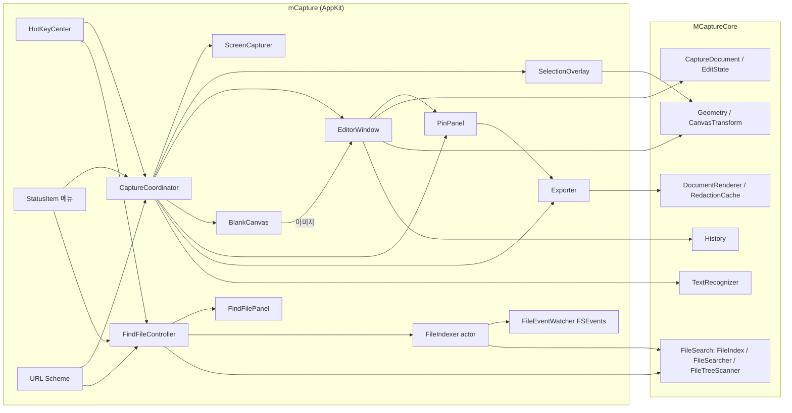
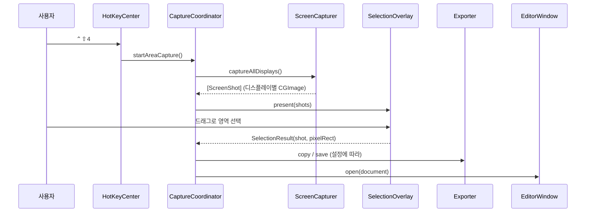

# mCapture 개발 스펙
개인용 macOS 스크린샷 캡처·주석 앱의 개발 명세.

> ℹ️ 대상 독자: 개발자(본인) | 최종 수정: 2026-10-19 | 상태: 1단계(MVP), 2단계 일상 편의, 3단계 측정·유틸, 4단계 파일 찾기 구현 완료, 실제 조작 수동 확인 대기

## 1. 목표와 범위

### 목표

- 일상 작업(영역 캡처 → 자동 복사·저장 → 간단한 주석)을 단축키 한 번으로 끝낸다
- 픽셀 정확도: 캡처·크롭 결과가 화면의 실제 픽셀과 1px도 어긋나지 않는다
- 반응 속도: 단축키를 누르고 영역 선택 화면이 뜰 때까지 체감 지연이 없다

### 비목표 (만들지 않는 것)

| 항목 | 이유 |
|---|---|
| 라이선스·결제·텔레메트리·자동 업데이트 | 혼자 쓰는 앱 |
| 클라우드·S3 업로드 | 로컬 저장·복사로 충분 |
| 앱스토어 배포, 샌드박스, 공증 | 공증 없는 DMG 직접 배포로 충분 (`scripts/make-dmg.sh`) |
| 다국어 | UI는 한국어 고정 |

## 2. 개발·실행 환경

| 항목 | 값 |
|---|---|
| OS | macOS 27.0.1 (Apple Silicon) |
| 디스플레이 | 내장 3456×2234 Retina + 외장 6720×3780(2배율) 2대 |
| 툴체인 | Swift 6.4 (Command Line Tools, **Xcode 없음**) |
| 빌드 | Swift Package Manager + `.app` 조립 스크립트 |
| 테스트 | Swift Testing (`./scripts/test.sh`) |
| 배포 대상 | macOS 15 이상 |

### Command Line Tools 환경의 제약

| 제약 | 증상 | 대응 |
|---|---|---|
| SwiftUI `@State`·`@Entry`·`@Animatable`은 매크로이고, 플러그인(`SwiftUIMacros`)이 Xcode에만 있음 | `plugin for module 'SwiftUIMacros' not found` | `ObservableObject` + `@Published`, `@ObservedObject` 사용. `@AppStorage`·`@StateObject`는 property wrapper라 사용 가능 |
| 증분 빌드 때 SwiftPM이 Testing 매크로 플러그인 경로를 빠뜨림 | `swift test`가 실행할 때마다 성공·실패를 번갈아 함 | `scripts/test.sh`가 활성 툴체인의 플러그인 경로를 `-plugin-path`로 넘김 |
| 터미널(개발 셸)에 화면 기록 권한 없음 | `screencapture`로 앱 창을 찍을 수 없음 | DEBUG 빌드 전용 `mcapture-dev://debug/snapshot`으로 앱이 자기 창 레이어를 PNG로 렌더링 |
| `actool`(에셋 카탈로그·Icon Composer 컴파일러)이 Xcode에만 있음 | macOS 26 `.icon` 형식 아이콘을 만들 수 없음 | `scripts/make-icon.swift`로 그린 PNG를 `iconutil`로 묶어 `.icns` 사용 |
| zsh에는 `log`라는 셸 내장 명령이 있음 | `log show`·`log stream`이 아무것도 출력하지 않거나 `too many arguments` | `/usr/bin/log`로 실행 |

## 3. 기술 스택

| 영역 | 선택 | 비고 |
|---|---|---|
| 언어 | Swift 6 (언어 모드 6, strict concurrency) | UI 코드는 `@MainActor` |
| 앱 구조 | AppKit (`NSApplication` + `AppDelegate`), 메뉴바 상주(`LSUIElement`) | SwiftUI App 생명주기는 쓰지 않음 |
| 화면 캡처 | ScreenCaptureKit `SCScreenshotManager` | `CGWindowListCreateImage`는 macOS 15부터 사용 불가 |
| 선택 오버레이·캔버스 | AppKit `NSView` + Core Animation 레이어 | 이미지는 레이어로 표시, 벡터는 `draw(_:)` |
| 렌더링 | Core Graphics + Core Text | 화면 표시와 내보내기가 같은 렌더러 사용. 블러만 Core Image |
| 텍스트·QR 인식 | Vision `RecognizeTextRequest`, `DetectBarcodesRequest` | macOS 15 Swift API (async) |
| 창 캡처 | `CGWindowListCopyWindowInfo`(창 목록·순서) + `SCContentFilter(desktopIndependentWindow:)` | 창 제목은 읽지 않음 |
| 설정·툴바 UI | SwiftUI (`NSHostingView`) | |
| 전역 단축키 | Carbon `RegisterEventHotKey` 직접 래핑 | 외부 의존성 없음, 권한 불필요 |
| 로그인 시 실행 | `SMAppService.mainApp` | |
| 잠자기 방지 | IOKit `IOPMAssertionCreateWithName` (`PreventUserIdleSystemSleep`) | `caffeinate -i`와 같은 assertion. 프로세스가 끝나면 시스템이 해제 |
| 파일 찾기 인덱스 | 자체 메모리 인덱스(배열을 나란히 둔 SoA) + FSEvents 증분 갱신 + 이진 스냅샷 | Spotlight(`NSMetadataQuery`)는 숨김·제외 폴더를 못 찾고 입력마다 즉시 응답하지 않음 |
| 파일 목록 읽기 | `FileManager.enumerator(.skipsPackageDescendants)`, `contentsOfDirectory` | 실측 5만 6천 개 1.0초라 `fts`·`getattrlistbulk`는 쓰지 않음 |
| 설정 저장 | `UserDefaults` | 도메인 = 번들 ID (`com.motolies.mcapture`, 개발 빌드는 `com.motolies.mcapture.dev`) |
| 외부 패키지 | 없음 | Xcode 없이 빌드 안정성 확보 |

## 4. 아키텍처

### 모듈 구성

`MCaptureCore`는 AppKit에 의존하지 않는 순수 로직이라 단위 테스트가 가능하다. `mCapture`는 AppKit 앱이다.



### 영역 캡처 흐름



### 디렉터리 구조

```
cap/
├── Package.swift
├── Sources/
│   ├── MCaptureCore/        # 순수 로직 (테스트 대상)
│   │   ├── Model/           # Annotation, EditState, CaptureDocument
│   │   ├── Geometry/        # 사각형 계산, CanvasTransform
│   │   ├── Rendering/       # AnnotationRenderer, DocumentRenderer, RedactionCache, ImageEncoder, ImageSampler
│   │   ├── Recognition/     # TextRecognizer (Vision 텍스트·바코드)
│   │   ├── FileSearch/      # 파일 찾기: HangulText, SearchQuery, NameMatcher, FileIndex, ExclusionRules, FileIndexSnapshot, FileSearcher, FileTreeScanner(DirectoryReconciler 포함)
│   │   └── Support/         # History, FileNaming, HotKeySpec, AppVariant(사용 중인 앱 / 개발 빌드 구분)
│   └── mCapture/            # AppKit 앱
│       ├── App/             # main, AppDelegate, MainMenu, StatusItem, HotKeyCenter, Preferences, SleepPreventer, DebugSnapshot(DEBUG)
│       ├── Capture/         # ScreenCapturer, CaptureCoordinator, WindowList, ScreenRecordingPermission
│       ├── Overlay/         # SelectionOverlayController, OverlayPanel, SelectionView(확대경 포함)
│       ├── Editor/          # EditorWindowController, CanvasView, EditorToolbar, EditorState, BlankCanvasWindowController(빈 캔버스)
│       ├── Pin/             # PinPanel (화면에 고정)
│       ├── Export/          # Exporter, ToastPanel
│       ├── Settings/        # SettingsView, SettingsModel, SettingsWindowController
│       ├── FindFile/        # FindFileController, FindFilePanel, SearchFieldEditor, ResultRowViews, FileIndexer(actor), FileEventWatcher, FileAccessPermission, FindFileSettingsSection
│       └── Common/          # ImageLayerView, DrawingView, SizeLabel, Loupe(확대경), ImageLoader, DragOutSource (오버레이·에디터 공용)
├── Tests/MCaptureCoreTests/
├── Resources/               # Info.plist, AppIcon.icns
├── scripts/
│   ├── build-app.sh             # swift build → build/mCapture-dev.app(기본) 또는 mCapture.app 조립 → 서명
│   ├── make-dmg.sh              # 배포용 DMG (production 변형 release 빌드)
│   ├── test.sh                  # 단위 테스트 (플러그인 경로 보정)
│   ├── make-icon.swift          # 앱 아이콘 생성 (swift scripts/make-icon.swift)
│   ├── create-signing-identity.sh   # 자체 서명 인증서 생성 (최초 1회)
│   ├── export-signing-identity.swift # 서명 인증서를 p12로 백업
│   └── import-signing-identity.sh   # 백업한 p12를 다른 컴퓨터에 복원
└── claudedocs/              # 스펙·분석 문서
```

## 5. 핵심 설계 규칙

### 좌표계

| 공간 | 원점·단위 | 사용처 |
|---|---|---|
| **이미지 픽셀** | 왼쪽 위, y 아래 방향, 픽셀 | 문서 모델의 모든 값(크롭, 주석, 선택 영역) |
| 뷰 | 왼쪽 위(`isFlipped = true`), 포인트 | 캔버스·오버레이 이벤트 처리 |
| 화면 | 왼쪽 아래(AppKit 전역), 포인트 | 창 배치에만 사용 |

- 모델에는 **이미지 픽셀 좌표만** 저장한다. 뷰 좌표 변환은 `CanvasTransform` 한 곳에서만 한다
- 화면에 보여주는 크기(W×H)와 키보드 이동량은 **논리 픽셀(pt)** 기준이다. 논리 1px = 이미지 `scale`px
- 선택 영역은 항상 이미지 픽셀 경계에 맞춘다

### 문서 모델과 실행 취소

```swift
// 원본 이미지는 불변, 편집 상태만 값 타입으로 관리
struct CaptureDocument {
    let image: CGImage        // 디스플레이 전체 캡처 (원본)
    let scale: CGFloat        // Retina 배율
    var state: EditState
}

struct EditState: Equatable {
    var crop: CGRect?             // nil이면 이미지 전체
    var annotations: [Annotation] // 배열 순서 = 레이어 순서
}
```

- 영역 캡처는 **디스플레이 전체 이미지 + crop**으로 만든다. 크롭 초기화로 언제든 영역을 넓힐 수 있다
- 실행 취소는 변경 직전의 `EditState`를 스택에 쌓는 스냅샷 방식이다
- 픽셀화·블러도 원본을 바꾸지 않는 주석(`redact(rect, .pixelate / .blur)`)이다. 그릴 때 `RedactionCache`가 원본에서 결과를 만든다. 따로 래스터화하는 단계가 필요 없다
- **레이어 그룹**: 붙여넣은 이미지(`image`), 가리기(`redact`), 형광펜(`highlighter`)은 원본을 대신하거나 원본에 붙는 베이스 레이어(`Annotation.isBaseLayer`)다. `EditState.add`·`bringToFront`가 베이스 레이어를 항상 다른 주석 아래에 두므로 렌더러와 `HitTester`는 배열 순서만 따른다
- 그리기 도구(R/A/T)에서는 베이스 레이어를 클릭 판정에서 빼 그 위에 바로 그릴 수 있게 한다. 선택 도구(V)에서만 고르고 옮긴다

### 렌더링

- `AnnotationRenderer`는 y 아래 방향 컨텍스트를 가정한다. 캔버스와 내보내기가 같은 함수를 호출한다
- 캔버스의 원본 이미지는 Core Animation 레이어로 표시한다(GPU 스케일링, 확대 시 nearest 필터). 주석·선택 영역만 `draw(_:)`로 그린다
- 내보내기는 `crop` 영역 크기의 비트맵에 원본 + 주석을 그린 뒤 PNG로 인코딩한다(Retina면 144 DPI 메타데이터). 복사·저장·토스트는 `Exporter.export` 한 곳에서 처리한다
- 픽셀화·블러는 원본 픽셀이 필요해 `AnnotationRenderer.draw`에 `RedactionCache`를 넘긴다. 캔버스는 문서마다 하나를 계속 쓰고(결과 캐시), 내보내기는 렌더링마다 새로 만든다. 가리기는 **원본만** 읽으므로 아래에 붙여넣은 이미지는 흐려지지 않는다
- 캔버스의 주석은 원본 이미지 레이어 위 별도 투명 레이어에 그려 블렌드 모드가 원본과 섞이지 않는다. 그래서 형광펜은 multiply 대신 알파(0.4)로 겹친다
- 텍스트 편집 중에는 `NSTextView`가 글자를, 캔버스가 배경 상자를 그린다. 편집 뷰 글꼴은 렌더러의 `CTFont`를 그대로 쓴다(`NSFont`와 toll-free 브리지)

### 같은 캡처는 같은 파일

- 캡처 직후 자동 저장한 파일 경로를 문서가 기억한다
- 에디터에서 `⌘S`나 Esc(저장 동작)를 하면 **그 파일을 덮어쓴다**. 새 파일은 `⇧⌘S`(다른 이름으로 저장)로만 만든다

### 동시성

- UI·캡처 조정 코드는 모두 `@MainActor`
- `CGImage`는 불변 객체라 스레드 간 전달용 래퍼(`SendableImage`, `@unchecked Sendable`)를 둔다. ScreenCaptureKit 병렬 캡처와 백그라운드 PNG 인코딩에만 쓴다
- 오버레이 선택 결과는 continuation으로 Sendable 값(화면 순번, `CGRect`)만 넘기고, `NSScreen`이 들어 있는 결과 객체는 메인 액터에서 다시 만든다
- Carbon 단축키 콜백은 메인 스레드에서 호출되므로 `MainActor.assumeIsolated`로 진입한다
- 파일 찾기 인덱스는 `FileIndexer` 액터가 값(`FileIndex`)으로 가진다. 검색은 `snapshot()`이 돌려준 값을 액터 밖에서 `FileSearcher.search`(`@concurrent`, CPU 수만큼 청크 병렬)로 훑는다. 값 타입이라 쓰기 전까지 배열을 공유하고, 락이나 `@unchecked Sendable` 인덱스가 없다
- 파일 I/O(전체 스캔, 디렉터리 읽기, 스냅샷 읽기·쓰기)는 액터 밖 GCD 전역 큐(스캔 `.background`, 나머지 `.utility`)에서 하고 결과만 액터로 가져온다. 협력 스레드 풀을 동기 I/O로 막지 않고, I/O를 기다리는 동안에도 검색이 응답한다
- 설정 변경·다시 만들기·끄기마다 generation을 올려, I/O를 기다리던 이전 작업의 결과는 버린다. 인덱스 압축(번호가 바뀜)은 이벤트 처리 순서 안에서만 한다
- `@unchecked Sendable`은 FSEvents 콜백 박스(`FileEventWatcher`)와 `NSRegularExpression` 래퍼(`RegexTerm`) 두 곳만 쓴다

### 포커스

- 오버레이는 `nonactivatingPanel`이라 앱을 활성화하지 않아도 키 입력(Esc, Space)을 받는다
- 영역 캡처를 취소하거나 에디터 없이 끝나면(텍스트 인식, Tab 색상 복사 포함) 캡처 직전의 앞쪽 앱을 다시 활성화한다
- 핀은 `nonactivatingPanel`이라 클릭해도 쓰던 앱의 포커스를 빼앗지 않는다. 단축키는 핀이 키 창일 때만 처리해 에디터의 ⌘C 등을 가로채지 않는다
- 에디터 단축키(V/R/A/T)는 한글 입력 상태에서도 동작하도록 문자 대신 ANSI 키 코드로 판별한다
- 파일 찾기 창은 `NSApp.activate()` 뒤 키 창으로 만든다(한글 입력기가 확실히 붙는 경로). 열 때 앞에 있던 앱을 기억했다가 Esc·⌘C로 닫으면 그 앱으로 돌려주고, 결과를 열거나 Finder에서 보이면 그쪽 앱이 앞으로 온다. 다른 앱·창을 누르면(키 창에서 벗어나면) 닫는다
- 파일 찾기 창의 Enter·Esc·↑↓는 필드 에디터의 명령(`doCommandBy`)으로 받는다. 한글 조합을 끝내는 Enter는 입력기가 먼저 써서 여기로 오지 않으므로 파일을 열지 않는다. ⌘ 조합은 키 코드로 판별한다

## 6. 기능 명세

### 1단계: MVP

| ID | 기능 | 상세 | 완료 기준 |
|---|---|---|---|
| F1 | 메뉴바 앱 | 메뉴바 아이콘과 메뉴(영역 캡처, 전체 화면 캡처, 이미지 열기, 저장 폴더 열기, 설정, 종료). Dock 아이콘은 에디터가 열려 있을 때만 표시(앱 아이콘 `AppIcon.icns`). 종료는 메뉴로만 하고 ⌘Q는 앞 창 닫기로 동작 | 앱 실행 후 메뉴바에 아이콘이 보이고 모든 메뉴가 동작 |
| F2 | 전역 단축키 | 영역 ⌃⇧4, 전체 화면 ⌃⇧1 (설정에서 변경) | 다른 앱이 활성화된 상태에서도 동작 |
| F3 | 캡처 엔진 | ScreenCaptureKit으로 모든 디스플레이를 동시에 캡처. 커서 제외, 자기 앱 창 제외, 네이티브 해상도 | 6K 디스플레이에서 결과가 6720×3780 |
| F4 | 영역 선택 오버레이 | 멈춘 화면 위에 디스플레이마다 오버레이. 선택 밖 어둡게, 크기 표시(pt), 십자선, 확대경(픽셀 격자·좌표·색상), Shift 정사각형, Space 누른 채 선택 영역 이동, 클릭만 하면 해당 디스플레이 전체, Esc 취소 | 3개 디스플레이 어디서든 선택 가능, 결과가 선택 영역과 픽셀 단위로 일치 |
| F5 | 캡처 후 동작 | 설정에 따라 클립보드 복사(PNG) / 저장 폴더에 저장 / 에디터 열기. 완료 알림(토스트) 표시 | 기본값: 세 가지 모두 켜짐 |
| F6 | 에디터 보기 | 맞춤(⌘1), 100%(⌘0), 선택 영역 줌(⌘2), 확대·축소(⌘=/⌘-), 핀치, 마우스 휠 줌, 트랙패드 스크롤·Space 드래그·우클릭 드래그로 이동, 확대 시 픽셀 선명 | 커서 위치를 기준으로 확대·축소 |
| F7 | 선택·크롭 | 선택 도구(V)로 드래그. 모서리·변 핸들 8개로 크기 조절(⇧ 정사각형), 방향키 이동(1pt, ⇧ 10pt), ⌘방향키 크기 조절, Enter 크롭, 크롭 초기화. 주석 선택 없이 Delete면 선택 영역 안에 완전히 들어간 주석을 지움(가장자리에 닿은 변은 바깥으로 늘려 판정, 배경은 그대로) | 크롭 후 내보낸 이미지 크기가 선택 크기와 일치 |
| F8 | 주석 도구 | 사각형(R), 화살표(A), 텍스트(T). 색상 8종, 크기 슬라이더 1~20(선 두께 = 값 pt, 글자 8+4×값, 카운터 지름 14+4×값. 예전 S/M/L = 2/4/7). 텍스트는 글꼴 5종(시스템·둥근·세리프·고정폭·손글씨)과 배경 상자(주석 색 + 대비색 글자) | 그린 결과가 내보낸 이미지에 그대로 나옴 |
| F9 | 주석 편집 | 클릭 선택, 드래그 이동, 핸들로 크기·끝점 조절(텍스트는 모서리 핸들로 글자 크기, 이미지는 비율 유지), Delete 삭제, 방향키 이동, 선택한 주석에 색상·크기·글꼴·배경 변경, 텍스트 더블클릭 편집 | 모든 편집이 실행 취소 가능 |
| F10 | 실행 취소 | ⌘Z / ⇧⌘Z | 생성·이동·삭제·스타일·크롭 모두 되돌림 |
| F11 | 내보내기 | ⌘C 복사(선택 영역이 있으면 그 부분만), ⌘S 저장(같은 파일 덮어쓰기), ⇧⌘S 다른 이름으로 저장, Esc는 설정된 동작 후 창 닫기 | |
| F12 | 설정 창 | 저장 폴더, 캡처 후 동작, Esc 동작, 단축키(버튼을 누르고 키 조합 녹화, 녹화 중 전역 단축키 해제), 로그인 시 실행, 화면 기록 권한 상태, 버전(`Info.plist`의 버전과 빌드한 커밋, 메뉴바 아이콘 툴팁에도 표시) | 변경 즉시 반영 |
| F13 | 권한 안내 | 화면 기록 권한이 없으면 시스템 요청 후 안내 창과 "시스템 설정 열기" 제공 | 권한 없이 캡처하면 빈 화면 대신 안내가 뜸 |
| F14 | URL Scheme | `mcapture://grab/area`, `grab/fullscreen`, `settings`, `open?path=` | 터미널 `open` 명령으로 동작 |
| F15 | 이미지 열기 | 파일 → 열기…(⇧⌘O), 메뉴바 "이미지 열기…", 에디터 캔버스에 이미지 파일을 끌어다 놓으면 새 에디터, Finder "다음으로 열기"(PNG만, `CFBundleDocumentTypes` `Alternate`라 기본 앱은 그대로). 열린 파일은 원본 경로를 기억하지 않아 ⌘S는 저장 폴더에 새 파일 | DPI로 Retina 배율 추정 |
| F16 | 이미지 붙여넣기 | ⌘V로 클립보드 이미지(PNG·TIFF 데이터 또는 복사한 이미지 파일)를 보이는 영역 가운데에 원래 논리 크기로 겹침. 90%를 넘으면 축소 | 내보낸 이미지에 그대로 나옴 |

### 2단계: 일상 편의

| ID | 기능 | 상세 | 완료 기준 |
|---|---|---|---|
| F17 | 색상 복사 | 영역 선택 오버레이에서 Tab을 누르면 확대경 가운데 픽셀의 HEX(`#RRGGBB`)를 복사하고 오버레이를 닫음. 토스트 아이콘은 복사한 색 견본 | 토스트에 복사한 색이 보이고 이전 앱으로 포커스가 돌아감 |
| F18 | 가리기 | 가리기 도구(B)로 드래그해 픽셀화·블러 주석을 만듦. 툴바 옵션 칸에서 방식을 고르고, 강도는 크기 값(블록 max(6, 2+2×값)pt, 반경 max(4, 2×값)pt). 원본은 바꾸지 않음 | 내보낸 이미지에서 영역 밖 픽셀이 원본과 같음 |
| F19 | 추가 도구 | 타원(O), 선(L, ⇧ 45°), 형광펜(H, 반투명 상자), 카운터(N, 누른 자리에 가장 큰 번호 + 1). 창이 좁으면 색상 팔레트를 현재 색 버튼 + 팝오버로 접음 | 그린 결과가 내보낸 이미지에 그대로 나옴 |
| F20 | 텍스트·QR 인식 | 전역 단축키·메뉴·URL로 영역을 고르면 Vision으로 한국어+영어 텍스트를 인식해 클립보드에 복사. QR 등 바코드가 있으면 그 내용만 복사. 줄바꿈 제거 설정, 이중 공백 정리 | 한·영 섞인 화면에서 텍스트가 복사됨 |
| F21 | 창 캡처 | 전역 단축키·메뉴·URL로 오버레이를 띄우면 커서 아래 창을 강조하고, 클릭한 창을 가려지지 않은 상태로 투명 배경 PNG로 캡처. 그림자 포함 설정(네이티브 해상도 유지). 창 밖 클릭은 디스플레이 전체, 드래그는 영역 캡처 | 그림자를 끈 결과가 창 크기 × 배율과 일치 |
| F22 | 핀 | 에디터 툴바·⌘P로 결과를 항상 위 테두리 없는 패널에 띄우고 에디터는 닫음. 끌어서 이동, 스크롤·핀치로 커서 기준 크기 조절, 우클릭 메뉴(50/100/200%, 반투명, 복사, 저장, 편집, 닫기) | 편집으로 돌아가면 주석이 그대로 남음 |
| F23 | 끌어놓기 | 에디터 툴바 손잡이를 끌어 다른 앱에 PNG를 놓음 (파일 URL + PNG 데이터). 손잡이에 마우스를 올리면 미리 인코딩 | Finder·메신저·브라우저 입력창에 이미지가 들어감 |
| F24 | 빈 캔버스 | 실행 중에 앱을 다시 실행하면(reopen 이벤트: Finder·Spotlight·Dock 아이콘 클릭) 놓기 전용 창을 띄움. 클립보드 이미지(⌘V), 이미지 파일(여러 개면 각각), 브라우저 이미지 데이터(PNG·TIFF)를 받으면 그 이미지의 에디터를 열고 빈 캔버스는 닫음. 하나만 띄우고 다시 실행하면 앞으로 가져옴. 처음 실행에는 띄우지 않음 | 메뉴바만 있는 상태에서 다시 실행 → ⌘V로 에디터가 열림 |

### 3단계: 측정·유틸

| ID | 기능 | 상세 | 완료 기준 |
|---|---|---|---|
| F25 | 컬러 피커 | **메뉴바·전역 단축키(⌃⇧6)·URL**: 영역 선택 오버레이의 색 모드. 화면을 어둡게 하지 않고 확대경에 `x, y   #HEX` / `rgb(…)` 두 줄을 보이며, 클릭하면 HEX, ⇧클릭하면 `rgb(r, g, b)`를 복사하고 닫음. **에디터 도구(I)**: 같은 확대경(보이는 영역 기준 좌표)과 클릭 규칙. 원본 픽셀을 읽고 주석은 무시. 반투명은 `#RRGGBBAA`/`rgba(…)`, 완전 투명은 복사하지 않음. 토스트에 색 견본. 비활성 에디터 첫 클릭은 복사하지 않음 | 복사한 값이 원본 픽셀의 sRGB 값과 같음 |
| F26 | 픽셀 자 | 에디터 도구(M). 호버하면 커서 아래 픽셀부터 상하좌우로 시작 색과 채널별 6 이하로 같은 구간을 찾아 가로·세로 선과 `W × H`(pt) 라벨(자동 간격, 보이는 영역 끝에서 멈춤). 드래그하면 두 점 측정선과 `W × H · 길이`(⇧ 45° 단위). 측정은 화면에만 그리고 내보내지 않음. 클릭·Esc·도구 변경·크롭으로 지움. 마우스 이동은 측정 표시 영역만 다시 그림 | 두 요소 사이 간격 라벨이 실제 픽셀 간격 ÷ 배율과 같음 |
| F27 | 잠자기 방지 | 메뉴바 메뉴의 체크 토글. `PreventUserIdleSystemSleep` assertion(`caffeinate -i`와 같음, 화면은 꺼짐). 켜지면 메뉴바 아이콘을 초록(비템플릿 팔레트 심볼)으로, 툴팁에 "잠자기 방지 켜짐". 저장하지 않아 실행할 때마다 꺼진 상태 | `pmset -g assertions`에 `mCapture prevent idle sleep`이 생기고, 끄거나 앱이 끝나면 사라짐 |

### 4단계: 파일 찾기

| ID | 기능 | 상세 | 완료 기준 |
|---|---|---|---|
| F28 | 파일 찾기 | **Everything·Cling처럼 이름으로 즉시 찾기.** 메뉴바·전역 단축키(⌃⇧F)·URL로 커서 화면 위쪽에 검색 창을 띄움(다시 누르면 닫힘). 글자마다 검색(한글 조합 중 글자 포함), 결과 최대 200개(보이는 줄 9개), 상태 줄에 일치 수·시간·인덱스 상태. **문법**: 공백 AND, 따옴표, `ext:pdf;png`, `folder:`·`file:`, `/`가 들어간 항은 전체 경로에 포함(`~/` 확장), `regex:`, 초성(`ㅎㄱ` → 한글). **순위**: 정확(확장자 뺀 이름 포함) > 접두 > 단어 경계 > 부분 > 퍼지(fzf식), `.app` 보너스, 동점은 이름 길이·깊이·경로. **동작**: ↩ 열기, ⌘↩ Finder에서 보기, ⌘C 경로 복사(검색어 일부를 골랐으면 글자 복사). 결과를 열 때 파일이 없으면 알리고 그 폴더를 다시 맞춤. **인덱스**: 앱 시작 5초 뒤 자동, 루트 `~`·`/Applications`·`/System/Applications`, 기본 제외(이름 node_modules·.git·Cache 등, 경로 ~/Library/Caches 등, 패키지 내부), 숨김 끔, FSEvents로 증분 갱신, 종료·스캔 후 스냅샷 저장 → 다음 실행 때 기록 재생. 설정에서 끄면 스냅샷 삭제 | 110만 개 합성 인덱스에서 일반·퍼지·초성 검색 50ms 이하, 파일을 만들고·옮기고·지우면 약 2초 안에 결과에 반영, 꺼져 있던 동안의 변경도 다시 실행하면 반영 |

## 7. 단축키

### 전역 (기본값, 설정에서 변경 가능)

| 동작 | 키 |
|---|---|
| 영역 캡처 | ⌃⇧4 |
| 전체 화면 캡처 | ⌃⇧1 |
| 창 캡처 | ⌃⇧3 |
| 텍스트 인식 | ⌃⇧5 |
| 컬러 피커 | ⌃⇧6 |
| 파일 찾기 | ⌃⇧F |

> ℹ️ **참고**: macOS 기본 스크린샷 단축키(⌘⇧3~5)와 겹치지 않게 정했다. 설정에서 다른 조합으로 바꿀 수 있다.
> 개발 빌드의 기본값은 ⌃⌥⇧ + 같은 키다([개발 빌드 분리](#개발-빌드-분리)).
> Carbon 단축키는 다른 앱보다 먼저 키를 가져가므로 ⌃⇧F를 쓰는 앱(일부 IDE 키맵 등)에서는 그 앱의 ⌃⇧F가 동작하지 않는다. 겹치면 설정에서 바꾼다.
>
> 등록할 때 앞 동작과 같은 조합이면 뒤 동작은 등록하지 않고 토스트로 알린다(새 동작의 기본값이 바꿔 둔 단축키와 겹칠 때).

### 영역 선택 오버레이

| 동작 | 키 |
|---|---|
| 정사각형 | 드래그 중 ⇧ |
| 선택 영역 이동 | 드래그 중 Space |
| 디스플레이 전체 | 드래그 없이 클릭 |
| 창 캡처 (창 모드) | 강조된 창 클릭 (드래그는 영역 선택) |
| 확대경 가운데 픽셀 색 복사 | Tab |
| 색 고르기 (컬러 피커 모드) | 클릭 HEX, ⇧클릭 RGB |
| 취소 | Esc |

### 에디터

| 동작 | 키 |
|---|---|
| 도구: 선택 / 사각형 / 타원 / 선 / 화살표 / 형광펜 / 텍스트 / 카운터 / 가리기 | V / R / O / L / A / H / T / N / B |
| 측정 도구: 컬러 피커 / 픽셀 자 | I / M |
| 색 복사 (컬러 피커) | 클릭 HEX, ⇧클릭 RGB |
| 거리 측정 (픽셀 자) | 드래그 (⇧ 45° 단위), 호버하면 자동 간격 |
| 크롭 | 선택 후 Enter |
| 선택 영역·주석 이동 | 방향키 (⇧ 10pt) |
| 선택 영역 크기 조절 | 모서리·변 핸들 드래그 (⇧ 정사각형), ⌘ + 방향키 (⇧ 10pt) |
| 주석 삭제 | Delete |
| 선택 영역 안 주석 지우기 (배경은 그대로) | 주석 선택 없이 Delete |
| 이미지 붙여넣기 | ⌘V |
| 이미지 열기 | ⇧⌘O, 캔버스에 파일 끌어다 놓기 |
| 정사각형·원 / 화살표·선 45° 단위 고정 | 그리는 중 ⇧ |
| 텍스트 줄바꿈 / 확정 | ⇧Enter / Enter |
| 맞춤 / 100% / 선택 영역 줌 | ⌘1 / ⌘0 / ⌘2 |
| 확대 / 축소 | ⌘= / ⌘- |
| 이동 | Space + 드래그, 우클릭 드래그, 트랙패드 스크롤 |
| 복사 / 저장 / 다른 이름으로 저장 | ⌘C / ⌘S / ⇧⌘S |
| 실행 취소 / 다시 실행 | ⌘Z / ⇧⌘Z |
| 크롭 초기화 | ⇧⌘R |
| 화면에 고정 (핀) | ⌘P |
| 다른 앱으로 끌어놓기 | 툴바 손잡이(✋) 끌기 |
| 닫기 | ⌘W (동작 없이), Esc (설정된 동작 후) |

Esc는 단계적으로 동작한다: 텍스트 편집 종료 → 측정 지우기 → 측정 도구면 선택 도구로 → 주석 선택 해제 → 선택 영역 해제 → 설정된 동작 후 창 닫기.

### 파일 찾기 창

| 동작 | 키 |
|---|---|
| 결과 고르기 | ↑ / ↓ (⌃P / ⌃N), Page Up / Page Down (8줄) |
| 열기 (기본 앱, 폴더는 Finder, `.app`은 실행) | ↩, 더블클릭 |
| Finder에서 보기 | ⌘↩ |
| 경로 복사 (닫고 이전 앱으로) | ⌘C |
| 닫기 (이전 앱으로) | Esc, ⌘W, ⌘Q, 단축키 다시 누르기 |
| 검색어 편집 | ⌘A / ⌘V / ⌘Z (편집 메뉴) |

### 핀

| 동작 | 키 |
|---|---|
| 이동 | 끌기 |
| 크기 조절 (커서 기준) | 스크롤, 핀치 |
| 50% / 100% / 200%, 반투명, 편집 | 우클릭 메뉴 |
| 복사 / 저장 | ⌘C / ⌘S |
| 닫기 | Esc, ⌘W |

## 8. 설정 (UserDefaults)

도메인: `com.motolies.mcapture` (개발 빌드는 `com.motolies.mcapture.dev`. 저장 폴더·단축키 기본값도 다르다 — [개발 빌드 분리](#개발-빌드-분리))

| 키 | 타입 | 기본값 | 설명 |
|---|---|---|---|
| `saveFolder` | String | `~/Pictures/mCapture` | 저장 폴더 (없으면 생성) |
| `fileNameTemplate` | String | `mCapture_{date}_{time}` | 새 파일 이름 형식 (`{date}` `{time}` `{yyyy}` `{yy}` `{MM}` `{dd}` `{HH}` `{mm}` `{ss}` `{app}`) |
| `afterCaptureCopy` | Bool | `true` | 캡처 후 클립보드 복사 |
| `afterCaptureSave` | Bool | `true` | 캡처 후 파일 저장 |
| `afterCaptureOpenEditor` | Bool | `true` | 캡처 후 에디터 열기 |
| `escAction` | String | `copy` | `copy` / `save` / `copySave` / `none` |
| `hotkeyArea` | String | `ctrl+shift+4` | 영역 캡처 단축키 |
| `hotkeyFullscreen` | String | `ctrl+shift+1` | 전체 화면 캡처 단축키 |
| `hotkeyWindow` | String | `ctrl+shift+3` | 창 캡처 단축키 |
| `hotkeyOcr` | String | `ctrl+shift+5` | 텍스트 인식 단축키 |
| `hotkeyColor` | String | `ctrl+shift+6` | 컬러 피커 단축키 |
| `hotkeyFindFile` | String | `ctrl+shift+f` | 파일 찾기 단축키 |
| `findFileEnabled` | Bool | `true` | 파일 찾기 인덱스를 앱 시작 때 만들고 변경 감시. 끄면 메모리를 비우고 스냅샷 삭제 |
| `findFileRoots` | [String] | `~`, `/Applications`, `/System/Applications` | 검색 폴더 (`~` 형태로 저장, 겹치는 폴더는 바깥 것만 씀) |
| `findFileExclusions` | String | `ExclusionRules.defaultText` | 제외 규칙, 한 줄에 하나. `/`·`~`로 시작하면 경로, 아니면 어느 깊이든 맞는 이름. 폴더 자체는 검색되고 안은 색인하지 않음 |
| `findFileIncludeHidden` | Bool | `false` | 이름이 `.`으로 시작하는 항목도 색인 (UF_HIDDEN 플래그는 보지 않음) |
| `findFileFirstScanNotified` | Bool | `false` | 처음 인덱스를 만들 때 "폴더 접근 허용 창이 뜰 수 있습니다" 토스트를 띄웠는지 |
| `windowShadow` | Bool | `true` | 창 캡처에 그림자 포함 (배경은 투명) |
| `ocrJoinLines` | Bool | `false` | 텍스트 인식 결과의 줄바꿈을 공백으로 바꿈 |
| `annotationColor` | String | `#FF3B30` | 마지막으로 쓴 주석 색 |
| `annotationSize` | Int | `4` | 마지막으로 쓴 주석 크기 (1~20). 예전 문자열 `small`/`medium`/`large`는 2/4/7로 읽음 |
| `annotationTextFont` | String | `system` | 마지막으로 쓴 텍스트 글꼴 (`system` / `rounded` / `serif` / `mono` / `handwriting`) |
| `annotationTextBackground` | Bool | `false` | 마지막으로 쓴 텍스트 배경 상자 |
| `annotationRedactMode` | String | `pixelate` | 마지막으로 쓴 가리기 방식 (`pixelate` / `blur`) |

**파일명**: 설정의 형식(`fileNameTemplate`)으로 만든다. 기본은 `mCapture_2026-10-16_11-05-32.png`. `{app}`은 `CaptureDocument.sourceAppName`(창 캡처는 고른 창의 소유 앱, 그 밖에는 캡처 전 앞 앱)이다. 경로 구분자·제어문자는 `-`로 바꾸고 UTF-8 200바이트로 자른다. 같은 이름이 있으면 `_2`, `_3`을 붙인다.

**단축키 문자열 형식**: 수식키(`cmd`, `shift`, `ctrl`, `opt`)와 키(`a`~`z`, `0`~`9`)를 `+`로 연결한다. 설정 창에서는 버튼을 누르고 키 조합을 직접 누르면 이 형식으로 저장된다.

```bash
defaults write com.motolies.mcapture hotkeyArea "cmd+shift+4"
```

## 9. URL Scheme

| URL | 동작 |
|---|---|
| `mcapture://grab/area` | 영역 캡처 |
| `mcapture://grab/fullscreen` | 커서가 있는 디스플레이 전체 캡처 |
| `mcapture://grab/window` | 창 캡처 (창 모드 오버레이) |
| `mcapture://ocr` | 텍스트 인식 |
| `mcapture://color` | 컬러 피커 (색 모드 오버레이) |
| `mcapture://settings` | 설정 창 열기 |
| `mcapture://find?q=검색어` | 파일 찾기 창을 열고 검색어를 채움 (`q`는 생략 가능). 결과는 자동으로 열지 않음 |
| `mcapture://open?path=/abs/path.png` | 이미지 파일을 에디터로 열기 |
| `mcapture-dev://debug/samples` | (DEBUG 빌드 전용) 앞쪽 에디터에 샘플 주석(사각형·화살표·텍스트·배경 텍스트·이미지·가리기)과 선택 영역 추가 |
| `mcapture-dev://debug/paste` | (DEBUG 빌드 전용) 앞쪽 에디터(또는 빈 캔버스)에서 ⌘V와 같은 붙여넣기 실행 |
| `mcapture-dev://debug/pin` | (DEBUG 빌드 전용) 앞쪽 에디터를 화면에 고정 |
| `mcapture-dev://debug/inspect?tool=colorPicker\|ruler&x=&y=[&x2=&y2=]` | (DEBUG 빌드 전용) 앞쪽 에디터에서 측정 도구를 고르고 이미지 픽셀 (x, y)에 커서가 있는 것처럼 확대경·자동 간격을 보임. x2·y2가 있으면 두 점 측정선 |
| `mcapture-dev://debug/awake?on=1\|0` | (DEBUG 빌드 전용) 잠자기 방지 켜기·끄기 (값이 없으면 토글). `pmset -g assertions`로 확인 |
| `mcapture-dev://debug/window?id=창번호&shadow=1&path=/abs/out.png` | (DEBUG 빌드 전용) 창 하나를 캡처해 PNG로 저장 (그림자 결과 비교) |
| `mcapture-dev://debug/find-stats?path=/abs/out.json` | (DEBUG 빌드 전용) 파일 찾기 인덱스 상태·항목 수·추정 메모리·phys_footprint·마지막 이벤트 ID·스캔 시간·거부 폴더를 JSON으로 |
| `mcapture-dev://debug/find-query?q=검색어&path=/abs/out.json` | (DEBUG 빌드 전용) 창 없이 검색해 상위 50개(경로·점수·강조 위치)와 시간·전체 일치 수를 JSON으로 |
| `mcapture-dev://debug/find-rebuild` | (DEBUG 빌드 전용) 파일 찾기 인덱스를 처음부터 다시 스캔 |
| `mcapture-dev://debug/snapshot?path=/abs/out.png` | (DEBUG 빌드 전용) 파일 찾기 창이 키 창이면 그 창, 아니면 앞쪽 에디터(또는 빈 캔버스) 창을 PNG로 렌더링. 에디터가 없으면 키 창, 그것도 없으면 보이는 창(핀)을 찍지만 내용 뷰가 뒤집힌(`isFlipped`) 창(SwiftUI인 설정 창 등)은 위아래가 뒤집혀 나온다(`sips -f vertical`로 바로잡음) |

```bash
open "mcapture://grab/area"
```

> ℹ️ **참고**: 개발 빌드는 스킴이 `mcapture-dev`다(`mcapture-dev://grab/area` 등). DEBUG 전용 URL은 개발 빌드에서 쓰므로 `mcapture-dev://`로 적었다.

> ⚠️ **주의**: 다른 앱이나 웹 페이지도 URL Scheme으로 캡처를 시작할 수 있다. 브라우저는 실행 전 확인 창을 띄우지만, 필요해지면 딥링크 허용 설정을 추가한다. 같은 이유로 `find?q=`는 창만 열고 결과를 열지 않는다.

## 10. 빌드·서명·권한

### 빌드와 실행

```bash
./scripts/build-app.sh          # debug 빌드 → build/mCapture-dev.app (개발 빌드)
./scripts/build-app.sh release  # release 빌드 (개발 빌드)
open build/mCapture-dev.app
pkill -x mCaptureDev            # 개발 빌드만 종료 (사용 중인 mCapture는 그대로)
```

### 개발 빌드 분리

DMG로 설치한 mCapture를 상주시킨 채 개발 빌드를 함께 띄워 시험한다. 두 앱이 같은 번들 ID를 쓰면 설정·단축키·URL·저장 폴더가 섞이고, `pkill mCapture`로 개발 빌드를 끌 때 사용 중인 앱까지 꺼진다. Carbon 전역 단축키는 두 프로세스가 같은 조합을 등록해도 둘 다 성공해서 겹친다는 경고도 뜨지 않는다. 그래서 `build-app.sh`는 기본으로 **번들 ID가 다른 개발 빌드(dev 변형)**를 만들고, 배포용(production 변형)은 `make-dmg.sh`만 만든다.

| 항목 | 사용 중인 앱 (production) | 개발 빌드 (dev) |
|---|---|---|
| 만드는 명령 | `./scripts/make-dmg.sh` → DMG로 설치 | `./scripts/build-app.sh [debug\|release]` |
| 앱 경로 | `/Applications/mCapture.app` | `build/mCapture-dev.app` |
| 번들 ID = 설정 도메인 = 로그 subsystem | `com.motolies.mcapture` | `com.motolies.mcapture.dev` |
| 앱 이름 (메뉴·창 제목·권한 안내) | mCapture | mCapture Dev |
| 실행 파일 (프로세스 이름) | `mCapture` | `mCaptureDev` |
| URL Scheme | `mcapture://` | `mcapture-dev://` |
| 기본 저장 폴더 | `~/Pictures/mCapture` | `~/Pictures/mCapture-dev` |
| 기본 단축키 | ⌃⇧4 / ⌃⇧1 / ⌃⇧3 / ⌃⇧5 / ⌃⇧6 / ⌃⇧F | ⌃⌥⇧4 / ⌃⌥⇧1 / ⌃⌥⇧3 / ⌃⌥⇧5 / ⌃⌥⇧6 / ⌃⌥⇧F |
| 파일 찾기 스냅샷 (권한 0600) | `~/Library/Caches/com.motolies.mcapture/FileIndex/index.v1` | `~/Library/Caches/com.motolies.mcapture.dev/FileIndex/index.v1` |
| 잠자기 방지 assertion 이름 | `mCapture prevent idle sleep` | `mCapture Dev prevent idle sleep` |
| 끌어놓기 임시 폴더 (시작할 때 비움) | `$TMPDIR/mCapture-drag` | `$TMPDIR/mCapture-dev-drag` |
| 메뉴바 아이콘 | `camera.viewfinder` | `hammer` |

- 앱 코드의 값은 `AppVariant`(`Sources/MCaptureCore/Support/AppVariant.swift`)가 실행 중인 번들 ID로 정한다. 번들 ID가 `com.motolies.mcapture`와 정확히 같을 때만 production이고, 나머지(번들 없이 실행한 경우 포함)는 모두 dev다
- 번들의 값은 `build-app.sh`가 `MCAPTURE_VARIANT`(기본 `dev`, 배포는 `production`)에 따라 `Info.plist`의 번들 ID·이름·실행 파일·URL Scheme을 덮어써 정한다. `Resources/Info.plist`에는 production 값을 둔다. 스크립트와 `AppVariant`의 값은 같게 유지한다
- `build-app.sh`는 변형과 상관없이 빌드한 커밋의 짧은 해시를 `Info.plist`의 `MCaptureGitCommit`에 넣는다(커밋하지 않은 변경이 있으면 `-dirty`). 설정 창과 메뉴바 툴팁은 빌드 번호 대신 이 값을 보여 줘 개발 빌드끼리도 구분된다(`AppVersion`). `CFBundleVersion`은 macOS가 버전 비교에 쓰는 정수 값이라 해시를 넣지 않는다. git 밖에서 빌드하면 키를 넣지 않고 빌드 번호를 보여 준다
- 화면 기록 권한은 앱마다 따로라 개발 빌드에도 한 번 허용한다. 배포본과 같은 `mCapture` 인증서로 서명하므로 재빌드해도 유지된다
- 클립보드는 시스템에 하나라 나눌 수 없다. 시험 중 사용 중인 앱의 클립보드 내용을 지키려면 개발 빌드 설정에서 "클립보드에 복사"를 끈다
- 워크트리마다 만든 개발 빌드는 같은 dev 정체성을 쓴다. 한 번에 하나만 띄운다 (`mcapture-dev://`가 어느 쪽으로 갈지 정해지지 않는다)
- `MCAPTURE_VARIANT=production ./scripts/build-app.sh`로 만든 `build/mCapture.app`은 사용 중인 앱과 번들 ID가 같다. 직접 실행하지 말고 DMG로 설치한다

### 코드 서명

화면 기록 권한(TCC)은 앱의 코드 서명에 묶인다. 임시 서명(`codesign -s -`)은 빌드할 때마다 서명이 바뀌어 **매번 권한을 다시 허용**해야 한다.

```bash
./scripts/create-signing-identity.sh   # 최초 1회: 로그인 키체인에 "mCapture" 인증서 생성
```

- `build-app.sh`는 이름이 정확히 `mCapture`인 인증서가 있으면 그것으로, 없으면 임시 서명으로 서명하고 경고를 출력한다. 2026-10-19까지 쓰던 이름은 `mCapture Dev`였다
- 다른 인증서를 쓰려면 `MCAPTURE_SIGN_IDENTITY` 환경 변수를 지정한다
- 인증서의 유효 기간, 백업·복원, 여러 컴퓨터에서 같은 인증서 쓰기, 교체는 [서명 인증서 관리](서명-인증서-관리.md)에 있다

### 권한

| 권한 | 용도 | 시점 |
|---|---|---|
| 화면 기록 | 모든 캡처 | 첫 캡처 시 시스템이 요청 |
| 파일 및 폴더 (데스크탑·문서·다운로드·iCloud Drive) | 파일 찾기 인덱스 | 처음 인덱스를 만들 때 폴더마다 시스템이 요청 (앱 시작 5초 뒤라 안내 토스트를 먼저 띄움). 거부하면 설정에 주황색으로 표시하고, 설정 창·검색 창을 열 때 다시 읽어 봄 |
| 전체 디스크 접근 (선택) | ~/Library의 Mail·Messages·Safari 등 보호 폴더 | 요청하지 않음. 없으면 조용히 건너뜀. 설정에 상태와 "시스템 설정 열기" |

> ℹ️ **참고**: 전체 디스크 접근 여부는 `~/Library/Application Support/com.apple.TCC/TCC.db`를 `open()`해 보는 방식이라 요청 창을 띄우지 않는다. 기본 제외 규칙에 `~/Library/Containers`·`Group Containers`·`CloudStorage`가 있는 것은 "다른 앱의 데이터"·클라우드 공급자별 요청 창이 로그인 직후 한꺼번에 뜨는 것을 막기 위해서다.

> ⚠️ **주의**: 앱 번들 없이 실행 파일만 터미널에서 실행하면 권한이 터미널 앱에 붙는다. 항상 `build/mCapture-dev.app`으로 실행한다. 임시 서명으로 권한을 준 뒤 재빌드했다면 시스템 설정에서 mCapture 항목을 삭제하고 다시 추가한다.

## 11. 테스트 전략

### 단위 테스트 (`./scripts/test.sh`, 178개)

| 대상 | 검증 내용 |
|---|---|
| Geometry | 두 점→사각형, 정사각형 제약, 픽셀 정렬, 경계 제한, 이동·크기 조절, 8방향 핸들 크기 조절(반대편 고정·뒤집힘), 비율 유지 크기 조절, 위아래 뒤집기(CG↔AppKit), 기준점 고정 배율 조절(핀) |
| CanvasTransform | 뷰↔이미지 좌표 왕복, 맞춤 줌, 커서 기준 줌에서 커서 아래 픽셀 고정 |
| History | 실행 취소·다시 실행 순서, 새 변경 시 redo 스택 비움 |
| HitTester | 사각형 테두리·화살표 선분·텍스트·이미지 영역 판정, 타원 둘레 띠·선·카운터 원·형광펜 상자, 가장 가까운 핸들 판정, 텍스트 핸들 배율 조절과 범위 제한, 선 45°·형광펜 정사각형 핸들, 카운터는 핸들 없음 |
| EditState | 베이스 레이어(형광펜 포함)가 일반 주석 아래에 쌓임, 맨 위로 올리기는 그룹 안에서만, 이미지 비교, 카운터 다음 번호 |
| DocumentRenderer | 크롭 크기, 주석 픽셀 색, 주석이 크롭 밖이면 잘림, 이미지 주석·가리기 채우기·배경 텍스트 픽셀, 글꼴과 배율, 타원·선·카운터·형광펜 픽셀, 픽셀화 블록 정렬·강도, 블러가 영역 밖을 건드리지 않음 |
| ImageSampler | 투명하지 않은 영역 경계, 픽셀 색(HEX·RGB, 위아래 방향, 소수 좌표 내림, 이미지 밖 nil, 반투명 premultiply 복원), 자동 간격(단색 전체, 요소 크기와 요소 사이 간격, 1px 선, 크롭 경계에서 멈춤·밖이면 nil, 그라디언트에서 시작 색 기준, 투명 바탕) |
| RGBAColor | HEX 변환, RGB 문자열(HEX와 같은 반올림, 반투명이면 `rgba`) |
| TextRecognizer | 바코드 우선, 줄바꿈 제거·이중 공백, 빈 결과 nil, Vision 통합(그린 한글·영문, `CIQRCodeGenerator` QR). 첫 실행은 시스템 모델 로딩으로 십수 초 걸릴 수 있음 |
| ImageEncoder | PNG 생성, 배율 2일 때 DPI 144 |
| FileNaming | 형식, 중복 시 접미사 |
| HotKeySpec | 파싱, 표시 문자열(⌃⇧4), 잘못된 입력 거부, 키 코드로 만든 값과 문자열 왕복 |
| AppVariant | 원래 번들 ID일 때만 production(나머지·번들 없음은 dev), 변형끼리 번들 ID·URL Scheme·저장 폴더·임시 폴더·기본 단축키(1·3·4·5·6·F)가 겹치지 않음 |
| HangulText | NFD → NFC, ASCII 그대로, 음절 초성(쌍자음 포함), 받침 전용 자모는 초성 아님, 받침 여부 |
| SearchQuery | 공백 AND, 따옴표, `ext:`(세미콜론·쉼표·점), `folder:`·`file:`, `regex:`(따옴표·오류), 경로 항과 `~` 확장, 모르는 접두어, 조합 중 마지막 항 |
| NameMatcher | 등급 순서(정확·접두·경계·부분·퍼지)와 점수, 확장자 뺀 정확 일치, 대소문자 무시, 초성·음절 섞기, 조합 중 음절(받침 무시), NFD 이름, 경계 보너스(`fb`: foo_bar > fabric), 강조 위치(한글·이모지), 바이트 사전 필터 |
| FileIndex | 경로 복원, 루트 `/`, NFC 저장·조회, 자식·경로 조회, 하위 트리 삭제, 압축 후 경로·불변식 유지, 삭제 후 다시 추가 |
| ExclusionRules | 이름·경로 규칙, 경로는 정확히 같을 때만, 점 이름 숨김, 이벤트 경로 거르기, 루트 정리, 설정 해시(FNV-1a 알려진 값) |
| FileIndexSnapshot | 저장·읽기 왕복, 설정 해시·잘림·바이트 변조·부모 불변식 위반 거부 |
| FileSearcher | AND, 초성, `ext`·`folder`·`file`, 경로 항(자손·이름 앞부분·`~`), `regex`, `.app` 보너스, 동점 순서, 상위 K와 전체 수(3만 개 병렬), 삭제·루트 제외, 조합 중 검색, UTF-8 디코딩 |
| FileTreeScanner (임시 폴더) | 깊이 우선 색인, `.app` 내부 건너뜀, 제외 폴더는 자체만, 숨김, 링크 순환, 권한 거부 기록(chmod 000), NFD 이름, 없는 루트, 하위 트리 붙이기 |
| DirectoryReconciler (임시 폴더) | 새 파일·폴더, 사라진 폴더, 폴더 이름 변경, 대소문자만 바꾼 이름, 여러 번 적용해도 같음, 파일 ↔ 폴더 교체 |

`MCAPTURE_PERF=1 ./scripts/test.sh -c release -Xswiftc -enable-testing --filter 성능`은 110만 개 합성 인덱스 검색 시간과 이 Mac의 실제 홈 스캔(읽기만)을 기록한다. 시간으로 실패시키지 않는다.

### UI 렌더링 확인 (자동)

```bash
./scripts/build-app.sh && open build/mCapture-dev.app
open "mcapture-dev://open?path=/path/to/image.png"   # 확인할 PNG 경로로 바꿔서 실행
open "mcapture-dev://debug/samples"
open "mcapture-dev://debug/snapshot?path=/tmp/snap.png"
```

- [x] 에디터 이미지 방향(뒤집힘 없음), 100% 논리 크기 표시
- [x] 주석·선택 영역·크기 라벨·핸들이 이미지 좌표에 맞게 그려짐
- [x] 선택 영역 핸들 8개, 텍스트 모서리 핸들, 배경 텍스트, 이미지 겹치기(주석 아래), 가리기 채우기
- [x] 붙여넣은 이미지가 원래 논리 크기로 가운데에 놓임 (`debug/paste`)
- [x] 텍스트 옵션이 나타나도 창 폭이 바뀌지 않음 (작은 이미지로 연 최소 폭 창)
- [x] 가리기 픽셀화·블러, 타원·선·형광펜·카운터 렌더링 (`debug/samples`)
- [x] 좁은 창에서 색상 팔레트가 접히고 크기·배율 라벨이 남음 (최소 폭 약 897pt, 측정 도구 추가 후 약 905pt)
- [x] 핀이 결과 이미지를 100% 논리 크기로 띄우고 에디터가 닫힘 (`debug/pin`)
- [x] 창 캡처 그림자: 끄면 창 크기 × 배율, 켜면 창은 원래 해상도 그대로이고 바깥에 그림자 (`debug/window`)
- [x] 처음 실행에는 창이 없고, 실행 중에 `open build/mCapture-dev.app`을 다시 하면 빈 캔버스가 뜨며 여러 번 해도 하나만 남음 (`debug/snapshot`, `CGWindowListCopyWindowInfo`로 창 수 확인)
- [x] 빈 캔버스에서 붙여넣기(`debug/paste`)하면 빈 캔버스가 닫히고 그 이미지의 에디터 하나만 남음
- [x] 툴바: 그리기 도구 뒤 구분선과 컬러 피커·픽셀 자 버튼, 최소 폭 약 905pt (400×300pt 이미지를 열면 place가 560pt를 요청해도 툴바 최소 폭 905pt로 열림)
- [x] 컬러 피커 확대경: 파랑 `#007AFF` 위에서 `225, 60   #007AFF` / `rgb(0, 122, 255)` (`debug/inspect?tool=colorPicker`)
- [x] 픽셀 자 자동 간격: 80px 떨어진 두 사각형 사이에서 `40 × 200` (가로 간격 40pt, 세로는 이미지 위 끝 ~ 1px 회색 선) (`debug/inspect?tool=ruler`)
- [x] 픽셀 자 측정선: (80, 250) → (400, 490)px이 `160 × 120 · 200`, 측정 중에는 자동 간격 숨김
- [x] 파일 찾기 창: `find?q=main`으로 열면 검색어 전체 선택, 결과 강조(굵게·강조색), 상태 줄 "1개 일치 · 2ms"와 키 안내, 결과 수에 따라 높이(80 / 121 / 201pt)
- [x] 파일 찾기 키(`postToPid`): ↓로 둘째 결과 선택 → ⌘C로 그 경로 복사·창 닫힘·토스트, Esc로 닫고 이전 앱 복귀, 메뉴바 "파일 찾기"로 열림
- [x] 파일 찾기 인덱스(`debug/find-query`): 초성 `ㅎㄱ`, 경로 `proj/src`. `mv`·`rm`·새 폴더가 약 2초 안에 반영(이벤트 5건 12ms), `.app` 내부 변경은 무시. 정상 종료 때 저장(0600), 꺼진 동안의 변경을 다시 실행할 때 기록 재생으로 반영(스냅샷 로드 1ms). 끄고 실행하면 스냅샷 삭제, 다시 켜면 전체 스캔
- [x] 설정 "파일 찾기" 섹션(폴더 목록·기본값·폴더 추가, 접힌 제외 규칙, 인덱스 상태와 다시 만들기, 전체 디스크 접근), 단축키 행 "파일 찾기 ⌃⌥⇧F". 내용이 화면보다 길면 창을 화면 높이에 맞추고 스크롤
- [x] 잠자기 방지: `debug/awake?on=1`이면 `pmset -g assertions`에 `PreventUserIdleSystemSleep named: "mCapture Dev prevent idle sleep"`, `on=0`·토글·`pkill`이면 사라짐

### 수동 확인 목록

- [ ] 3개 디스플레이 각각에서 영역 캡처, 디스플레이 경계 근처 선택
- [ ] 캡처 취소(Esc) 후 원래 쓰던 앱으로 포커스가 돌아감
- [ ] 전체 화면 앱 위에서 오버레이 표시
- [ ] 캡처 결과를 원본과 픽셀 비교 (확대경 좌표와 결과 크기 일치)
- [ ] 텍스트 편집 중 단축키(V/R/A/T, Delete)가 도구로 새지 않음
- [ ] 에디터 여러 개 동시에 열기, 마지막 창을 닫으면 Dock 아이콘 사라짐
- [ ] 권한 없는 상태에서 캡처 시 안내 표시
- [ ] 선택 영역 핸들 위에서 크기 조절 커서로 바뀌고, 끌어서 크기가 바뀜
- [ ] 브라우저 이미지 복사·스크린샷 복사·Finder 파일 복사 후 ⌘V
- [ ] 선택 도구로 범위를 끈 뒤 Delete하면 범위 안 주석만 지워지고 배경은 그대로
- [ ] 텍스트 편집 중 글꼴·배경 변경, 배경 상자가 글자를 따라 늘어남, 모서리 핸들로 크기 조절
- [ ] 단축키 녹화 중 기존 단축키를 눌러도 캡처가 시작되지 않고, 녹화 후 새 단축키로 캡처됨
- [ ] ⇧⌘O와 메뉴바 "이미지 열기…", 캔버스에 파일 끌어다 놓기
- [ ] Finder에서 PNG 우클릭 → 다음으로 열기 → mCapture로 에디터가 열림(앱이 꺼진 상태·실행 중 모두), ⌘S는 저장 폴더에 새 파일이고 원본은 그대로
- [ ] Finder·Dock에 앱 아이콘 표시
- [ ] 영역 선택 중 Tab → HEX 복사 토스트, 이전 앱으로 포커스 복귀
- [ ] ⌃⇧5로 한·영 섞인 화면 텍스트 인식, QR 디코딩, 줄바꿈 제거 설정, 첫 인식이 늦으면 "인식 중" 토스트
- [ ] ⌃⇧3 창 강조 → 클릭으로 창 캡처, 창 밖 클릭은 디스플레이 전체, 드래그는 영역, 다중 디스플레이에 걸친 창
- [ ] 가리기 도구로 픽셀화·블러를 만들고 방식·크기(슬라이더) 변경, 큰 블러를 끌 때 끊김 정도
- [ ] 타원·선·형광펜·카운터 그리기와 번호 이어 붙이기, 팔레트 팝오버로 색 변경
- [ ] 핀: 끌어서 이동, 스크롤·핀치 크기 조절, 우클릭 메뉴 전체, 반투명, 편집으로 돌아갔을 때 주석 유지, 전체 화면 앱 위 표시, 에디터의 ⌘C를 핀이 가로채지 않음
- [ ] 끌어놓기: Finder·Slack·브라우저 입력창에 PNG가 들어감, 6K 캡처에서 끊김 없음
- [ ] 빈 캔버스: Finder·Spotlight·Dock 아이콘으로 다시 실행, Finder 파일·여러 파일·브라우저 이미지 끌어다 놓기(놓는 동안 테두리 강조), 이미지 없는 클립보드 ⌘V 토스트, Esc로 닫으면 Dock 아이콘이 사라짐
- [ ] 메뉴바 컬러 피커·⌃⌥⇧6(개발 빌드): 화면이 어두워지지 않음, 확대경 두 줄, 클릭 HEX·⇧클릭 RGB, 색 견본 토스트(흰색·검정도 보임), 이전 앱 포커스 복귀, Esc·우클릭 취소, 3개 디스플레이, 설정 단축키 섹션에 "컬러 피커"
- [ ] F4/F17 회귀: 영역 캡처 확대경 모양 그대로, Tab HEX 복사
- [ ] 에디터 I: 클릭·⇧클릭 복사, 주석 위를 눌러도 주석이 선택되지 않음, 비활성 창 첫 클릭은 복사하지 않음, Space를 누르면 확대경이 숨고 ⌘Tab으로 나가면 지워짐
- [ ] 에디터 M: 버튼 사이 여백 호버 간격, 드래그·⇧ 45°, Esc·도구 변경·클릭·크롭으로 측정 지움, 내보낸 이미지에 측정 없음, 줌을 바꿔도 선이 픽셀에 맞음, 마우스 이동 때 자국이 남지 않음, 6K 캡처에서 끊김 없음
- [ ] 메뉴바 잠자기 방지: 체크 표시, 초록 아이콘(밝은·어두운 메뉴바, 메뉴가 열린 하이라이트 상태), 툴팁, 다시 실행하면 꺼짐
- [ ] 파일 찾기 ⌃⇧F(개발 빌드 ⌃⌥⇧F)로 열고 다시 눌러 닫기 (합성 키 이벤트는 이 Mac에서 Carbon 단축키까지 가지 않아 자동 시험 불가)
- [ ] 파일 찾기에서 두벌식으로 "한글"을 치는 동안 결과가 계속 바뀌고("하" 단계에서 "한글…"이 보임), 조합을 끝내는 Enter가 파일을 열지 않음. 초성 `ㅂㄱㅅ`
- [ ] 파일 찾기 ↩ 열기(파일·폴더·`.app`), ⌘↩ Finder에서 선택, ⌘C 뒤 이전 앱에서 바로 ⌘V, 검색어 ⌘A·⌘V·⌘Z, 다른 앱을 누르면 닫힘
- [ ] 파일 찾기 창: 전체 화면 앱 위, 3개 디스플레이(커서 화면 위쪽 가운데), 밝은·어두운 모드
- [ ] 처음 인덱싱: 안내 토스트, 데스크탑·문서·다운로드 허용 창(거부하면 설정에 주황색, 시스템 설정에서 허용 후 설정 창을 열면 반영)
- [ ] 실제 홈 규모(사용 중인 앱): 첫 스캔 시간·항목 수·메모리(`debug` 없이 로그 `findfile` 범주), 로그인 직후 CPU, 하루 쓰고 난 뒤 FSEvents 반영 지연
- [ ] 설정에서 폴더 추가·빼기, 제외 규칙 편집, 숨김 켜기 → 2초 뒤 다시 스캔. 인덱스 끄기 → 검색 창에 "꺼져 있습니다"

## 12. 성능 목표

| 지표 | 목표 | 측정 |
|---|---|---|
| 단축키 → 오버레이 표시 | 150ms 이내 (3개 디스플레이) | `os.Logger` 타이밍 로그 |
| 오버레이 드래그 | 60fps 체감 | 선택 변경 시 바뀐 영역만 다시 그림 |
| 메모리 | 선택 후 선택하지 않은 디스플레이 이미지 즉시 해제 | 활성 상태 보기 |
| 파일 찾기 검색 | 110만 개에서 p95 50ms 이하 (정규식 400ms 이하) | 합성 측정(릴리스): 일반 3ms, 퍼지 4ms, 초성 9ms, 경로 항 4ms, `ext` 1ms, 정규식 54ms |
| 파일 찾기 인덱스 메모리 | 110만 개에서 60MB 이하 | 합성 약 48MB. 실제 이 Mac 기본 설정 5만 6천 개 약 3MB |
| 파일 찾기 첫 스캔 | 30초 이하 (`.background` QoS) | 이 Mac 기본 설정 1.0초(캐시 제외 전 20만 개 5.6초) |
| 파일 찾기 스냅샷 | 로드 300ms 이하 | 110만 개 35MB 저장·로드 약 40ms |

```bash
/usr/bin/log stream --predicate 'subsystem == "com.motolies.mcapture"' --level info       # 사용 중인 앱
/usr/bin/log stream --predicate 'subsystem == "com.motolies.mcapture.dev"' --level info   # 개발 빌드
```

## 13. 결정 기록

| 결정 | 대안 | 이유 |
|---|---|---|
| 화면을 먼저 캡처한 뒤 선택 | 실시간 화면 위에서 선택 | 즉각 반응, 확대경·색상 추출이 같은 이미지 사용, 선택 중 화면 변화 영향 없음 |
| 외부 패키지 없음 | KeyboardShortcuts 등 | Xcode 없는 환경에서 빌드 안정성, 필요한 범위가 작음 |
| SwiftPM + 스크립트 | Xcode 프로젝트 | 모든 파일이 텍스트, CLI만으로 빌드·테스트 |
| 영역 캡처도 전체 이미지 + crop 보관 | 잘라낸 이미지만 보관 | 크롭 초기화로 영역 확장 가능 |
| 같은 캡처는 같은 파일에 저장 | 저장할 때마다 새 파일 | 자동 저장 후 편집해도 파일이 늘어나지 않음 |
| 파일에서 연 이미지(Finder "다음으로 열기" 포함)는 ⌘S로 저장 폴더에 새 파일 | 원본에 덮어쓰기 | 크롭·주석이 원본에 되돌릴 수 없게 합쳐지는 것을 막음. 덮어쓰려면 ⇧⌘S로 고름 |
| UI 한국어 | 영어 | 개인용 |
| 개발 빌드는 별도 번들 ID(`.dev`) | 같은 번들 ID로 빌드하고 시험 전에 사용 중인 앱 종료 | 상주 중인 앱을 끄지 않고 함께 띄움. 설정·단축키·URL·저장 폴더·임시 폴더가 섞이지 않음 |
| Carbon `RegisterEventHotKey` | `NSEvent` 전역 모니터 | 손쉬운 사용 권한 불필요, 이벤트를 가로채 다른 앱에 전달되지 않음 |
| `ObservableObject` | `@Observable`, `@State` | Command Line Tools에 SwiftUI 매크로 플러그인 없음 |
| 자기 앱 창은 캡처에서 제외 | 모두 포함 | 토스트·에디터가 찍히지 않게. 에디터 화면 자체를 찍을 일은 드묾 |
| 이미지·가리기는 베이스 레이어 주석 | 원본을 직접 수정, 별도 레이어 배열 | 실행 취소·이동·크기 조절을 기존 주석 경로로 처리하고, 배열 순서 하나로 그리기·클릭 판정 순서를 유지 |
| 캔버스 커서는 tracking area로 관리 | cursor rect | 겹치는 cursor rect의 우선순위는 문서화돼 있지 않아 핸들 커서가 정해지지 않음 |
| 툴바 텍스트 옵션은 숨기지 않고 비활성화 | 텍스트일 때만 표시 | 툴바 최소 폭이 창 최소 폭이 되어, 옵션이 나타날 때 창이 넓어짐 |
| 단축키 녹화는 로컬 이벤트 모니터 + 녹화 중 전역 단축키 해제 | 키를 받는 커스텀 NSView | 메뉴 단축키(⌘Q 등)보다 먼저 받고, Carbon 단축키가 키를 가로채지 않게 |
| 픽셀화는 CoreGraphics 축소 후 보간 없이 확대 | `CIPixellate` | 블록을 영역 왼쪽 위에 맞추고 결과가 매번 같아 픽셀 테스트 가능. 블러만 Core Image |
| 가리기는 원본만 읽음 | 아래 레이어까지 합성해서 흐림 | 주석 순서와 무관하게 결과가 정해지고 캐시 키가 단순함. 붙여넣은 이미지 위 가리기는 제약으로 남김 |
| 형광펜은 알파 0.4 베이스 레이어 | multiply 블렌드, 일반 주석 | 캔버스는 원본 위 별도 레이어라 블렌드가 원본과 섞이지 않음. 베이스 레이어라 화살표·텍스트를 탁하게 하지 않음 |
| 텍스트 인식은 바코드가 있으면 바코드 내용만 | 텍스트와 함께 복사 | QR 주변 글자 인식 결과는 쓸모가 없음 |
| 창 캡처는 클릭 후 그 창만 SCK로 다시 캡처 | 멈춘 화면에서 창 영역 크롭 | 다른 창에 가려진 부분과 투명 배경·그림자를 얻음 |
| 창 그림자는 여유 있게 확대 없이 받아 투명 가장자리 자르기 | 창 크기 출력 | 창 크기로 받으면 SCK가 그림자를 넣으려고 창을 축소함 |
| 좁으면 색상 팔레트 접기 | 도구 묶기, 최소 폭 증가 허용 | 도구 9개를 한 번 클릭·단축키로 유지하면서 창 최소 폭을 약 1,030pt → 897pt로 줄임 |
| 미리보기 썸네일은 만들지 않음 | 캡처 후 에디터 대신 썸네일 | 지금 흐름(에디터 또는 복사·저장)으로 충분 |
| 끌어놓기 결과를 손잡이 호버 때 미리 인코딩 | 드래그 시작 때 동기 인코딩 | 6K PNG 인코딩이 약 0.6초라 드래그 시작이 끊김 |
| 빈 캔버스는 별도 놓기 창, 이미지가 오면 에디터로 교체 | 이미지 없는 `CaptureDocument`, 흰 배경 캔버스에 이미지 주석으로 붙임 | 원본 이미지 불변 규칙을 지키고, 결과 크기가 붙인 이미지 크기와 같음. 에디터를 먼저 열고 빈 캔버스를 닫아 Dock 아이콘이 깜빡이지 않음 |
| 다시 실행은 열린 창과 무관하게 빈 캔버스 | 열린 창이 없을 때만(`hasVisibleWindows`) | Finder·Spotlight로 다시 실행한 것과 Dock 아이콘 클릭은 같은 reopen 이벤트라 구분할 수 없음. 에디터가 떠 있어도 빈 캔버스를 바로 얻는 쪽을 택함 |
| 메뉴바 컬러 피커는 영역 선택 오버레이의 색 모드 | 시스템 `NSColorSampler` | 멈춘 화면·확대경·다중 디스플레이·포커스 복귀를 그대로 쓰고, ⇧클릭(RGB)을 구분할 수 있음. 색을 보는 기능이라 화면을 어둡게 하지 않음 |
| 컬러 피커는 메뉴바와 에디터 둘 다 | 메뉴바만 | 자기 앱 창은 화면 캡처에서 빠지므로 에디터에 연 이미지의 색은 에디터 도구로만 집을 수 있음. 확대경(`Loupe`)은 한 코드를 함께 씀 |
| 에디터 피커·자는 원본 픽셀만 읽음 (주석 무시) | 주석까지 합성한 결과 | F17과 같은 기준. 마우스를 움직일 때마다 합성하면 `DocumentRenderer.render`가 `RedactionCache`를 매번 새로 만들어 블러가 있으면 느림 |
| 피커 값은 sRGB, 자동 간격은 원본 색 공간에서 비교 | 둘 다 sRGB | 복사 값은 웹·디자인 도구가 쓰는 sRGB. 경계 판정을 sRGB로 하면 P3 캡처에서 sRGB 밖의 서로 다른 색이 같은 값으로 잘려 경계를 놓침 |
| 자동 간격은 시작 픽셀 색과 비교, 채널별 차이 6까지 같은 색 | 이웃 픽셀끼리 비교, 정확히 같은 색 | 이웃 비교는 그라디언트에서 끝없이 번짐. 0이면 반투명 재질의 ±1~3 디더링에서 끊김. 설정 항목은 두지 않음 |
| 자동 간격은 커서 행·열 1px 띠만 읽고 마지막 결과 캐시 | 이미지 전체를 버퍼로 펼침 | 6K 이미지 전체는 약 100MB. 띠는 수십 KB라 마우스 이동마다 읽어도 됨 |
| 측정은 화면에만 그리는 일시 표시 | 치수선 주석으로 남김 | 측정용 도구. 주석으로 만들면 렌더러·HitTester·실행 취소의 exhaustive switch를 모두 고쳐야 함 |
| 측정 표시는 부분 무효화 | 마우스 이동마다 `redraw()` | 전체 다시 그리기는 모든 주석과 툴바 정보를 갱신해 60~120Hz 마우스 이동에 비쌈. `InspectionLayout` 하나로 그리기와 무효화 영역을 함께 정해 자국이 남지 않게 함 |
| 측정 도구는 주석 판정보다 먼저 마우스를 처리 | 도구 switch 안에서 처리 | 기존 mouseDown은 도구 switch 전에 주석을 골라 옮기므로, 주석 위에서 색을 집거나 잴 수 없게 됨 |
| 측정 도구에서 Esc는 측정 지우기 → 선택 도구로 | 기존 단계 그대로 | 색을 복사한 직후 Esc로 창이 닫히며 설정된 동작(기본 복사)이 클립보드를 이미지로 덮어쓰는 것을 한 번 막음 |
| 컬러 피커는 비활성 창 첫 클릭을 받지 않음 (`acceptsFirstMouse`) | 다른 도구처럼 받음 | 확대경을 보기 전 클릭으로 클립보드가 덮어써지지 않게 |
| 툴바 오른쪽 동작 버튼을 `spacing: 2`로 묶음 | 그대로 두고 최소 폭 증가 허용 | 측정 도구 2개와 구분선(약 +71pt)을 넣고도 최소 폭이 약 897pt → 905pt로만 늘어남 |
| 잠자기 방지는 IOKit `IOPMAssertion` | `caffeinate` 프로세스, `ProcessInfo.beginActivity` | `caffeinate -i`와 정확히 같은 assertion이고 실패 코드를 볼 수 있음. 앱이 죽으면 시스템이 풀어 고아 프로세스가 남지 않고 종료 처리 코드가 필요 없음 |
| 잠자기 방지는 시스템 유휴 잠자기만, 저장하지 않음 | 화면 꺼짐까지 방지, 다시 실행해도 유지 | 사용자 결정(화면은 꺼져도 됨). 켜 둔 것을 잊고 계속 깨어 있지 않도록 실행할 때마다 꺼진 상태 |
| 잠자기 방지 assertion 이름은 영문 | 한국어 | `pmset -g assertions`가 ASCII가 아닌 이름을 빈 문자열(`named: ""`)로 보여 줌. 시스템 진단용 식별자라 UI 한국어 규칙의 예외 |
| 켜짐 아이콘은 팔레트 색 비템플릿 심볼 | 템플릿 이미지 + `contentTintColor` | 메뉴바가 템플릿 이미지를 단색으로 칠해 tint 결과가 OS·vibrancy에 따라 불확실. 꺼지면 다시 템플릿이라 밝은·어두운 메뉴바를 따라감 |
| 파일 찾기는 자체 인덱스 + FSEvents | Spotlight 위임, 둘을 섞음 | 숨김·`node_modules` 같은 Spotlight 제외 영역도 찾고, 글자마다 수 ms로 응답. Cling과 같은 방식 |
| 인덱스는 배열을 나란히 둔 값 타입(SoA), 이름은 NFC UTF-8 버퍼 하나 | 항목마다 String·클래스 | 110만 개 약 48MB(String 배열이면 80MB 넘음), 포인터를 따라가지 않아 캐시 친화적, 값이라 액터 밖 병렬 검색에 그대로 넘김 |
| 부모 번호 < 자식 번호 불변식 | 임의 순서 + 경로 문자열 저장 | 경로 항 검색을 앞에서부터 한 번 훑어 계산(부모 결과를 먼저 앎), 압축해도 순서만 지키면 유지 |
| FSEvents는 부모 디렉터리를 다시 읽어 맞춤 | 이벤트 종류(생성·삭제·이름 변경)대로 반영 | 이벤트가 합쳐지거나 순서가 섞여도, 대소문자만 바뀐 이름(대소문자 무시 APFS)이나 NFD 경로여도 결과가 같고 멱등. 내용만 바뀐 이벤트는 무시 |
| 스냅샷 + 이벤트 ID로 다음 실행 때 기록 재생 | 실행할 때마다 전체 스캔 | 재시작 직후 바로 검색, 꺼져 있던 동안의 변경도 반영. 장치 UUID·설정 해시가 다르면 전체 스캔 |
| 스냅샷은 스캔 후·재생 후·종료 때·바뀐 채 1시간마다만 저장 | 주기 저장 | SSD 쓰기를 줄임. 저장하지 못하고 꺼져도 다음 실행 때 이벤트 기록으로 따라잡음 |
| 숨김은 이름이 `.`으로 시작하는지만 봄 | `.skipsHiddenFiles` | `.skipsHiddenFiles`는 UF_HIDDEN 플래그가 붙은 ~/Library까지 빼 버림 |
| 기본 제외에 Chromium·Electron 캐시 이름과 ~/Library/pnpm | ~/Library 전체 제외, 제외 없음 | 사용자 결정으로 ~/Library를 검색하되, 실측에서 Application Support 10만 개 중 9만 개가 `Cache`·`Code Cache`·`CacheStorage`·`Service Worker`였음 |
| 대소문자는 ASCII만 무시 | 유니코드 대소문자 접기 | 이름 버퍼 하나로 바이트 비교, 한국어·영어 사용에 충분. É/é는 구분됨 |
| 초성은 질의 자모를 그 초성의 음절과 같게 보는 비교 | 이름마다 초성 문자열을 따로 저장 | 메모리를 더 쓰지 않음. `(음절 − 0xAC00) / 588` 한 번 |
| 한글 조합 중 글자는 커스텀 필드 에디터로 받음 | `controlTextDidChange` | 조합 중에도 결과가 바뀌어야 함. 마지막 받침 없는 음절은 초성+중성만 비교해 "하" 단계에서도 "한글"이 보임 |
| 정규식은 청크마다 사본 | 한 `NSRegularExpression`을 함께 씀 | 함께 쓰면 내부 잠금 경합으로 110만 개 약 500ms, 사본이면 54ms |
| 결과 목록은 AppKit `NSTableView` | SwiftUI `List` | 포커스를 늘 검색 필드에 두고 선택만 옮김, 강조 선택색 유지, 셀 재사용 |
| 검색 창은 앱을 활성화한 뒤 키 창 | 활성화 없이 비활성 패널 | 한글 입력기가 확실히 붙는 경로(영역 선택 오버레이와 같음). 닫을 때 이전 앱으로 돌려줌 |
| ⌘C는 결과가 있으면 경로 복사, 검색어 일부를 직접 골랐을 때만 글자 복사 | 검색어에 선택이 있으면 글자 복사 | 다시 열 때 검색어를 전체 선택해 두므로, 그 상태의 ⌘C가 경로 대신 검색어를 복사했음 |
| `find?q=`는 창만 염 | 결과 자동 열기 | 다른 앱·웹 페이지도 URL을 부를 수 있음 |
| 단축키 ⌃⇧F | ⌥Space, ⌃⇧Space | 사용자 결정. 캡처 단축키와 같은 ⌃⇧ 계열이고 `HotKeySpec`이 바로 지원(Space는 미지원) |
| 설정 창 높이를 화면에 맞추고 스크롤 | 내용 높이 그대로(`fixedSize`) | 파일 찾기 섹션을 넣자 약 1,480pt가 되어 내장 디스플레이(1,117pt)를 넘음 |
