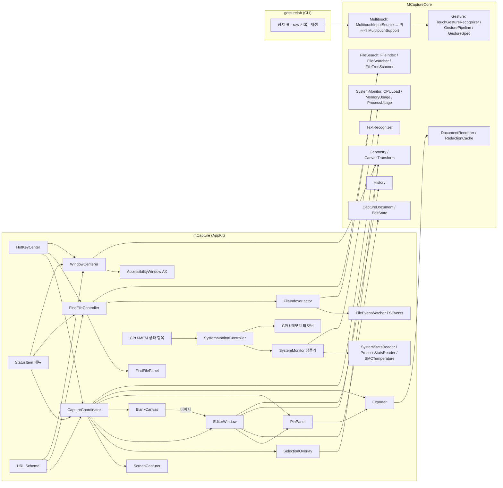
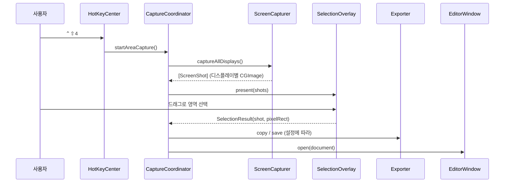

# mCapture 개발 스펙
개인용 macOS 스크린샷 캡처·주석 앱의 개발 명세.

> ℹ️ 대상 독자: 개발자(본인) | 최종 수정: 2026-10-21 | 상태: 1단계(MVP), 2단계 일상 편의, 3단계 측정·유틸, 4단계 파일 찾기, 5단계 시스템 모니터 구현 완료, 실제 조작 수동 확인 대기

## 1. 목표와 범위

### 목표

- 일상 작업(영역 캡처 → 자동 복사·저장 → 간단한 주석)을 단축키 한 번으로 끝낸다
- 픽셀 정확도: 캡처·크롭 결과가 화면의 실제 픽셀과 1px도 어긋나지 않는다
- 반응 속도: 단축키를 누르고 영역 선택 화면이 뜰 때까지 체감 지연이 없다

### 비목표 (만들지 않는 것)

| 항목 | 이유 |
|---|---|
| 라이선스·결제·텔레메트리·자동 업데이트 | 혼자 쓰는 앱 |
| 클라우드·S3 업로드 | 로컬 저장·복사로 충분 |
| 앱스토어 배포, 샌드박스, 공증 | 공증 없는 DMG 직접 배포로 충분 (`scripts/make-dmg.sh`) |
| 다국어 | UI는 한국어 고정 |

## 2. 개발·실행 환경

| 항목 | 값 |
|---|---|
| OS | macOS 27.0.1 (Apple Silicon) |
| 디스플레이 | 내장 3456×2234 Retina + 외장 6720×3780(2배율) 2대 |
| 툴체인 | Swift 6.4 (Command Line Tools, **Xcode 없음**) |
| 빌드 | Swift Package Manager + `.app` 조립 스크립트 |
| 테스트 | Swift Testing (`./scripts/test.sh`) |
| 배포 대상 | macOS 15 이상 |

### Command Line Tools 환경의 제약

| 제약 | 증상 | 대응 |
|---|---|---|
| SwiftUI `@State`·`@Entry`·`@Animatable`은 매크로이고, 플러그인(`SwiftUIMacros`)이 Xcode에만 있음 | `plugin for module 'SwiftUIMacros' not found` | `ObservableObject` + `@Published`, `@ObservedObject` 사용. `@AppStorage`·`@StateObject`는 property wrapper라 사용 가능 |
| 증분 빌드 때 SwiftPM이 Testing 매크로 플러그인 경로를 빠뜨림 | `swift test`가 실행할 때마다 성공·실패를 번갈아 함 | `scripts/test.sh`가 활성 툴체인의 플러그인 경로를 `-plugin-path`로 넘김 |
| 터미널(개발 셸)에 화면 기록 권한 없음 | `screencapture`로 앱 창을 찍을 수 없음 | DEBUG 빌드 전용 `mcapture-dev://debug/snapshot`으로 앱이 자기 창 레이어를 PNG로 렌더링 |
| `actool`(에셋 카탈로그·Icon Composer 컴파일러)이 Xcode에만 있음 | macOS 26 `.icon` 형식 아이콘을 만들 수 없음 | `scripts/make-icon.swift`로 그린 PNG를 `iconutil`로 묶어 `.icns` 사용 |
| zsh에는 `log`라는 셸 내장 명령이 있음 | `log show`·`log stream`이 아무것도 출력하지 않거나 `too many arguments` | `/usr/bin/log`로 실행 |

## 3. 기술 스택

| 영역 | 선택 | 비고 |
|---|---|---|
| 언어 | Swift 6 (언어 모드 6, strict concurrency) | UI 코드는 `@MainActor` |
| 앱 구조 | AppKit (`NSApplication` + `AppDelegate`), 메뉴바 상주(`LSUIElement`) | SwiftUI App 생명주기는 쓰지 않음 |
| 화면 캡처 | ScreenCaptureKit `SCScreenshotManager` | `CGWindowListCreateImage`는 macOS 15부터 사용 불가 |
| 선택 오버레이·캔버스 | AppKit `NSView` + Core Animation 레이어 | 이미지는 레이어로 표시, 벡터는 `draw(_:)` |
| 렌더링 | Core Graphics + Core Text | 화면 표시와 내보내기가 같은 렌더러 사용. 블러만 Core Image |
| 텍스트·QR 인식 | Vision `RecognizeTextRequest`, `DetectBarcodesRequest` | macOS 15 Swift API (async) |
| 창 캡처 | `CGWindowListCopyWindowInfo`(창 목록·순서) + `SCContentFilter(desktopIndependentWindow:)` | 창 제목은 읽지 않음 |
| 설정·툴바 UI | SwiftUI (`NSHostingView`) | |
| 전역 단축키 | Carbon `RegisterEventHotKey` 직접 래핑 | 외부 의존성 없음, 권한 불필요 |
| 로그인 시 실행 | `SMAppService.mainApp` | |
| 잠자기 방지 | IOKit `IOPMAssertionCreateWithName` (`PreventUserIdleSystemSleep`) | `caffeinate -i`와 같은 assertion. 프로세스가 끝나면 시스템이 해제 |
| 파일 찾기 인덱스 | 자체 메모리 인덱스(배열을 나란히 둔 SoA) + FSEvents 증분 갱신 + 이진 스냅샷 | Spotlight(`NSMetadataQuery`)는 숨김·제외 폴더를 못 찾고 입력마다 즉시 응답하지 않음 |
| 파일 목록 읽기 | `FileManager.enumerator(.skipsPackageDescendants)`, `contentsOfDirectory` | 실측 5만 6천 개 1.0초라 `fts`·`getattrlistbulk`는 쓰지 않음 |
| 시스템 모니터 샘플링 | Mach `host_processor_info`·`host_statistics64`, `sysctl`(압력·스왑·부팅 시각·코어 구성), `getloadavg` | 1초마다 메인 밖(`@concurrent`)에서 읽어 값만 메인으로 |
| GPU 사용률·메모리 | IORegistry `IOAccelerator`의 `PerformanceStatistics` | `Device Utilization %`, `Alloc system memory`(물리 메모리 대비 %), `In use system memory`. FPS·클럭 키는 없음 |
| CPU·GPU 온도 | AppleSMC 사용자 클라이언트 (`IOConnectCallStructMethod`) | 키를 열거해 CPU `Tp`·`Te`·`Tf`, GPU `Tg`(flt) 평균. 10초마다 |
| 프로세스 목록 | CPU는 `/bin/ps -Aro`, 메모리는 `proc_pid_rusage`(phys_footprint) | 공개 API는 다른 사용자 프로세스에 EPERM. `ps`는 엔타이틀먼트로 전부 읽음 |
| 메뉴바 모니터 항목·팝오버 | `NSStatusItem` 두 줄 글자 이미지, `NSPopover` + SwiftUI | 메뉴 대신 팝오버: 메뉴 추적 중엔 메인 큐가 멈춰 갱신이 끊김 |
| 설정 저장 | `UserDefaults` | 도메인 = 번들 ID (`com.motolies.mcapture`, 개발 빌드는 `com.motolies.mcapture.dev`) |
| 외부 패키지 | 없음 | Xcode 없이 빌드 안정성 확보 |

## 4. 아키텍처

### 모듈 구성

`MCaptureCore`는 AppKit에 의존하지 않는 순수 로직이라 단위 테스트가 가능하다. `mCapture`는 AppKit 앱이다. 예외로 `MCaptureCore/Multitouch`는 비공개 프레임워크를 dlopen하는 OS 어댑터인데, 앱에 의존할 수 없는 진단 CLI `gesturelab`도 써야 해서 코어에 둔다(`Gesture/`의 공개 API만 쓰므로 별도 타깃으로 떼어낼 수 있다).



### 영역 캡처 흐름



### 디렉터리 구조

```
cap/
├── Package.swift
├── Sources/
│   ├── MCaptureCore/        # 순수 로직 (테스트 대상)
│   │   ├── Model/           # Annotation, EditState, CaptureDocument
│   │   ├── Geometry/        # 사각형 계산(RectMath), CanvasTransform, WindowCentering(창 가운데 맞춤·큰 창 정책)
│   │   ├── Rendering/       # AnnotationRenderer, DocumentRenderer, RedactionCache, ImageEncoder, ImageSampler
│   │   ├── Recognition/     # TextRecognizer (Vision 텍스트·바코드)
│   │   ├── FileSearch/      # 파일 찾기: HangulText, SearchQuery, NameMatcher, FileIndex, ExclusionRules, FileIndexSnapshot, FileSearcher, FileTreeScanner(DirectoryReconciler 포함)
│   │   ├── SystemMonitor/   # CPULoad(틱 → 사용률), MemoryUsage(앱·와이어드·압축·압력·스왑), UsageHistory, ProcessUsage(ps 파서·앱 단위 묶기), MonitorFormat(형식·임계값), CoreGridLayout(코어 링 열 수·크기)
│   │   ├── Support/         # History, FileNaming, HotKeySpec, KeyChord(보낼 키 조합·KeyModifiers), AppVariant(사용 중인 앱 / 개발 빌드 구분)
│   │   ├── Gesture/         # 입력 제스처: InputDevice(장치 종류·식별), TouchFrame, InputGesture(종류·이벤트), TouchGestureRecognizer(손가락 묶음 상태 기계·Profile), GesturePipeline(장치별 인식기·직렬 큐), InputSource(소스 계약), GestureSpec(트리거 조건), GestureBinding(조건=동작 한 줄·목록 매칭), TouchFrameLog(raw 로그 형식)
│   │   └── Multitouch/      # 비공개 MultitouchSupport 어댑터: MultitouchAPI(dlopen), MultitouchDevice(+IORegistry 열거), MultitouchCallbackRouter(C 콜백 라우팅), MultitouchInputSource(InputSource 구현), MultitouchDeviceWatcher(IOKit 연결·해제 알림)
│   ├── gesturelab/          # 제스처 진단 CLI (swift run gesturelab): 장치 표, --raw 기록, --replay 재생, --watch 연결 알림, 임계값 플래그. 앱 번들에 들어가지 않는다
│   └── mCapture/            # AppKit 앱
│       ├── App/             # main, AppDelegate(perform(AppAction) 단일 분기), AppAction(공용 동작), MainMenu, StatusItem, HotKeyCenter, Preferences, SleepPreventer, DebugSnapshot(DEBUG)
│       ├── Capture/         # ScreenCapturer, CaptureCoordinator, WindowList, ScreenRecordingPermission
│       ├── Overlay/         # SelectionOverlayController, OverlayPanel, SelectionView(확대경 포함)
│       ├── Editor/          # EditorWindowController, CanvasView, EditorToolbar, EditorState, BlankCanvasWindowController(빈 캔버스)
│       ├── Pin/             # PinPanel (화면에 고정)
│       ├── Export/          # Exporter, ToastPanel
│       ├── Settings/        # SettingsModel, 일반·캡처 탭 화면과 단축키 섹션(SettingsView), SettingsWindowController(툴바 탭·창 높이), KeyRecorder(단축키·보낼 키 공용 녹화)
│       ├── FindFile/        # FindFileController, FindFilePanel, SearchFieldEditor, ResultRowViews, FileIndexer(actor), FileEventWatcher, FileAccessPermission, FindFileSettingsView(설정 탭)
│       ├── Gesture/         # GestureService(바인딩 실행·지연 열기·재연결·녹음 핸들러), GestureSettingsView(설정 탭·편집기), KeySender(CGEvent 키 보내기), AccessibilityPermission
│       ├── Window/          # WindowCenterer(앞 앱 포커스 창을 커서 화면 가운데로: 대상 앱·쓰기 순서·실패 토스트), AccessibilityWindow(AX 창 요소 찾기·프레임 읽기/쓰기)
│       ├── SystemMonitor/   # SystemMonitorController(상태 항목·팝오버·설정 KVO), SystemMonitor(샘플러), SystemStatsReader(Mach·sysctl·IOKit), ProcessStatsReader(ps·libproc·아이콘), SMCTemperature, MonitorStatusItem(두 줄 글자), CPUDetailView, MemoryDetailView, MonitorWidgets, SystemMonitorSettingsView(설정 탭)
│       └── Common/          # ImageLayerView, DrawingView, SizeLabel, Loupe(확대경), ImageLoader, DragOutSource (오버레이·에디터 공용)
├── Tests/MCaptureCoreTests/
├── Resources/               # Info.plist, AppIcon.icns
├── scripts/
│   ├── build-app.sh             # swift build → build/mCapture-dev.app(기본) 또는 mCapture.app 조립 → 서명
│   ├── make-dmg.sh              # 배포용 DMG (production 변형 release 빌드)
│   ├── test.sh                  # 단위 테스트 (플러그인 경로 보정)
│   ├── make-icon.swift          # 앱 아이콘 생성 (swift scripts/make-icon.swift)
│   ├── create-signing-identity.sh   # 자체 서명 인증서 생성 (최초 1회)
│   ├── export-signing-identity.swift # 서명 인증서를 p12로 백업
│   └── import-signing-identity.sh   # 백업한 p12를 다른 컴퓨터에 복원
└── claudedocs/              # 스펙·분석 문서
```

## 5. 핵심 설계 규칙

### 좌표계

| 공간 | 원점·단위 | 사용처 |
|---|---|---|
| **이미지 픽셀** | 왼쪽 위, y 아래 방향, 픽셀 | 문서 모델의 모든 값(크롭, 주석, 선택 영역) |
| 뷰 | 왼쪽 위(`isFlipped = true`), 포인트 | 캔버스·오버레이 이벤트 처리 |
| 화면 | 왼쪽 아래(AppKit 전역), 포인트 | 창 배치에만 사용 |

- 모델에는 **이미지 픽셀 좌표만** 저장한다. 뷰 좌표 변환은 `CanvasTransform` 한 곳에서만 한다
- 화면에 보여주는 크기(W×H)와 키보드 이동량은 **논리 픽셀(pt)** 기준이다. 논리 1px = 이미지 `scale`px
- 선택 영역은 항상 이미지 픽셀 경계에 맞춘다

### 문서 모델과 실행 취소

```swift
// 원본 이미지는 불변, 편집 상태만 값 타입으로 관리
struct CaptureDocument {
    let image: CGImage        // 디스플레이 전체 캡처 (원본)
    let scale: CGFloat        // Retina 배율
    var state: EditState
}

struct EditState: Equatable {
    var crop: CGRect?             // nil이면 이미지 전체
    var annotations: [Annotation] // 배열 순서 = 레이어 순서
}
```

- 영역 캡처는 **디스플레이 전체 이미지 + crop**으로 만든다. 크롭 초기화로 언제든 영역을 넓힐 수 있다
- 실행 취소는 변경 직전의 `EditState`를 스택에 쌓는 스냅샷 방식이다
- 픽셀화·블러도 원본을 바꾸지 않는 주석(`redact(rect, .pixelate / .blur)`)이다. 그릴 때 `RedactionCache`가 원본에서 결과를 만든다. 따로 래스터화하는 단계가 필요 없다
- **레이어 그룹**: 붙여넣은 이미지(`image`), 가리기(`redact`), 형광펜(`highlighter`)은 원본을 대신하거나 원본에 붙는 베이스 레이어(`Annotation.isBaseLayer`)다. `EditState.add`·`bringToFront`가 베이스 레이어를 항상 다른 주석 아래에 두므로 렌더러와 `HitTester`는 배열 순서만 따른다
- 그리기 도구(R/A/T)에서는 베이스 레이어를 클릭 판정에서 빼 그 위에 바로 그릴 수 있게 한다. 선택 도구(V)에서만 고르고 옮긴다

### 렌더링

- `AnnotationRenderer`는 y 아래 방향 컨텍스트를 가정한다. 캔버스와 내보내기가 같은 함수를 호출한다
- 캔버스의 원본 이미지는 Core Animation 레이어로 표시한다(GPU 스케일링, 확대 시 nearest 필터). 주석·선택 영역만 `draw(_:)`로 그린다
- 내보내기는 `crop` 영역 크기의 비트맵에 원본 + 주석을 그린 뒤 PNG로 인코딩한다(Retina면 144 DPI 메타데이터). 복사·저장·토스트는 `Exporter.export` 한 곳에서 처리한다
- 픽셀화·블러는 원본 픽셀이 필요해 `AnnotationRenderer.draw`에 `RedactionCache`를 넘긴다. 캔버스는 문서마다 하나를 계속 쓰고(결과 캐시), 내보내기는 렌더링마다 새로 만든다. 가리기는 **원본만** 읽으므로 아래에 붙여넣은 이미지는 흐려지지 않는다
- 캔버스의 주석은 원본 이미지 레이어 위 별도 투명 레이어에 그려 블렌드 모드가 원본과 섞이지 않는다. 그래서 형광펜은 multiply 대신 알파(0.4)로 겹친다
- 텍스트 편집 중에는 `NSTextView`가 글자를, 캔버스가 배경 상자를 그린다. 편집 뷰 글꼴은 렌더러의 `CTFont`를 그대로 쓴다(`NSFont`와 toll-free 브리지)

### 같은 캡처는 같은 파일

- 캡처 직후 자동 저장한 파일 경로를 문서가 기억한다
- 에디터에서 `⌘S`나 Esc(저장 동작)를 하면 **그 파일을 덮어쓴다**. 새 파일은 `⇧⌘S`(다른 이름으로 저장)로만 만든다

### 동시성

- UI·캡처 조정 코드는 모두 `@MainActor`
- `CGImage`는 불변 객체라 스레드 간 전달용 래퍼(`SendableImage`, `@unchecked Sendable`)를 둔다. ScreenCaptureKit 병렬 캡처와 백그라운드 PNG 인코딩에만 쓴다
- 오버레이 선택 결과는 continuation으로 Sendable 값(화면 순번, `CGRect`)만 넘기고, `NSScreen`이 들어 있는 결과 객체는 메인 액터에서 다시 만든다
- Carbon 단축키 콜백은 메인 스레드에서 호출되므로 `MainActor.assumeIsolated`로 진입한다
- 파일 찾기 인덱스는 `FileIndexer` 액터가 값(`FileIndex`)으로 가진다. 검색은 `snapshot()`이 돌려준 값을 액터 밖에서 `FileSearcher.search`(`@concurrent`, CPU 수만큼 청크 병렬)로 훑는다. 값 타입이라 쓰기 전까지 배열을 공유하고, 락이나 `@unchecked Sendable` 인덱스가 없다
- 파일 I/O(전체 스캔, 디렉터리 읽기, 스냅샷 읽기·쓰기)는 액터 밖 GCD 전역 큐(스캔 `.background`, 나머지 `.utility`)에서 하고 결과만 액터로 가져온다. 협력 스레드 풀을 동기 I/O로 막지 않고, I/O를 기다리는 동안에도 검색이 응답한다
- 설정 변경·다시 만들기·끄기마다 generation을 올려, I/O를 기다리던 이전 작업의 결과는 버린다. 인덱스 압축(번호가 바뀜)은 이벤트 처리 순서 안에서만 한다
- `@unchecked Sendable`은 FSEvents 콜백 박스(`FileEventWatcher`), `NSRegularExpression` 래퍼(`RegexTerm`), `CGImage` 래퍼(`SendableImage`), 스캔 거부 경로 모음(`FileTreeScanner.DeniedPaths`), 멀티터치 프레임 박스(`GesturePipeline`) 다섯 곳만 쓴다. 각각 검사할 수 없는 이유·가변 상태·그것을 바꾸는 유일한 곳을 주석에 적는다
- 멀티터치 접촉 프레임은 프레임워크 스레드 → `MultitouchCallbackRouter`(잠금 보호 핸들러 표, 전역 C 콜백은 `static let` 하나씩) → `GesturePipeline` 직렬 큐 순으로 흐르고, 앱은 `InputSource.events`(`AsyncStream`, 최신 16개 버퍼)로 받는다. 버튼 시각은 마지막 프레임의 장치 시각을 쓴다(MT 콜백과 이벤트 탭이 같은 클릭을 둘 다 알려 주므로 150ms 중복 제거가 같은 시계를 전제). 소스 정지는 콜백 해제 → `MTDeviceStop` → 라우터 정리 → 큐 배수 → 스트림 종료 순이고 콜백 안에서 부르지 않는다
- 시스템 모니터는 `SystemMonitor`(메인 액터)의 `Task` 루프가 1초마다 `@concurrent` 함수로 Mach·sysctl·IOKit·SMC를 읽고 값(`SystemSnapshot`)만 메인으로 가져온다. 프로세스 목록(`ps` 실행·libproc)도 같은 방식이며 팝오버가 열린 동안 2초마다 읽는다. 설정은 UserDefaults KVO로 받아 메인에서 반영한다

### 포커스

- 오버레이는 `nonactivatingPanel`이라 앱을 활성화하지 않아도 키 입력(Esc, Space)을 받는다
- 영역 캡처를 취소하거나 에디터 없이 끝나면(텍스트 인식, Tab 색상 복사 포함) 캡처 직전의 앞쪽 앱을 다시 활성화한다
- 핀은 `nonactivatingPanel`이라 클릭해도 쓰던 앱의 포커스를 빼앗지 않는다. 단축키는 핀이 키 창일 때만 처리해 에디터의 ⌘C 등을 가로채지 않는다
- 에디터 단축키(V/R/A/T)는 한글 입력 상태에서도 동작하도록 문자 대신 ANSI 키 코드로 판별한다
- 파일 찾기 창은 `NSApp.activate()` 뒤 키 창으로 만든다(한글 입력기가 확실히 붙는 경로). 열 때 앞에 있던 앱을 기억했다가 Esc·⌘C로 닫으면 그 앱으로 돌려주고, 결과를 열거나 Finder에서 보이면 그쪽 앱이 앞으로 온다. 다른 앱·창을 누르면(키 창에서 벗어나면) 닫는다
- 파일 찾기 창의 Enter·Esc·↑↓는 필드 에디터의 명령(`doCommandBy`)으로 받는다. 한글 조합을 끝내는 Enter는 입력기가 먼저 써서 여기로 오지 않으므로 파일을 열지 않는다. ⌘ 조합은 키 코드로 판별한다

## 6. 기능 명세

### 1단계: MVP

| ID | 기능 | 상세 | 완료 기준 |
|---|---|---|---|
| F1 | 메뉴바 앱 | 메뉴바 아이콘과 메뉴(영역 캡처, 전체 화면 캡처, 이미지 열기, 저장 폴더 열기, 설정, 종료). Dock 아이콘은 에디터가 열려 있을 때만 표시(앱 아이콘 `AppIcon.icns`). 종료는 메뉴로만 하고 ⌘Q는 앞 창 닫기로 동작 | 앱 실행 후 메뉴바에 아이콘이 보이고 모든 메뉴가 동작 |
| F2 | 전역 단축키 | 영역 ⌃⇧4, 전체 화면 ⌃⇧1 (설정에서 변경) | 다른 앱이 활성화된 상태에서도 동작 |
| F3 | 캡처 엔진 | ScreenCaptureKit으로 모든 디스플레이를 동시에 캡처. 커서 제외, 자기 앱 창 제외, 네이티브 해상도 | 6K 디스플레이에서 결과가 6720×3780 |
| F4 | 영역 선택 오버레이 | 멈춘 화면 위에 디스플레이마다 오버레이. 선택 밖 어둡게, 크기 표시(pt), 십자선, 확대경(픽셀 격자·좌표·색상), Shift 정사각형, Space 누른 채 선택 영역 이동, 클릭만 하면 해당 디스플레이 전체, Esc 취소 | 3개 디스플레이 어디서든 선택 가능, 결과가 선택 영역과 픽셀 단위로 일치 |
| F5 | 캡처 후 동작 | 설정에 따라 클립보드 복사(PNG) / 저장 폴더에 저장 / 에디터 열기. 완료 알림(토스트) 표시 | 기본값: 세 가지 모두 켜짐 |
| F6 | 에디터 보기 | 맞춤(⌘1), 100%(⌘0), 선택 영역 줌(⌘2), 확대·축소(⌘=/⌘-), 핀치, 마우스 휠 줌, 트랙패드 스크롤·Space 드래그·우클릭 드래그로 이동, 확대 시 픽셀 선명 | 커서 위치를 기준으로 확대·축소 |
| F7 | 선택·크롭 | 선택 도구(V)로 드래그. 모서리·변 핸들 8개로 크기 조절(⇧ 정사각형), 방향키 이동(1pt, ⇧ 10pt), ⌘방향키 크기 조절, Enter 크롭, 크롭 초기화. 주석 선택 없이 Delete면 선택 영역 안에 완전히 들어간 주석을 지움(가장자리에 닿은 변은 바깥으로 늘려 판정, 배경은 그대로) | 크롭 후 내보낸 이미지 크기가 선택 크기와 일치 |
| F8 | 주석 도구 | 사각형(R), 화살표(A), 텍스트(T). 색상 8종, 크기 슬라이더 1~20(선 두께 = 값 pt, 글자 8+4×값, 카운터 지름 14+4×값. 예전 S/M/L = 2/4/7). 텍스트는 글꼴 5종(시스템·둥근·세리프·고정폭·손글씨)과 배경 상자(주석 색 + 대비색 글자) | 그린 결과가 내보낸 이미지에 그대로 나옴 |
| F9 | 주석 편집 | 클릭 선택, 드래그 이동, 핸들로 크기·끝점 조절(텍스트는 모서리 핸들로 글자 크기, 이미지는 비율 유지), Delete 삭제, 방향키 이동, 선택한 주석에 색상·크기·글꼴·배경 변경, 텍스트 더블클릭 편집 | 모든 편집이 실행 취소 가능 |
| F10 | 실행 취소 | ⌘Z / ⇧⌘Z | 생성·이동·삭제·스타일·크롭 모두 되돌림 |
| F11 | 내보내기 | ⌘C 복사(선택 영역이 있으면 그 부분만), ⌘S 저장(같은 파일 덮어쓰기), ⇧⌘S 다른 이름으로 저장, Esc는 설정된 동작 후 창 닫기 | |
| F12 | 설정 창 | 툴바 아이콘 탭 다섯 개. **일반**: 로그인 시 실행, 화면 기록·손쉬운 사용 권한 상태, 창 가운데로 이동 단축키(F32), 버전(`Info.plist`의 버전과 빌드한 커밋, 메뉴바 아이콘 툴팁에도 표시), GitHub 저장소 링크. **캡처**: 저장 폴더, 파일 이름, 캡처 후 동작, Esc 동작, 창 그림자, 줄바꿈 제거, 캡처 단축키. **파일 찾기**: F28 설정과 그 단축키. **제스처**: F31. **시스템 모니터**: F29 설정. 단축키는 버튼을 누르고 키 조합 녹화(`KeyRecorder` 하나를 모든 탭이 나눠 씀: 녹화 중 전역 단축키 해제, 탭을 바꾸면 취소, 겹침 검사는 모든 탭의 단축키 대상). 탭마다 창 높이를 내용에 맞춤(위쪽 모서리 고정, 화면보다 길면 스크롤), 다시 열면 마지막 탭 | 변경 즉시 반영 |
| F13 | 권한 안내 | 화면 기록 권한이 없으면 시스템 요청 후 안내 창과 "시스템 설정 열기" 제공 | 권한 없이 캡처하면 빈 화면 대신 안내가 뜸 |
| F14 | URL Scheme | `mcapture://grab/area`, `grab/fullscreen`, `settings`, `open?path=` | 터미널 `open` 명령으로 동작 |
| F15 | 이미지 열기 | 파일 → 열기…(⇧⌘O), 메뉴바 "이미지 열기…", 에디터 캔버스에 이미지 파일을 끌어다 놓으면 새 에디터, Finder "다음으로 열기"(PNG만, `CFBundleDocumentTypes` `Alternate`라 기본 앱은 그대로). 열린 파일은 원본 경로를 기억하지 않아 ⌘S는 저장 폴더에 새 파일 | DPI로 Retina 배율 추정 |
| F16 | 이미지 붙여넣기 | ⌘V로 클립보드 이미지(PNG·TIFF 데이터 또는 복사한 이미지 파일)를 보이는 영역 가운데에 원래 논리 크기로 겹침. 90%를 넘으면 축소 | 내보낸 이미지에 그대로 나옴 |

### 2단계: 일상 편의

| ID | 기능 | 상세 | 완료 기준 |
|---|---|---|---|
| F17 | 색상 복사 | 영역 선택 오버레이에서 Tab을 누르면 확대경 가운데 픽셀의 HEX(`#RRGGBB`)를 복사하고 오버레이를 닫음. 토스트 아이콘은 복사한 색 견본 | 토스트에 복사한 색이 보이고 이전 앱으로 포커스가 돌아감 |
| F18 | 가리기 | 가리기 도구(B)로 드래그해 픽셀화·블러 주석을 만듦. 툴바 옵션 칸에서 방식을 고르고, 강도는 크기 값(블록 max(6, 2+2×값)pt, 반경 max(4, 2×값)pt). 원본은 바꾸지 않음 | 내보낸 이미지에서 영역 밖 픽셀이 원본과 같음 |
| F19 | 추가 도구 | 타원(O), 선(L, ⇧ 45°), 형광펜(H, 반투명 상자), 카운터(N, 누른 자리에 가장 큰 번호 + 1). 창이 좁으면 색상 팔레트를 현재 색 버튼 + 팝오버로 접음 | 그린 결과가 내보낸 이미지에 그대로 나옴 |
| F20 | 텍스트·QR 인식 | 전역 단축키·메뉴·URL로 영역을 고르면 Vision으로 한국어+영어 텍스트를 인식해 클립보드에 복사. QR 등 바코드가 있으면 그 내용만 복사. 줄바꿈 제거 설정, 이중 공백 정리 | 한·영 섞인 화면에서 텍스트가 복사됨 |
| F21 | 창 캡처 | 전역 단축키·메뉴·URL로 오버레이를 띄우면 커서 아래 창을 강조하고, 클릭한 창을 가려지지 않은 상태로 투명 배경 PNG로 캡처. 그림자 포함 설정(네이티브 해상도 유지). 창 밖 클릭은 디스플레이 전체, 드래그는 영역 캡처 | 그림자를 끈 결과가 창 크기 × 배율과 일치 |
| F22 | 핀 | 에디터 툴바·⌘P로 결과를 항상 위 테두리 없는 패널에 띄우고 에디터는 닫음. 끌어서 이동, 스크롤·핀치로 커서 기준 크기 조절, 우클릭 메뉴(50/100/200%, 반투명, 복사, 저장, 편집, 닫기) | 편집으로 돌아가면 주석이 그대로 남음 |
| F23 | 끌어놓기 | 에디터 툴바 손잡이를 끌어 다른 앱에 PNG를 놓음 (파일 URL + PNG 데이터). 손잡이에 마우스를 올리면 미리 인코딩 | Finder·메신저·브라우저 입력창에 이미지가 들어감 |
| F24 | 빈 캔버스 | 실행 중에 앱을 다시 실행하면(reopen 이벤트: Finder·Spotlight·Dock 아이콘 클릭) 놓기 전용 창을 띄움. 클립보드 이미지(⌘V), 이미지 파일(여러 개면 각각), 브라우저 이미지 데이터(PNG·TIFF)를 받으면 그 이미지의 에디터를 열고 빈 캔버스는 닫음. 하나만 띄우고 다시 실행하면 앞으로 가져옴. 처음 실행에는 띄우지 않음 | 메뉴바만 있는 상태에서 다시 실행 → ⌘V로 에디터가 열림 |

### 3단계: 측정·유틸

| ID | 기능 | 상세 | 완료 기준 |
|---|---|---|---|
| F25 | 컬러 피커 | **메뉴바·전역 단축키(⌃⇧6)·URL**: 영역 선택 오버레이의 색 모드. 화면을 어둡게 하지 않고 확대경에 `x, y   #HEX` / `rgb(…)` 두 줄을 보이며, 클릭하면 HEX, ⇧클릭하면 `rgb(r, g, b)`를 복사하고 닫음. **에디터 도구(I)**: 같은 확대경(보이는 영역 기준 좌표)과 클릭 규칙. 원본 픽셀을 읽고 주석은 무시. 반투명은 `#RRGGBBAA`/`rgba(…)`, 완전 투명은 복사하지 않음. 토스트에 색 견본. 비활성 에디터 첫 클릭은 복사하지 않음 | 복사한 값이 원본 픽셀의 sRGB 값과 같음 |
| F26 | 픽셀 자 | 에디터 도구(M). 호버하면 커서 아래 픽셀부터 상하좌우로 시작 색과 채널별 6 이하로 같은 구간을 찾아 가로·세로 선과 `W × H`(pt) 라벨(자동 간격, 보이는 영역 끝에서 멈춤). 드래그하면 두 점 측정선과 `W × H · 길이`(⇧ 45° 단위). 측정은 화면에만 그리고 내보내지 않음. 클릭·Esc·도구 변경·크롭으로 지움. 마우스 이동은 측정 표시 영역만 다시 그림 | 두 요소 사이 간격 라벨이 실제 픽셀 간격 ÷ 배율과 같음 |
| F27 | 잠자기 방지 | 메뉴바 메뉴의 체크 토글. `PreventUserIdleSystemSleep` assertion(`caffeinate -i`와 같음, 화면은 꺼짐). 켜지면 메뉴바 아이콘을 초록(비템플릿 팔레트 심볼)으로, 툴팁에 "잠자기 방지 켜짐". 저장하지 않아 실행할 때마다 꺼진 상태 | `pmset -g assertions`에 `mCapture prevent idle sleep`이 생기고, 끄거나 앱이 끝나면 사라짐 |

### 4단계: 파일 찾기

| ID | 기능 | 상세 | 완료 기준 |
|---|---|---|---|
| F28 | 파일 찾기 | **Everything·Cling처럼 이름으로 즉시 찾기.** 메뉴바·전역 단축키(⌃⇧F)·URL로 커서 화면 위쪽에 검색 창을 띄움(다시 누르면 닫힘). 글자마다 검색(한글 조합 중 글자 포함), 결과 최대 200개(보이는 줄 9개), 상태 줄에 일치 수·시간·인덱스 상태. **문법**: 공백 AND, 따옴표, `ext:pdf;png`, `folder:`·`file:`, `/`가 들어간 항은 전체 경로에 포함(`~/` 확장), `regex:`, 초성(`ㅎㄱ` → 한글). **순위**: 정확(확장자 뺀 이름 포함) > 접두 > 단어 경계 > 부분 > 퍼지(fzf식), `.app` 보너스, 동점은 이름 길이·깊이·경로. **동작**: ↩ 열기, ⌘↩ Finder에서 보기, ⌘C 경로 복사(검색어 일부를 골랐으면 글자 복사). 결과를 열 때 파일이 없으면 알리고 그 폴더를 다시 맞춤. **인덱스**: 앱 시작 5초 뒤 자동, 루트 `~`·`/Applications`·`/System/Applications`, 기본 제외(이름 node_modules·.git·Cache 등, 경로 ~/Library/Caches 등, 패키지 내부), 숨김 끔, 제외 영역 안의 폴더도 검색 폴더로 직접 추가하면 색인(예: `~/Library/CloudStorage/OneDrive-…`), FSEvents로 증분 갱신, 종료·스캔 후 스냅샷 저장 → 다음 실행 때 기록 재생. 설정에서 끄면 스냅샷 삭제 | 110만 개 합성 인덱스에서 일반·퍼지·초성 검색 50ms 이하, 파일을 만들고·옮기고·지우면 약 2초 안에 결과에 반영, 꺼져 있던 동안의 변경도 다시 실행하면 반영 |

### 5단계: 시스템 모니터

| ID | 기능 | 상세 | 완료 기준 |
|---|---|---|---|
| F29 | 시스템 모니터 | **메뉴바**: CPU·MEM 상태 항목 두 개(두 줄 글자 `CPU / 24%`, `MEM / 58%`, 폭 34pt 고정, 왼쪽부터 CPU·MEM·앱 아이콘). CPU는 사용자+시스템 %(코어 평균), MEM은 메모리 압력 %(= 100 − `kern.memorystatus_level`). 1초마다 갱신. 임계값(기본 CPU 80, 압력 80, 토글로 끔) 이상이면 그 항목 글자를 빨간색으로(평소 템플릿 이미지). ⌘-드래그 배치와 메뉴바 밖으로 빼기는 `autosaveName`으로 기억하고 표시 설정과 맞춘다. **팝오버**(항목 클릭, 바깥 클릭·다른 항목 클릭·다시 클릭으로 닫힘, 폭 300pt): CPU — 온도(SMC 코어 센서 평균, 없으면 전체 %), 1분 기록 막대(사용자·시스템 쌓기), 코어 링 격자(효율 분홍·성능 파랑, 열 수는 코어 수에 맞춤: 8 한 줄·10 5+5·12 6+6·14 7+7·16 8+8·24 8×3)와 그룹 평균, 프로세스 상위 5(`ps`, 전 프로세스, 앱 단위 합산), GPU 링 3개(사용률, 메모리 = 물리 메모리 대비 GPU 할당 %, 온도 `Tg*` 평균)와 할당·사용 중 바이트, 로드 평균, 가동 시간. 메모리 — 압력 링(단계 색)·사용 링(앱·와이어드·압축 분할), 내역(앱·와이어드·압축됨·여유), 프로세스 상위 5(phys_footprint, 내 계정), 페이지 입출력/초, 스왑. 프로세스는 팝오버가 열린 동안 2초마다 조회. FPS·GPU 클럭은 공개 API가 없어 두지 않음(iStat도 클럭은 0). **설정 탭**: 표시 토글 2개, 임계값 토글+슬라이더(10~100, 5 단위) 2개 | 값이 `sysctl`·`vm_stat`·활성 상태 보기와 맞고, 유휴 CPU 약 1%, 온도를 못 읽는 Mac에서도 나머지가 동작 |

### 6단계: 제스처 입력

| ID | 기능 | 상세 | 완료 기준 |
|---|---|---|---|
| F30 | 제스처 인식 코어 | 비공개 `MultitouchSupport`의 접촉 프레임(약 88Hz)으로 매직마우스 2·3·4손가락 탭·길게 탭·좌우앞뒤 스와이프·물리 클릭(손가락 수·좌우 버튼)을 인식한다. 제스처 = 거의 동시에 닿은 손가락 묶음, 떨어짐은 프레임 부재로 판정, 분류는 mm 단위. 장치별 설정은 `TouchGestureRecognizer.Profile`, 소스 계약은 `InputSource`, 트리거 조건은 `GestureSpec`(`mouse+3+swipe+left`). 진단 CLI `swift run gesturelab`(`--raw` 기록, `--replay` 재생, 임계값 플래그). 앱 UI 없음. 설계: `claudedocs/제스처-입력-설계.md` | 실측 로그 조각·합성 프레임 단위 테스트 통과, 5분 실사용 기록 92클릭에서 1·2·3·4손가락 구분, 권한 없이 BTT와 동시 수신(`claudedocs/매직마우스-제스처-poc.md`), 이관 전후 재생 출력 동일 |
| F31 | 제스처 트리거 → 동작 | 설정 **제스처** 탭에서 바인딩(조건 → 동작)을 만든다. 조건은 `GestureSpec`(장치·손가락 2~4·탭/길게 탭/클릭/스와이프·방향/버튼)을 피커로 고르거나 **제스처 녹음**(마우스에서 직접 해 채움, 그동안 바인딩 실행 중지, 시작 300ms 유예·끝난 뒤 0.5초 재점등 방지)으로 채운다. 동작은 공용 `AppAction`(캡처 5·도구 6) 또는 **키 조합 보내기**(`KeyChord`, 손쉬운 사용 권한, `KeySender`가 CGEvent를 HID 탭에 post). 목록은 켬·끔, 동작 메뉴, ✎ 편집, ⊖ 삭제. 저장은 `gestureBindings: [String]`(`[#]조건=동작`), 같은 조건은 하나, 매칭은 켜진 것 중 장치 지정 우선 → 모든 장치. `GestureService`: 켜진 바인딩이 있거나 설정 창이 열려 있을 때만 장치를 열고(지연 열기), 설정은 KVO로 반영, 장치 연결·해제(`MultitouchDeviceWatcher`)·잠자기 복귀·세션 활성 때 1초 디바운스 뒤 소스 재생성(실패 시 1초 간격 3회), 캡처 중·대화상자 중·키 녹화 중에는 실행하지 않음, 종료 시작 때 먼저 정지. 메뉴·단축키·URL·제스처가 모두 `AppDelegate.perform(AppAction)`을 탄다. 2손가락·클릭·겹침·단축키와 같은 키·권한 없음은 편집기가 경고. 기본 바인딩 없음, 기능 기본 켜짐 | 실제 3·4손가락 제스처로 바인딩 실행, 녹음으로 조건 채움, 마우스를 껐다 켠 뒤 10초 안 복구, 잠자기 복귀 후 동작, 권한 없이 키를 보내면 토스트, 바인딩이 없으면 장치를 열지 않음(`debug/gesture-stats` state=idle). 하드웨어 없이 `defaults write` + `debug/gesture?spec=`로 매칭·실행·녹음 경로 확인됨 |

### 7단계: 창 유틸

| ID | 기능 | 상세 | 완료 기준 |
|---|---|---|---|
| F32 | 창 가운데로 이동 | 전역 단축키(⌃⇧C)·메뉴바 메뉴·윈도우 메뉴·URL `window/center`·제스처 바인딩이 `AppAction.centerWindow`로 `WindowCenterer`를 부른다. **대상**: 앞 앱(`frontmostApplication`)의 포커스 창. URL은 `open`이 창 없는 자기 앱을 앞으로 가져오므로 그때는 `menuBarOwningApplication`(직전 앱). 앞 앱이 자기 자신이면 `NSApp.keyWindow ?? mainWindow`를 `setFrame`(권한 불필요). **AX 경로**(`AccessibilityWindow`): `AXUIElementCreateApplication` → `kAXFocusedWindow`(없으면 `kAXMainWindow`) → 역할 `AXWindow`·최소화·`AXFullScreen` 검사, 요소마다 메시지 한도 1초. 프레임은 CG 좌표를 `RectMath.flipped`로 AppKit 좌표로. **계산**(코어 `WindowCentering.frame(centering:in:oversize:)`): 커서 화면 `visibleFrame` 가운데, 원점 반올림, 넘치는 축만 사용 영역 크기로 줄임(`shrinkToFit`), `keepSize`면 왼쪽 위 정렬. **쓰기 순서**: 크기 먼저(거부해도 계속) → 실제 크기 다시 읽고 `keepSize`로 원점 재계산 → 위치 쓰기 → 크기가 또 바뀌면 한 번 더(최대 2회) → 실제 원점이 1pt 넘게 다르면 `ignored`. 화면 `frame`과 똑같은 창은 전체 화면으로 봄. **실패 토스트**(대상 화면에): 권한 없음(+`AccessibilityPermission.request()`로 프롬프트·시스템 설정), 옮길 창 없음, 전체 화면, 응답 없음(`cannotComplete`), 옮기지 못함(무시·그 밖 AXError). 성공은 토스트 없음, 로그 `window` 범주. 설정 › 일반에 권한 행과 "창" 단축키 섹션 | 3개 디스플레이 사이로 이동(음수 좌표 화면 포함), 큰 창이 내장 디스플레이 사용 영역 크기로 줄어듦, 전체 화면·창 없음 토스트, 권한 없이 누르면 토스트와 시스템 설정, 허용 후 재실행 없이 동작, `WindowCentering` 단위 테스트 5개 |

## 7. 단축키

### 전역 (기본값, 설정에서 변경 가능)

| 동작 | 키 |
|---|---|
| 영역 캡처 | ⌃⇧4 |
| 전체 화면 캡처 | ⌃⇧1 |
| 창 캡처 | ⌃⇧3 |
| 텍스트 인식 | ⌃⇧5 |
| 컬러 피커 | ⌃⇧6 |
| 파일 찾기 | ⌃⇧F |
| 창 가운데로 이동 | ⌃⇧C |

> ℹ️ **참고**: macOS 기본 스크린샷 단축키(⌘⇧3~5)와 겹치지 않게 정했다. 설정에서 다른 조합으로 바꿀 수 있다.
> 개발 빌드의 기본값은 ⌃⌥⇧ + 같은 키다([개발 빌드 분리](#개발-빌드-분리)).
> Carbon 단축키는 다른 앱보다 먼저 키를 가져가므로 ⌃⇧F를 쓰는 앱(일부 IDE 키맵 등)에서는 그 앱의 ⌃⇧F가 동작하지 않는다. 겹치면 설정에서 바꾼다.
>
> 등록할 때 앞 동작과 같은 조합이면 뒤 동작은 등록하지 않고 토스트로 알린다(새 동작의 기본값이 바꿔 둔 단축키와 겹칠 때).

### 영역 선택 오버레이

| 동작 | 키 |
|---|---|
| 정사각형 | 드래그 중 ⇧ |
| 선택 영역 이동 | 드래그 중 Space |
| 디스플레이 전체 | 드래그 없이 클릭 |
| 창 캡처 (창 모드) | 강조된 창 클릭 (드래그는 영역 선택) |
| 확대경 가운데 픽셀 색 복사 | Tab |
| 색 고르기 (컬러 피커 모드) | 클릭 HEX, ⇧클릭 RGB |
| 취소 | Esc |

### 에디터

| 동작 | 키 |
|---|---|
| 도구: 선택 / 사각형 / 타원 / 선 / 화살표 / 형광펜 / 텍스트 / 카운터 / 가리기 | V / R / O / L / A / H / T / N / B |
| 측정 도구: 컬러 피커 / 픽셀 자 | I / M |
| 색 복사 (컬러 피커) | 클릭 HEX, ⇧클릭 RGB |
| 거리 측정 (픽셀 자) | 드래그 (⇧ 45° 단위), 호버하면 자동 간격 |
| 크롭 | 선택 후 Enter |
| 선택 영역·주석 이동 | 방향키 (⇧ 10pt) |
| 선택 영역 크기 조절 | 모서리·변 핸들 드래그 (⇧ 정사각형), ⌘ + 방향키 (⇧ 10pt) |
| 주석 삭제 | Delete |
| 선택 영역 안 주석 지우기 (배경은 그대로) | 주석 선택 없이 Delete |
| 이미지 붙여넣기 | ⌘V |
| 이미지 열기 | ⇧⌘O, 캔버스에 파일 끌어다 놓기 |
| 정사각형·원 / 화살표·선 45° 단위 고정 | 그리는 중 ⇧ |
| 텍스트 줄바꿈 / 확정 | ⇧Enter / Enter |
| 맞춤 / 100% / 선택 영역 줌 | ⌘1 / ⌘0 / ⌘2 |
| 확대 / 축소 | ⌘= / ⌘- |
| 이동 | Space + 드래그, 우클릭 드래그, 트랙패드 스크롤 |
| 복사 / 저장 / 다른 이름으로 저장 | ⌘C / ⌘S / ⇧⌘S |
| 실행 취소 / 다시 실행 | ⌘Z / ⇧⌘Z |
| 크롭 초기화 | ⇧⌘R |
| 화면에 고정 (핀) | ⌘P |
| 다른 앱으로 끌어놓기 | 툴바 손잡이(✋) 끌기 |
| 닫기 | ⌘W (동작 없이), Esc (설정된 동작 후) |

Esc는 단계적으로 동작한다: 텍스트 편집 종료 → 측정 지우기 → 측정 도구면 선택 도구로 → 주석 선택 해제 → 선택 영역 해제 → 설정된 동작 후 창 닫기.

### 파일 찾기 창

| 동작 | 키 |
|---|---|
| 결과 고르기 | ↑ / ↓ (⌃P / ⌃N), Page Up / Page Down (8줄) |
| 열기 (기본 앱, 폴더는 Finder, `.app`은 실행) | ↩, 더블클릭 |
| Finder에서 보기 | ⌘↩ |
| 경로 복사 (닫고 이전 앱으로) | ⌘C |
| 닫기 (이전 앱으로) | Esc, ⌘W, ⌘Q, 단축키 다시 누르기 |
| 검색어 편집 | ⌘A / ⌘V / ⌘Z (편집 메뉴) |

### 핀

| 동작 | 키 |
|---|---|
| 이동 | 끌기 |
| 크기 조절 (커서 기준) | 스크롤, 핀치 |
| 50% / 100% / 200%, 반투명, 편집 | 우클릭 메뉴 |
| 복사 / 저장 | ⌘C / ⌘S |
| 닫기 | Esc, ⌘W |

## 8. 설정 (UserDefaults)

도메인: `com.motolies.mcapture` (개발 빌드는 `com.motolies.mcapture.dev`. 저장 폴더·단축키 기본값도 다르다 — [개발 빌드 분리](#개발-빌드-분리))

| 키 | 타입 | 기본값 | 설명 |
|---|---|---|---|
| `saveFolder` | String | `~/Pictures/mCapture` | 저장 폴더 (없으면 생성) |
| `fileNameTemplate` | String | `mCapture_{date}_{time}` | 새 파일 이름 형식 (`{date}` `{time}` `{yyyy}` `{yy}` `{MM}` `{dd}` `{HH}` `{mm}` `{ss}` `{app}`) |
| `afterCaptureCopy` | Bool | `true` | 캡처 후 클립보드 복사 |
| `afterCaptureSave` | Bool | `true` | 캡처 후 파일 저장 |
| `afterCaptureOpenEditor` | Bool | `true` | 캡처 후 에디터 열기 |
| `escAction` | String | `copy` | `copy` / `save` / `copySave` / `none` |
| `hotkeyArea` | String | `ctrl+shift+4` | 영역 캡처 단축키 |
| `hotkeyFullscreen` | String | `ctrl+shift+1` | 전체 화면 캡처 단축키 |
| `hotkeyWindow` | String | `ctrl+shift+3` | 창 캡처 단축키 |
| `hotkeyOcr` | String | `ctrl+shift+5` | 텍스트 인식 단축키 |
| `hotkeyColor` | String | `ctrl+shift+6` | 컬러 피커 단축키 |
| `hotkeyFindFile` | String | `ctrl+shift+f` | 파일 찾기 단축키 |
| `hotkeyCenterWindow` | String | `ctrl+shift+c` | 창 가운데로 이동 단축키 |
| `findFileEnabled` | Bool | `true` | 파일 찾기 인덱스를 앱 시작 때 만들고 변경 감시. 끄면 메모리를 비우고 스냅샷 삭제 |
| `findFileRoots` | [String] | `~`, `/Applications`, `/System/Applications` | 검색 폴더 (`~` 형태로 저장). 바깥 폴더를 스캔할 때 이미 색인되는 폴더는 빼고, 바깥 폴더의 제외 영역(제외 폴더·숨김 폴더 안) 안에 있으면 따로 색인 |
| `findFileExclusions` | String | `ExclusionRules.defaultText` | 제외 규칙, 한 줄에 하나. `/`·`~`로 시작하면 경로, 아니면 어느 깊이든 맞는 이름. 폴더 자체는 검색되고 안은 색인하지 않음 |
| `findFileIncludeHidden` | Bool | `false` | 이름이 `.`으로 시작하는 항목도 색인 (UF_HIDDEN 플래그는 보지 않음) |
| `findFileFirstScanNotified` | Bool | `false` | 처음 인덱스를 만들 때 "폴더 접근 허용 창이 뜰 수 있습니다" 토스트를 띄웠는지 |
| `windowShadow` | Bool | `true` | 창 캡처에 그림자 포함 (배경은 투명) |
| `ocrJoinLines` | Bool | `false` | 텍스트 인식 결과의 줄바꿈을 공백으로 바꿈 |
| `annotationColor` | String | `#FF3B30` | 마지막으로 쓴 주석 색 |
| `annotationSize` | Int | `4` | 마지막으로 쓴 주석 크기 (1~20). 예전 문자열 `small`/`medium`/`large`는 2/4/7로 읽음 |
| `annotationTextFont` | String | `system` | 마지막으로 쓴 텍스트 글꼴 (`system` / `rounded` / `serif` / `mono` / `handwriting`) |
| `annotationTextBackground` | Bool | `false` | 마지막으로 쓴 텍스트 배경 상자 |
| `annotationRedactMode` | String | `pixelate` | 마지막으로 쓴 가리기 방식 (`pixelate` / `blur`) |
| `monitorCPUVisible` | Bool | `true` | 메뉴바 CPU 항목 표시. 메뉴바 밖으로 빼면 함께 꺼진다 |
| `monitorMemoryVisible` | Bool | `true` | 메뉴바 MEM(압력) 항목 표시 |
| `monitorCPUAlert` | Bool | `true` | CPU 임계값 색 변경 사용 |
| `monitorCPUThreshold` | Int | `80` | CPU 사용률 임계값 % (이상이면 빨간색) |
| `monitorMemoryAlert` | Bool | `true` | 메모리 압력 임계값 색 변경 사용 |
| `monitorMemoryThreshold` | Int | `80` | 메모리 압력 임계값 % |
| `gestureEnabled` | Bool | `true` | 매직마우스 제스처로 동작 실행. 끄면 장치를 닫는다 |
| `gestureBindings` | [String] | `[]` | 제스처 바인딩 한 줄씩(아래 형식). 읽을 수 없는 줄은 버린다 |
| `NSStatusItem Visible monitor-cpu` 등 | Bool | - | macOS가 상태 항목 배치·숨김을 기억하는 키(`autosaveName` `monitor-cpu`·`monitor-memory`). 직접 고치지 않는다 |

**파일명**: 설정의 형식(`fileNameTemplate`)으로 만든다. 기본은 `mCapture_2026-10-16_11-05-32.png`. `{app}`은 `CaptureDocument.sourceAppName`(창 캡처는 고른 창의 소유 앱, 그 밖에는 캡처 전 앞 앱)이다. 경로 구분자·제어문자는 `-`로 바꾸고 UTF-8 200바이트로 자른다. 같은 이름이 있으면 `_2`, `_3`을 붙인다.

**단축키 문자열 형식**: 수식키(`cmd`, `shift`, `ctrl`, `opt`)와 키(`a`~`z`, `0`~`9`)를 `+`로 연결한다. 설정 창에서는 버튼을 누르고 키 조합을 직접 누르면 이 형식으로 저장된다.

```bash
defaults write com.motolies.mcapture hotkeyArea "cmd+shift+4"
```

**제스처 바인딩 문자열 형식**: `[#]조건=동작`. `#`으로 시작하면 꺼진 바인딩. 조건은 `GestureSpec`(`장치+손가락+종류[+방향|+버튼]`, 장치 `mouse`·`trackpad`·`builtin`·`any`, 종류 `tap`·`longpress`·`click`·`swipe`, 방향 `left`·`right`·`up`·`down`, 버튼 `right`·`buttonN`, 왼쪽은 생략). 동작은 `AppAction.rawValue`(`captureArea` 등 12개) 또는 `keys:` + `KeyChord`(수식키 `ctrl`·`opt`·`shift`·`cmd` 순 + 키 하나: 영문자·숫자·`minus`·`comma` 같은 문장부호 이름·`return`·`tab`·`space`·`delete`·`escape`·`home`·`end`·`pageup`·`pagedown`·`forwarddelete`·`left`·`right`·`up`·`down`·`f1`~`f20`). 같은 조건이 두 줄이면 앞 줄만 남는다.

```bash
defaults write com.motolies.mcapture gestureBindings -array "mouse+3+swipe+left=captureArea" "mouse+4+tap=keys:shift+cmd+left" "#any+2+tap=findFile"
```

## 9. URL Scheme

| URL | 동작 |
|---|---|
| `mcapture://grab/area` | 영역 캡처 |
| `mcapture://grab/fullscreen` | 커서가 있는 디스플레이 전체 캡처 |
| `mcapture://grab/window` | 창 캡처 (창 모드 오버레이) |
| `mcapture://ocr` | 텍스트 인식 |
| `mcapture://color` | 컬러 피커 (색 모드 오버레이) |
| `mcapture://window/center` | 앞 앱의 포커스 창을 커서가 있는 화면 가운데로 (F32). `open`이 자기 앱을 활성화하므로 대상은 메뉴 막대를 가진 앱(직전 앱) |
| `mcapture://settings` | 설정 창 열기 (마지막에 본 탭, 처음엔 일반) |
| `mcapture://settings?tab=general\|capture\|find\|gesture\|monitor` | 설정 창을 그 탭으로 열기. 모르는 값이면 마지막 탭 |
| `mcapture://find?q=검색어` | 파일 찾기 창을 열고 검색어를 채움 (`q`는 생략 가능). 결과는 자동으로 열지 않음 |
| `mcapture://open?path=/abs/path.png` | 이미지 파일을 에디터로 열기 |
| `mcapture-dev://debug/samples` | (DEBUG 빌드 전용) 앞쪽 에디터에 샘플 주석(사각형·화살표·텍스트·배경 텍스트·이미지·가리기)과 선택 영역 추가 |
| `mcapture-dev://debug/paste` | (DEBUG 빌드 전용) 앞쪽 에디터(또는 빈 캔버스)에서 ⌘V와 같은 붙여넣기 실행 |
| `mcapture-dev://debug/pin` | (DEBUG 빌드 전용) 앞쪽 에디터를 화면에 고정 |
| `mcapture-dev://debug/inspect?tool=colorPicker\|ruler&x=&y=[&x2=&y2=]` | (DEBUG 빌드 전용) 앞쪽 에디터에서 측정 도구를 고르고 이미지 픽셀 (x, y)에 커서가 있는 것처럼 확대경·자동 간격을 보임. x2·y2가 있으면 두 점 측정선 |
| `mcapture-dev://debug/awake?on=1\|0` | (DEBUG 빌드 전용) 잠자기 방지 켜기·끄기 (값이 없으면 토글). `pmset -g assertions`로 확인 |
| `mcapture-dev://debug/window?id=창번호&shadow=1&path=/abs/out.png` | (DEBUG 빌드 전용) 창 하나를 캡처해 PNG로 저장 (그림자 결과 비교) |
| `mcapture-dev://debug/find-stats?path=/abs/out.json` | (DEBUG 빌드 전용) 파일 찾기 인덱스 상태·항목 수·추정 메모리·phys_footprint·마지막 이벤트 ID·스캔 시간·거부 폴더를 JSON으로 |
| `mcapture-dev://debug/find-query?q=검색어&path=/abs/out.json` | (DEBUG 빌드 전용) 창 없이 검색해 상위 50개(경로·점수·강조 위치)와 시간·전체 일치 수를 JSON으로 |
| `mcapture-dev://debug/find-rebuild` | (DEBUG 빌드 전용) 파일 찾기 인덱스를 처음부터 다시 스캔 |
| `mcapture-dev://debug/monitor-stats?path=/abs/out.json[&image=/abs/items.png]` | (DEBUG 빌드 전용) 설정을 다시 읽은 뒤 시스템 모니터의 최신 스냅샷(CPU 전체·코어·효율/성능, 메모리 내역·압력·스왑·페이지, 로드·가동 시간, GPU, 온도·센서 키, 프로세스 상위 5 두 목록)과 항목 상태(표시·값·임계값·빨간색 여부)를 JSON으로. `image`가 있으면 메뉴바 글자 이미지(평소·100%·빨간색·값 없음)를 PNG로 |
| `mcapture-dev://debug/monitor-show?kind=cpu\|memory[&path=/abs/out.png][&cores=N]` | (DEBUG 빌드 전용) 그 항목의 팝오버를 토글. `path`가 있으면 1.5초 뒤(프로세스 목록 도착 후) 팝오버 내용을 PNG로 (창 배경색을 깔고 뒤집기를 바로잡아 그대로 보임). `cores=N`이면 코어 링을 N개로 흉내 내 다른 칩의 격자를 확인 |
| `mcapture-dev://debug/monitor-smc?path=/abs/out.json` | (DEBUG 빌드 전용) SMC 온도 키 전부(이름·자료형·값)를 JSON으로. 새 칩에서 CPU 키 패턴을 확인할 때 |
| `mcapture-dev://debug/gesture?spec=mouse+3+tap` | (DEBUG 빌드 전용) 합성 제스처 이벤트를 넣는다. 녹음 중이면 녹음으로, 아니면 바인딩 매칭·실행으로 간다. 장치가 없으면 가짜 서술자 |
| `mcapture-dev://debug/gesture-stats?path=/abs/out.json` | (DEBUG 빌드 전용) 제스처 서비스 상태(켜짐·state·장치·바인딩·마지막 제스처·세대·재시작 수·권한·설정 창 열림·녹음 중)를 JSON으로 |
| `mcapture-dev://debug/gesture-record` | (DEBUG 빌드 전용) 설정 제스처 탭의 "제스처 녹음" 버튼을 누른 것과 같다. 그 뒤 `debug/gesture?spec=`로 편집기가 채워지는지 본다 |
| `mcapture-dev://debug/snapshot?path=/abs/out.png` | (DEBUG 빌드 전용) 파일 찾기 창이 키 창이면 그 창, 아니면 앞쪽 에디터(또는 빈 캔버스) 창을 PNG로 렌더링. 에디터가 없으면 키 창, 그것도 없으면 보이는 창(핀, 설정 창)을 찍는다. 내용 뷰가 뒤집힌(`isFlipped`) 창은 위아래가 뒤집혀 나온다(`sips -f vertical`로 바로잡음). 설정 창은 내용 뷰가 탭 컨트롤러 뷰라 바로 나오고, 툴바(창 테두리)는 찍히지 않는다 |

```bash
open "mcapture://grab/area"
```

> ℹ️ **참고**: 개발 빌드는 스킴이 `mcapture-dev`다(`mcapture-dev://grab/area` 등). DEBUG 전용 URL은 개발 빌드에서 쓰므로 `mcapture-dev://`로 적었다.

> ⚠️ **주의**: 다른 앱이나 웹 페이지도 URL Scheme으로 캡처를 시작할 수 있다. 브라우저는 실행 전 확인 창을 띄우지만, 필요해지면 딥링크 허용 설정을 추가한다. 같은 이유로 `find?q=`는 창만 열고 결과를 열지 않는다.

## 10. 빌드·서명·권한

### 빌드와 실행

```bash
./scripts/build-app.sh          # debug 빌드 → build/mCapture-dev.app (개발 빌드)
./scripts/build-app.sh release  # release 빌드 (개발 빌드)
open build/mCapture-dev.app
pkill -x mCaptureDev            # 개발 빌드만 종료 (사용 중인 mCapture는 그대로)
```

### 개발 빌드 분리

DMG로 설치한 mCapture를 상주시킨 채 개발 빌드를 함께 띄워 시험한다. 두 앱이 같은 번들 ID를 쓰면 설정·단축키·URL·저장 폴더가 섞이고, `pkill mCapture`로 개발 빌드를 끌 때 사용 중인 앱까지 꺼진다. Carbon 전역 단축키는 두 프로세스가 같은 조합을 등록해도 둘 다 성공해서 겹친다는 경고도 뜨지 않는다. 그래서 `build-app.sh`는 기본으로 **번들 ID가 다른 개발 빌드(dev 변형)**를 만들고, 배포용(production 변형)은 `make-dmg.sh`만 만든다.

| 항목 | 사용 중인 앱 (production) | 개발 빌드 (dev) |
|---|---|---|
| 만드는 명령 | `./scripts/make-dmg.sh` → DMG로 설치 | `./scripts/build-app.sh [debug\|release]` |
| 앱 경로 | `/Applications/mCapture.app` | `build/mCapture-dev.app` |
| 번들 ID = 설정 도메인 = 로그 subsystem | `com.motolies.mcapture` | `com.motolies.mcapture.dev` |
| 앱 이름 (메뉴·창 제목·권한 안내) | mCapture | mCapture Dev |
| 실행 파일 (프로세스 이름) | `mCapture` | `mCaptureDev` |
| URL Scheme | `mcapture://` | `mcapture-dev://` |
| 기본 저장 폴더 | `~/Pictures/mCapture` | `~/Pictures/mCapture-dev` |
| 기본 단축키 | ⌃⇧4 / ⌃⇧1 / ⌃⇧3 / ⌃⇧5 / ⌃⇧6 / ⌃⇧F | ⌃⌥⇧4 / ⌃⌥⇧1 / ⌃⌥⇧3 / ⌃⌥⇧5 / ⌃⌥⇧6 / ⌃⌥⇧F |
| 파일 찾기 스냅샷 (권한 0600) | `~/Library/Caches/com.motolies.mcapture/FileIndex/index.v1` | `~/Library/Caches/com.motolies.mcapture.dev/FileIndex/index.v1` |
| 잠자기 방지 assertion 이름 | `mCapture prevent idle sleep` | `mCapture Dev prevent idle sleep` |
| 끌어놓기 임시 폴더 (시작할 때 비움) | `$TMPDIR/mCapture-drag` | `$TMPDIR/mCapture-dev-drag` |
| 메뉴바 아이콘 | `camera.viewfinder` | `hammer` |

- 앱 코드의 값은 `AppVariant`(`Sources/MCaptureCore/Support/AppVariant.swift`)가 실행 중인 번들 ID로 정한다. 번들 ID가 `com.motolies.mcapture`와 정확히 같을 때만 production이고, 나머지(번들 없이 실행한 경우 포함)는 모두 dev다
- 번들의 값은 `build-app.sh`가 `MCAPTURE_VARIANT`(기본 `dev`, 배포는 `production`)에 따라 `Info.plist`의 번들 ID·이름·실행 파일·URL Scheme을 덮어써 정한다. `Resources/Info.plist`에는 production 값을 둔다. 스크립트와 `AppVariant`의 값은 같게 유지한다
- `build-app.sh`는 변형과 상관없이 빌드한 커밋의 짧은 해시를 `Info.plist`의 `MCaptureGitCommit`에 넣는다(커밋하지 않은 변경이 있으면 `-dirty`). 설정 창과 메뉴바 툴팁은 빌드 번호 대신 이 값을 보여 줘 개발 빌드끼리도 구분된다(`AppVersion`). `CFBundleVersion`은 macOS가 버전 비교에 쓰는 정수 값이라 해시를 넣지 않는다. git 밖에서 빌드하면 키를 넣지 않고 빌드 번호를 보여 준다
- 화면 기록 권한은 앱마다 따로라 개발 빌드에도 한 번 허용한다. 배포본과 같은 `mCapture` 인증서로 서명하므로 재빌드해도 유지된다
- 클립보드는 시스템에 하나라 나눌 수 없다. 시험 중 사용 중인 앱의 클립보드 내용을 지키려면 개발 빌드 설정에서 "클립보드에 복사"를 끈다
- 워크트리마다 만든 개발 빌드는 같은 dev 정체성을 쓴다. 한 번에 하나만 띄운다 (`mcapture-dev://`가 어느 쪽으로 갈지 정해지지 않는다)
- `MCAPTURE_VARIANT=production ./scripts/build-app.sh`로 만든 `build/mCapture.app`은 사용 중인 앱과 번들 ID가 같다. 직접 실행하지 말고 DMG로 설치한다

### 코드 서명

화면 기록 권한(TCC)은 앱의 코드 서명에 묶인다. 임시 서명(`codesign -s -`)은 빌드할 때마다 서명이 바뀌어 **매번 권한을 다시 허용**해야 한다.

```bash
./scripts/create-signing-identity.sh   # 최초 1회: 로그인 키체인에 "mCapture" 인증서 생성
```

- `build-app.sh`는 이름이 정확히 `mCapture`인 인증서가 있으면 그것으로, 없으면 임시 서명으로 서명하고 경고를 출력한다. 2026-10-19까지 쓰던 이름은 `mCapture Dev`였다
- 다른 인증서를 쓰려면 `MCAPTURE_SIGN_IDENTITY` 환경 변수를 지정한다
- 인증서의 유효 기간, 백업·복원, 여러 컴퓨터에서 같은 인증서 쓰기, 교체는 [서명 인증서 관리](서명-인증서-관리.md)에 있다

### 권한

| 권한 | 용도 | 시점 |
|---|---|---|
| 화면 기록 | 모든 캡처 | 첫 캡처 시 시스템이 요청 |
| 파일 및 폴더 (데스크탑·문서·다운로드·iCloud Drive) | 파일 찾기 인덱스 | 처음 인덱스를 만들 때 폴더마다 시스템이 요청 (앱 시작 5초 뒤라 안내 토스트를 먼저 띄움). 거부하면 설정에 주황색으로 표시하고, 설정 창·검색 창을 열 때 다시 읽어 봄 |
| 전체 디스크 접근 (선택) | ~/Library의 Mail·Messages·Safari 등 보호 폴더 | 요청하지 않음. 없으면 조용히 건너뜀. 설정에 상태와 "시스템 설정 열기" |
| 입력 모니터링 | 필요 없음. 멀티터치 접촉 프레임과 MT 버튼 콜백은 권한 없이 수신된다(실측, F30). 진단 CLI `gesturelab`의 보조 CGEventTap만 권한이 있을 때 켜진다 | 요청하지 않음 |
| 손쉬운 사용 (선택. macOS 27부터 "기기 제어 및 데이터 접근") | 창 가운데로 이동(F32, AX 위치·크기 쓰기)과 제스처의 "키 조합 보내기"(`CGEvent.post`). 제스처 인식과 자기 창 이동에는 필요 없다 | 창 가운데로 이동을 권한 없이 실행하면 토스트와 함께 `AXIsProcessTrustedWithOptions`(프롬프트) 후 시스템 설정을 연다(단축키는 의도한 조작). 설정 › 일반·제스처의 권한 행에서도 같은 요청. 제스처 키 보내기는 토스트만. 허용 여부는 `AXIsProcessTrusted`로 읽어 재실행 없이 반영되고, 제스처 탭은 권한이 없는 동안 1초마다, 일반 탭은 창이 열리거나 다시 키가 될 때 읽는다 |

> ℹ️ **참고**: 전체 디스크 접근 여부는 `~/Library/Application Support/com.apple.TCC/TCC.db`를 `open()`해 보는 방식이라 요청 창을 띄우지 않는다. 기본 제외 규칙에 `~/Library/Containers`·`Group Containers`·`CloudStorage`가 있는 것은 "다른 앱의 데이터"·클라우드 공급자별 요청 창이 로그인 직후 한꺼번에 뜨는 것을 막기 위해서다.

> ⚠️ **주의**: 앱 번들 없이 실행 파일만 터미널에서 실행하면 권한이 터미널 앱에 붙는다. 항상 `build/mCapture-dev.app`으로 실행한다. 임시 서명으로 권한을 준 뒤 재빌드했다면 시스템 설정에서 mCapture 항목을 삭제하고 다시 추가한다.

## 11. 테스트 전략

### 단위 테스트 (`./scripts/test.sh`, 267개)

| 대상 | 검증 내용 |
|---|---|
| Geometry | 두 점→사각형, 정사각형 제약, 픽셀 정렬, 경계 제한, 이동·크기 조절, 8방향 핸들 크기 조절(반대편 고정·뒤집힘), 비율 유지 크기 조절, 위아래 뒤집기(CG↔AppKit), 기준점 고정 배율 조절(핀) |
| WindowCentering | 사용 영역 안이면 크기 유지·가운데(원점 반올림), 큰 창은 넘치는 축만 영역 크기로 줄임(소수 영역은 내림), keepSize면 왼쪽 위 정렬(제목 막대 보임), 멱등, 음수 원점 보조 화면 |
| CanvasTransform | 뷰↔이미지 좌표 왕복, 맞춤 줌, 커서 기준 줌에서 커서 아래 픽셀 고정 |
| History | 실행 취소·다시 실행 순서, 새 변경 시 redo 스택 비움 |
| HitTester | 사각형 테두리·화살표 선분·텍스트·이미지 영역 판정, 타원 둘레 띠·선·카운터 원·형광펜 상자, 가장 가까운 핸들 판정, 텍스트 핸들 배율 조절과 범위 제한, 선 45°·형광펜 정사각형 핸들, 카운터는 핸들 없음 |
| EditState | 베이스 레이어(형광펜 포함)가 일반 주석 아래에 쌓임, 맨 위로 올리기는 그룹 안에서만, 이미지 비교, 카운터 다음 번호 |
| DocumentRenderer | 크롭 크기, 주석 픽셀 색, 주석이 크롭 밖이면 잘림, 이미지 주석·가리기 채우기·배경 텍스트 픽셀, 글꼴과 배율, 타원·선·카운터·형광펜 픽셀, 픽셀화 블록 정렬·강도, 블러가 영역 밖을 건드리지 않음 |
| ImageSampler | 투명하지 않은 영역 경계, 픽셀 색(HEX·RGB, 위아래 방향, 소수 좌표 내림, 이미지 밖 nil, 반투명 premultiply 복원), 자동 간격(단색 전체, 요소 크기와 요소 사이 간격, 1px 선, 크롭 경계에서 멈춤·밖이면 nil, 그라디언트에서 시작 색 기준, 투명 바탕) |
| RGBAColor | HEX 변환, RGB 문자열(HEX와 같은 반올림, 반투명이면 `rgba`) |
| TextRecognizer | 바코드 우선, 줄바꿈 제거·이중 공백, 빈 결과 nil, Vision 통합(그린 한글·영문, `CIQRCodeGenerator` QR). 첫 실행은 시스템 모델 로딩으로 십수 초 걸릴 수 있음 |
| ImageEncoder | PNG 생성, 배율 2일 때 DPI 144 |
| FileNaming | 형식, 중복 시 접미사 |
| HotKeySpec | 파싱, 표시 문자열(⌃⇧4), 잘못된 입력 거부, 키 코드로 만든 값과 문자열 왕복 |
| AppVariant | 원래 번들 ID일 때만 production(나머지·번들 없음은 dev), 변형끼리 번들 ID·URL Scheme·저장 폴더·임시 폴더·기본 단축키(1·3·4·5·6·F·C)가 겹치지 않음 |
| HangulText | NFD → NFC, ASCII 그대로, 음절 초성(쌍자음 포함), 받침 전용 자모는 초성 아님, 받침 여부 |
| SearchQuery | 공백 AND, 따옴표, `ext:`(세미콜론·쉼표·점), `folder:`·`file:`, `regex:`(따옴표·오류), 경로 항과 `~` 확장, 모르는 접두어, 조합 중 마지막 항 |
| NameMatcher | 등급 순서(정확·접두·경계·부분·퍼지)와 점수, 확장자 뺀 정확 일치, 대소문자 무시, 초성·음절 섞기, 조합 중 음절(받침 무시), NFD 이름, 경계 보너스(`fb`: foo_bar > fabric), 강조 위치(한글·이모지), 바이트 사전 필터 |
| FileIndex | 경로 복원, 루트 `/`, NFC 저장·조회, 자식·경로 조회, 하위 트리 삭제, 압축 후 경로·불변식 유지, 삭제 후 다시 추가 |
| ExclusionRules | 이름·경로 규칙, 경로는 정확히 같을 때만, 점 이름 숨김, 이벤트 경로 거르기, 루트 정리, 설정 해시(FNV-1a 알려진 값) |
| FileIndexSnapshot | 저장·읽기 왕복, 설정 해시·잘림·바이트 변조·부모 불변식 위반 거부 |
| FileSearcher | AND, 초성, `ext`·`folder`·`file`, 경로 항(자손·이름 앞부분·`~`), `regex`, `.app` 보너스, 동점 순서, 상위 K와 전체 수(3만 개 병렬), 삭제·루트 제외, 조합 중 검색, UTF-8 디코딩 |
| FileTreeScanner (임시 폴더) | 깊이 우선 색인, `.app` 내부 건너뜀, 제외 폴더는 자체만, 숨김, 링크 순환, 권한 거부 기록(chmod 000), NFD 이름, 없는 루트, 하위 트리 붙이기 |
| DirectoryReconciler (임시 폴더) | 새 파일·폴더, 사라진 폴더, 폴더 이름 변경, 대소문자만 바꾼 이름, 여러 번 적용해도 같음, 파일 ↔ 폴더 교체 |
| CPULoad | 틱 차이 → 코어별·사용자·시스템 %, nice는 사용자, 틱이 안 늘면 0, 코어 수 불일치·빈 샘플은 nil, 효율 코어(앞 번호) 그룹 평균, 효율 코어 없으면 전체 평균 |
| MemoryUsage | 앱(internal − purgeable)·와이어드·압축·여유 합 = 전체, 사용률, 압력 = 100 − level(0~100 제한), 단계(1·2·4), 퍼지 가능 > 익명이면 0, 페이지 입출력 속도(줄면 0, 간격 0이면 0) |
| UsageHistory | 용량 초과 시 오래된 것부터 버림 |
| ProcessUsage | `ps` 파서(공백 경로, 경로 없는 kernel_task, 잘못된 줄 무시), 가장 바깥 `.app` 번들·표시 이름, 앱 단위 합산(CPU·footprint·프로세스 수), CPU·메모리 상위 N과 동점 이름순 |
| MonitorFormat | 바이트(0KB·KB·MB 소수·GB 소수), 퍼센트 반올림, 가동 시간(일·시간·분), 로드 평균, 임계값 판정(꺼짐·이상·100 제한) |
| CoreGridLayout | 칩별 코어 수(8·10·12·14·16·24·32)의 열 수, 1~64개 모두 줄 수가 최소이고 그 줄 수를 내는 가장 작은 열, 링 지름(폭 맞춤·최대 30·최소 12) |
| TouchGestureRecognizer | 합성 프레임(`FrameBuilder`): 2손가락 탭, 네 방향 스와이프(+y=앞), 길게 탭, 미분류 이동, 1손가락 무시, 시작 때 닿아 있던 손가락 제외, 블루투스 공백(300ms) 뒤 가짜 탭 없음, 181ms 늦은 합류, 클릭의 손가락 수·버튼·150ms 중복 제거·묶음 닫기, flush 세대, 1.5초 길게 누름, 가장자리 Hover 필터, 손바닥 프레임. 실측 로그 조각(`GestureFixtures`): 가장자리 새끼손가락이 Hover로 이어진 3손가락(길게 탭 462ms), 2손가락 탭 135ms, 오른쪽 스와이프 dx +12.2mm, 가장자리 Hover 포함 4손가락 클릭 한 번 |
| TouchFrameLog | 프레임 줄·버튼 줄 쓰기·읽기 왕복(패딩·x 표시·dt 꼬리·라벨·손바닥), 실측 줄, 이벤트 줄은 nil, 장치 표에서 표면 크기 |
| GesturePipeline | 장치별 인식·세션 시각·프레임 수, 장치 없는 버튼은 최근 프레임 장치로, 장치 버튼과 중복 제거, 뺀 장치는 세기만 함 |
| GestureSpec | 문자열 왕복(왼쪽 버튼 생략, 대소문자·공백 허용), 잘못된 형식 거부, 진단 종류·안 맞는 속성 거부, 장치·제스처 일치, 표시 이름, 집합 동일성 |
| GestureBinding | 한 줄 왕복(`#` 꺼짐, `keys:` 동작), 표준 형식 정리, 형식 오류 12종 nil, 목록 읽기에서 잘못된 줄·중복 조건 제거(첫 줄 우선), 꺼진 바인딩 불일치, 장치 지정 우선·꺼지면 모든 장치로, 불일치 nil, 겹침 양방향, encode→decode 보존 |
| 이벤트 스트림 가정 | `AsyncStream`은 `finish()` 뒤에도 버퍼를 먼저 배출한다 (서비스가 세대 번호로 늦은 이벤트를 버리는 근거) |
| KeyChord | 문자열 왕복(수식키 순서 고정), 대소문자·공백·별칭(esc·enter·backspace·alt·pgdn), 잘못된 입력 거부, 키 코드로 만들기, 표시 문자열(⇧⌘←·Space·F5), `HotKeySpec.keyCodes`와 키 코드 일치·`chord`, 키 이름에 구분자 없음·중복 없음 |
| InputDevice·InputGesture | Family ID 매핑, 기본 Profile(마우스만), 접촉 상태 이름 왕복, 표시 이름(앞뒤/위아래), 진단 종류 숨김, 이벤트 설명 형식 |

`MCAPTURE_PERF=1 ./scripts/test.sh -c release -Xswiftc -enable-testing --filter 성능`은 110만 개 합성 인덱스 검색 시간과 이 Mac의 실제 홈 스캔(읽기만)을 기록한다. 시간으로 실패시키지 않는다.

### UI 렌더링 확인 (자동)

```bash
./scripts/build-app.sh && open build/mCapture-dev.app
open "mcapture-dev://open?path=/path/to/image.png"   # 확인할 PNG 경로로 바꿔서 실행
open "mcapture-dev://debug/samples"
open "mcapture-dev://debug/snapshot?path=/tmp/snap.png"
```

- [x] 에디터 이미지 방향(뒤집힘 없음), 100% 논리 크기 표시
- [x] 주석·선택 영역·크기 라벨·핸들이 이미지 좌표에 맞게 그려짐
- [x] 선택 영역 핸들 8개, 텍스트 모서리 핸들, 배경 텍스트, 이미지 겹치기(주석 아래), 가리기 채우기
- [x] 붙여넣은 이미지가 원래 논리 크기로 가운데에 놓임 (`debug/paste`)
- [x] 텍스트 옵션이 나타나도 창 폭이 바뀌지 않음 (작은 이미지로 연 최소 폭 창)
- [x] 가리기 픽셀화·블러, 타원·선·형광펜·카운터 렌더링 (`debug/samples`)
- [x] 좁은 창에서 색상 팔레트가 접히고 크기·배율 라벨이 남음 (최소 폭 약 897pt, 측정 도구 추가 후 약 905pt)
- [x] 핀이 결과 이미지를 100% 논리 크기로 띄우고 에디터가 닫힘 (`debug/pin`)
- [x] 창 캡처 그림자: 끄면 창 크기 × 배율, 켜면 창은 원래 해상도 그대로이고 바깥에 그림자 (`debug/window`)
- [x] 처음 실행에는 창이 없고, 실행 중에 `open build/mCapture-dev.app`을 다시 하면 빈 캔버스가 뜨며 여러 번 해도 하나만 남음 (`debug/snapshot`, `CGWindowListCopyWindowInfo`로 창 수 확인)
- [x] 빈 캔버스에서 붙여넣기(`debug/paste`)하면 빈 캔버스가 닫히고 그 이미지의 에디터 하나만 남음
- [x] 툴바: 그리기 도구 뒤 구분선과 컬러 피커·픽셀 자 버튼, 최소 폭 약 905pt (400×300pt 이미지를 열면 place가 560pt를 요청해도 툴바 최소 폭 905pt로 열림)
- [x] 컬러 피커 확대경: 파랑 `#007AFF` 위에서 `225, 60   #007AFF` / `rgb(0, 122, 255)` (`debug/inspect?tool=colorPicker`)
- [x] 픽셀 자 자동 간격: 80px 떨어진 두 사각형 사이에서 `40 × 200` (가로 간격 40pt, 세로는 이미지 위 끝 ~ 1px 회색 선) (`debug/inspect?tool=ruler`)
- [x] 픽셀 자 측정선: (80, 250) → (400, 490)px이 `160 × 120 · 200`, 측정 중에는 자동 간격 숨김
- [x] 파일 찾기 창: `find?q=main`으로 열면 검색어 전체 선택, 결과 강조(굵게·강조색), 상태 줄 "1개 일치 · 2ms"와 키 안내, 결과 수에 따라 높이(80 / 121 / 201pt)
- [x] 파일 찾기 키(`postToPid`): ↓로 둘째 결과 선택 → ⌘C로 그 경로 복사·창 닫힘·토스트, Esc로 닫고 이전 앱 복귀, 메뉴바 "파일 찾기"로 열림
- [x] 파일 찾기 인덱스(`debug/find-query`): 초성 `ㅎㄱ`, 경로 `proj/src`. `mv`·`rm`·새 폴더가 약 2초 안에 반영(이벤트 5건 12ms), `.app` 내부 변경은 무시. 정상 종료 때 저장(0600), 꺼진 동안의 변경을 다시 실행할 때 기록 재생으로 반영(스냅샷 로드 1ms). 끄고 실행하면 스냅샷 삭제, 다시 켜면 전체 스캔
- [x] 제외 영역 안에 직접 추가한 검색 폴더(`debug/find-query`, scratchpad): 루트 `home`과 `home/Library/CloudStorage/OneDrive-회사`(설정에는 NFD), 제외 `home/Library/CloudStorage` → 두 루트 모두 유지, `보고서` 1건(중복 없음). 스캔 뒤 OneDrive-회사에 만든 파일·새 폴더 안 파일이 약 4초 안에 검색됨(FSEvents). 추가하지 않은 OneDrive-개인의 새 파일은 계속 제외
- [x] 설정 창 툴바 탭 [일반, 캡처, 파일 찾기]: 탭마다 창 높이가 내용에 맞게 바뀌고(일반 410·파일 찾기 933pt, 폭 480) 위쪽 모서리가 고정됨. 처음 실행과 탭 전환에서 같은 높이. `settings?tab=capture`로 처음 열 때 그 탭. 캡처 단축키 5개는 캡처 탭, "파일 찾기 ⌃⌥⇧F"는 파일 찾기 탭. 파일 찾기 탭은 인덱스·검색 폴더·제외 규칙·권한·단축키 섹션
- [x] 잠자기 방지: `debug/awake?on=1`이면 `pmset -g assertions`에 `PreventUserIdleSystemSleep named: "mCapture Dev prevent idle sleep"`, `on=0`·토글·`pkill`이면 사라짐
- [x] 시스템 모니터 메뉴바(`menu bar 2` AX): 왼쪽부터 CPU(x 1590)·MEM(1640)·아이콘(1698), 설명 `CPU 43%`·`MEM 56%`. `debug/monitor-stats`의 값이 `sysctl kern.memorystatus_level`(압력 = 100 − level)·`vm.swapusage`·`vm.loadavg`·`ioreg IOAccelerator`와 같고 코어 14개(효율 4). `defaults write … monitorCPUThreshold -int 1`이면 2초 안에 `alert: true`, `monitorMemoryVisible -bool false`면 항목이 2개. 글자 이미지(`image=`): 두 줄 배치, 100%도 폭 안, 빨간색 변형
- [x] 시스템 모니터 팝오버(`debug/monitor-show?kind=cpu&path=`): 온도 머리글, 기록 막대, 코어 링 2줄(분홍 4·파랑 10), 프로세스 5개(WindowServer 포함, Chrome 23개 합산, 아이콘·현지화 이름에 `.app` 없음), GPU 링·메모리, 로드 평균, 가동 시간. `kind=memory`: 압력(노랑 = 경고)·사용 링, 내역 4줄, 프로세스(IntelliJ IDEA 8.3GB 7개 합산), 페이지 입출력/초, 스왑 막대. 다른 항목을 열면 이전 팝오버가 닫히고, 다시 누르면 닫힘(창 0개)
- [x] 시스템 모니터 비용(1초 갱신): 샘플 0.3~0.6ms, SMC 온도 약 30ms는 10초마다. debug 빌드 유휴 `top` 약 1.8%(2초 갱신 때 약 1.1%), 팝오버 열림 약 4%·메모리 약 160MB. release 빌드 유휴 1.5~2.2%, 팝오버 열림 1.7~1.9%, 메모리 25~29MB. `sample`로 보면 유휴 비용은 AppKit 메뉴바 복제본 다시 그리기가 대부분
- [x] 코어 링 격자(`debug/monitor-show?kind=cpu&cores=N`): 8코어 한 줄(26pt), 10코어 5+5, 16코어 8+8, 32코어 8×4. 이 Mac 14코어는 7+7(30pt)
- [x] GPU 카드(`debug/monitor-show?kind=cpu`): 링 3개(사용률 49%, 메모리 41% = 할당 9.8GB/24GB, 온도 56°)가 폭을 채우고 아래에 할당·사용 중 바이트. `debug/monitor-stats`의 `gpu.memoryPercent`·`gpuTemperature`(`Tg*` 22개 평균)

### 수동 확인 목록

- [ ] 3개 디스플레이 각각에서 영역 캡처, 디스플레이 경계 근처 선택
- [ ] 캡처 취소(Esc) 후 원래 쓰던 앱으로 포커스가 돌아감
- [ ] 전체 화면 앱 위에서 오버레이 표시
- [ ] 캡처 결과를 원본과 픽셀 비교 (확대경 좌표와 결과 크기 일치)
- [ ] 텍스트 편집 중 단축키(V/R/A/T, Delete)가 도구로 새지 않음
- [ ] 에디터 여러 개 동시에 열기, 마지막 창을 닫으면 Dock 아이콘 사라짐
- [ ] 권한 없는 상태에서 캡처 시 안내 표시
- [ ] 선택 영역 핸들 위에서 크기 조절 커서로 바뀌고, 끌어서 크기가 바뀜
- [ ] 브라우저 이미지 복사·스크린샷 복사·Finder 파일 복사 후 ⌘V
- [ ] 선택 도구로 범위를 끈 뒤 Delete하면 범위 안 주석만 지워지고 배경은 그대로
- [ ] 텍스트 편집 중 글꼴·배경 변경, 배경 상자가 글자를 따라 늘어남, 모서리 핸들로 크기 조절
- [ ] 단축키 녹화 중 기존 단축키를 눌러도 캡처가 시작되지 않고, 녹화 후 새 단축키로 캡처됨
- [ ] ⇧⌘O와 메뉴바 "이미지 열기…", 캔버스에 파일 끌어다 놓기
- [ ] Finder에서 PNG 우클릭 → 다음으로 열기 → mCapture로 에디터가 열림(앱이 꺼진 상태·실행 중 모두), ⌘S는 저장 폴더에 새 파일이고 원본은 그대로
- [ ] Finder·Dock에 앱 아이콘 표시
- [ ] 영역 선택 중 Tab → HEX 복사 토스트, 이전 앱으로 포커스 복귀
- [ ] ⌃⇧5로 한·영 섞인 화면 텍스트 인식, QR 디코딩, 줄바꿈 제거 설정, 첫 인식이 늦으면 "인식 중" 토스트
- [ ] ⌃⇧3 창 강조 → 클릭으로 창 캡처, 창 밖 클릭은 디스플레이 전체, 드래그는 영역, 다중 디스플레이에 걸친 창
- [ ] 가리기 도구로 픽셀화·블러를 만들고 방식·크기(슬라이더) 변경, 큰 블러를 끌 때 끊김 정도
- [ ] 타원·선·형광펜·카운터 그리기와 번호 이어 붙이기, 팔레트 팝오버로 색 변경
- [ ] 핀: 끌어서 이동, 스크롤·핀치 크기 조절, 우클릭 메뉴 전체, 반투명, 편집으로 돌아갔을 때 주석 유지, 전체 화면 앱 위 표시, 에디터의 ⌘C를 핀이 가로채지 않음
- [ ] 끌어놓기: Finder·Slack·브라우저 입력창에 PNG가 들어감, 6K 캡처에서 끊김 없음
- [ ] 빈 캔버스: Finder·Spotlight·Dock 아이콘으로 다시 실행, Finder 파일·여러 파일·브라우저 이미지 끌어다 놓기(놓는 동안 테두리 강조), 이미지 없는 클립보드 ⌘V 토스트, Esc로 닫으면 Dock 아이콘이 사라짐
- [ ] 메뉴바 컬러 피커·⌃⌥⇧6(개발 빌드): 화면이 어두워지지 않음, 확대경 두 줄, 클릭 HEX·⇧클릭 RGB, 색 견본 토스트(흰색·검정도 보임), 이전 앱 포커스 복귀, Esc·우클릭 취소, 3개 디스플레이, 설정 단축키 섹션에 "컬러 피커"
- [ ] F4/F17 회귀: 영역 캡처 확대경 모양 그대로, Tab HEX 복사
- [ ] 에디터 I: 클릭·⇧클릭 복사, 주석 위를 눌러도 주석이 선택되지 않음, 비활성 창 첫 클릭은 복사하지 않음, Space를 누르면 확대경이 숨고 ⌘Tab으로 나가면 지워짐
- [ ] 에디터 M: 버튼 사이 여백 호버 간격, 드래그·⇧ 45°, Esc·도구 변경·클릭·크롭으로 측정 지움, 내보낸 이미지에 측정 없음, 줌을 바꿔도 선이 픽셀에 맞음, 마우스 이동 때 자국이 남지 않음, 6K 캡처에서 끊김 없음
- [ ] 메뉴바 잠자기 방지: 체크 표시, 초록 아이콘(밝은·어두운 메뉴바, 메뉴가 열린 하이라이트 상태), 툴팁, 다시 실행하면 꺼짐
- [ ] 파일 찾기 ⌃⇧F(개발 빌드 ⌃⌥⇧F)로 열고 다시 눌러 닫기 (합성 키 이벤트는 이 Mac에서 Carbon 단축키까지 가지 않아 자동 시험 불가)
- [ ] 파일 찾기에서 두벌식으로 "한글"을 치는 동안 결과가 계속 바뀌고("하" 단계에서 "한글…"이 보임), 조합을 끝내는 Enter가 파일을 열지 않음. 초성 `ㅂㄱㅅ`
- [ ] 파일 찾기 ↩ 열기(파일·폴더·`.app`), ⌘↩ Finder에서 선택, ⌘C 뒤 이전 앱에서 바로 ⌘V, 검색어 ⌘A·⌘V·⌘Z, 다른 앱을 누르면 닫힘
- [ ] 파일 찾기 창: 전체 화면 앱 위, 3개 디스플레이(커서 화면 위쪽 가운데), 밝은·어두운 모드
- [ ] 처음 인덱싱: 안내 토스트, 데스크탑·문서·다운로드 허용 창(거부하면 설정에 주황색, 시스템 설정에서 허용 후 설정 창을 열면 반영)
- [ ] 실제 홈 규모(사용 중인 앱): 첫 스캔 시간·항목 수·메모리(`debug` 없이 로그 `findfile` 범주), 로그인 직후 CPU, 하루 쓰고 난 뒤 FSEvents 반영 지연
- [ ] 설정에서 폴더 추가·빼기, 제외 규칙 편집, 숨김 켜기 → 2초 뒤 다시 스캔. 인덱스 끄기 → 검색 창에 "꺼져 있습니다"
- [ ] 설정 탭을 마우스로 전환(높이 애니메이션, 위쪽 모서리 고정), 창 제목 "mCapture 설정", 닫았다 다시 열면 마지막 탭, 단축키 녹화 중 탭을 바꾸면 녹화가 취소되고 전역 단축키가 다시 동작, 내장 디스플레이에서 캡처 탭이 화면에 맞게 줄고 스크롤
- [ ] 제스처: "매직마우스 3손가락 스와이프 왼쪽 → 영역 캡처"를 추가하고 실제 스와이프로 오버레이가 뜸, 오버레이 중 다시 해도 무시. 녹음을 누르고 4손가락 탭을 하면 피커가 채워지고 그동안 기존 바인딩이 실행되지 않음, 녹음 버튼 위에서 클릭 제스처를 해도 다시 켜지지 않음, 탭 전환·창 닫기로 녹음 해제
- [ ] 제스처 키 보내기: 권한 없을 때 토스트와 권한 행 주황색 → 시스템 설정에서 허용하면 재실행 없이 TextEdit ⇧⌘←·Finder ⌘W·F11이 들어감. 보낸 키가 mCapture 단축키와 같을 때 단축키까지 발화하는지
- [ ] 제스처 재연결: 마우스 전원을 껐다 켜거나 2분 유휴로 끊긴 뒤 10초 안에 다시 동작(`gesturelab --watch`로 first-match/terminated 알림 도착 확인, 로그 `gesture` 범주 "멀티터치 장치 연결"). `pmset sleepnow` 복귀 뒤 동작. 재시작이 `CreateList`의 옛 ref 때문에 실패하면 3회 재시도 뒤 다음 알림 대기
- [ ] 제스처 끄기: 탭의 토글을 끄면 `debug/gesture-stats`의 state가 off이고 장치 목록이 비며, 시험 전후 `defaults read com.motolies.mcapture`(사용 중인 앱)가 그대로
- [ ] 시스템 모니터 메뉴바: 밝은·어두운 메뉴바에서 두 줄 글자, 메뉴바가 열린 하이라이트 상태, 임계값을 낮춰 빨간색으로 바뀌는지, ⌘-드래그로 자리 옮긴 뒤 재실행에도 유지, 메뉴바 밖으로 빼면 설정 토글이 꺼지고 다시 켜면 나타남
- [ ] 시스템 모니터 팝오버: 다른 앱이 활성인 상태에서 열고 바깥 클릭·다른 앱 클릭으로 닫힘, 전체 화면 앱 위, 3개 디스플레이 각각의 메뉴바에서 그 화면에 뜸, 열어 둔 채 2초마다 값이 바뀜, CPU 부하(예: `yes > /dev/null`)에 코어 링·프로세스·온도가 반응
- [ ] 시스템 모니터 하루 사용: `footprint -p`로 메모리가 늘지 않음, 로그인 직후·절전 복귀 뒤에도 값이 이어짐(절전 중 틱 차이는 0)
- [ ] 창 가운데로 이동 ⌃⌥⇧C(개발 빌드): Safari 창을 보조 모니터에 두고 커서를 주 모니터에 둔 채 누르면 주 모니터 사용 영역 가운데, 커서를 옮겨 다시 누르면 그쪽 가운데, 주 화면 위·왼쪽(음수 좌표) 디스플레이에서도. 터미널(셀 격자 재배치)·Chrome, 작은 디스플레이보다 큰 고정 크기 대화상자(줄이기 거부 → 왼쪽 위 정렬), 6K 크기 창을 내장 디스플레이로(사용 영역 크기로 줄어듦)
- [ ] 창 가운데로 이동 예외: 전체 화면 Safari → "전체 화면 창은 옮길 수 없습니다", 창 없는 Finder·최소화만 있는 앱 → "옮길 창이 없습니다", 권한을 끈 채 누르면 토스트 + 시스템 요청 창 + 시스템 설정 → 허용 후 재실행 없이 동작하고 설정 › 일반 권한 행이 창을 다시 누르면 "허용됨". 에디터가 앞이면 에디터가 움직임(권한 무관), 핀이 키면 뒤 앱 창이 움직임, `open "mcapture-dev://window/center"`는 터미널 창이 움직임
- [ ] 창 가운데로 이동 연결: 메뉴바 메뉴 구분선 뒤 항목과 현재 단축키, 윈도우 메뉴 항목, 설정 › 일반 "창" 섹션에서 다른 키로 녹화(겹치면 거부), 캡처 탭에는 새 행 없음, 제스처 동작 피커 도구 묶음에 "창 가운데로 이동"(3손가락 탭 바인딩으로 실행)

## 12. 성능 목표

| 지표 | 목표 | 측정 |
|---|---|---|
| 단축키 → 오버레이 표시 | 150ms 이내 (3개 디스플레이) | `os.Logger` 타이밍 로그 |
| 오버레이 드래그 | 60fps 체감 | 선택 변경 시 바뀐 영역만 다시 그림 |
| 메모리 | 선택 후 선택하지 않은 디스플레이 이미지 즉시 해제 | 활성 상태 보기 |
| 파일 찾기 검색 | 110만 개에서 p95 50ms 이하 (정규식 400ms 이하) | 합성 측정(릴리스): 일반 3ms, 퍼지 4ms, 초성 9ms, 경로 항 4ms, `ext` 1ms, 정규식 54ms |
| 파일 찾기 인덱스 메모리 | 110만 개에서 60MB 이하 | 합성 약 48MB. 실제 이 Mac 기본 설정 5만 6천 개 약 3MB |
| 파일 찾기 첫 스캔 | 30초 이하 (`.background` QoS) | 이 Mac 기본 설정 1.0초(캐시 제외 전 20만 개 5.6초) |
| 파일 찾기 스냅샷 | 로드 300ms 이하 | 110만 개 35MB 저장·로드 약 40ms |
| 시스템 모니터 샘플링 | 유휴 CPU 2% 이하 | 1초 간격 샘플 0.3~0.6ms(Mach·sysctl·IORegistry), SMC 온도 CPU 117키+GPU 22키 약 30ms는 10초마다. 유휴 비용의 대부분은 AppKit이 상태 항목 이미지가 바뀔 때마다 디스플레이 3개의 메뉴바 복제본을 다시 그리는 것(`NSStatusItem _updateReplicants`, 10초 중 약 95ms). release 빌드 실측: 유휴 1.5~2.2%, 팝오버 열림 1.7~1.9%, 메모리 25~29MB |

```bash
/usr/bin/log stream --predicate 'subsystem == "com.motolies.mcapture"' --level info       # 사용 중인 앱
/usr/bin/log stream --predicate 'subsystem == "com.motolies.mcapture.dev"' --level info   # 개발 빌드
```

## 13. 결정 기록

| 결정 | 대안 | 이유 |
|---|---|---|
| 화면을 먼저 캡처한 뒤 선택 | 실시간 화면 위에서 선택 | 즉각 반응, 확대경·색상 추출이 같은 이미지 사용, 선택 중 화면 변화 영향 없음 |
| 외부 패키지 없음 | KeyboardShortcuts 등 | Xcode 없는 환경에서 빌드 안정성, 필요한 범위가 작음 |
| SwiftPM + 스크립트 | Xcode 프로젝트 | 모든 파일이 텍스트, CLI만으로 빌드·테스트 |
| 영역 캡처도 전체 이미지 + crop 보관 | 잘라낸 이미지만 보관 | 크롭 초기화로 영역 확장 가능 |
| 같은 캡처는 같은 파일에 저장 | 저장할 때마다 새 파일 | 자동 저장 후 편집해도 파일이 늘어나지 않음 |
| 파일에서 연 이미지(Finder "다음으로 열기" 포함)는 ⌘S로 저장 폴더에 새 파일 | 원본에 덮어쓰기 | 크롭·주석이 원본에 되돌릴 수 없게 합쳐지는 것을 막음. 덮어쓰려면 ⇧⌘S로 고름 |
| UI 한국어 | 영어 | 개인용 |
| 개발 빌드는 별도 번들 ID(`.dev`) | 같은 번들 ID로 빌드하고 시험 전에 사용 중인 앱 종료 | 상주 중인 앱을 끄지 않고 함께 띄움. 설정·단축키·URL·저장 폴더·임시 폴더가 섞이지 않음 |
| Carbon `RegisterEventHotKey` | `NSEvent` 전역 모니터 | 손쉬운 사용 권한 불필요, 이벤트를 가로채 다른 앱에 전달되지 않음 |
| `ObservableObject` | `@Observable`, `@State` | Command Line Tools에 SwiftUI 매크로 플러그인 없음 |
| 자기 앱 창은 캡처에서 제외 | 모두 포함 | 토스트·에디터가 찍히지 않게. 에디터 화면 자체를 찍을 일은 드묾 |
| 이미지·가리기는 베이스 레이어 주석 | 원본을 직접 수정, 별도 레이어 배열 | 실행 취소·이동·크기 조절을 기존 주석 경로로 처리하고, 배열 순서 하나로 그리기·클릭 판정 순서를 유지 |
| 캔버스 커서는 tracking area로 관리 | cursor rect | 겹치는 cursor rect의 우선순위는 문서화돼 있지 않아 핸들 커서가 정해지지 않음 |
| 툴바 텍스트 옵션은 숨기지 않고 비활성화 | 텍스트일 때만 표시 | 툴바 최소 폭이 창 최소 폭이 되어, 옵션이 나타날 때 창이 넓어짐 |
| 단축키 녹화는 로컬 이벤트 모니터 + 녹화 중 전역 단축키 해제 | 키를 받는 커스텀 NSView | 메뉴 단축키(⌘Q 등)보다 먼저 받고, Carbon 단축키가 키를 가로채지 않게 |
| 픽셀화는 CoreGraphics 축소 후 보간 없이 확대 | `CIPixellate` | 블록을 영역 왼쪽 위에 맞추고 결과가 매번 같아 픽셀 테스트 가능. 블러만 Core Image |
| 가리기는 원본만 읽음 | 아래 레이어까지 합성해서 흐림 | 주석 순서와 무관하게 결과가 정해지고 캐시 키가 단순함. 붙여넣은 이미지 위 가리기는 제약으로 남김 |
| 형광펜은 알파 0.4 베이스 레이어 | multiply 블렌드, 일반 주석 | 캔버스는 원본 위 별도 레이어라 블렌드가 원본과 섞이지 않음. 베이스 레이어라 화살표·텍스트를 탁하게 하지 않음 |
| 텍스트 인식은 바코드가 있으면 바코드 내용만 | 텍스트와 함께 복사 | QR 주변 글자 인식 결과는 쓸모가 없음 |
| 창 캡처는 클릭 후 그 창만 SCK로 다시 캡처 | 멈춘 화면에서 창 영역 크롭 | 다른 창에 가려진 부분과 투명 배경·그림자를 얻음 |
| 창 그림자는 여유 있게 확대 없이 받아 투명 가장자리 자르기 | 창 크기 출력 | 창 크기로 받으면 SCK가 그림자를 넣으려고 창을 축소함 |
| 좁으면 색상 팔레트 접기 | 도구 묶기, 최소 폭 증가 허용 | 도구 9개를 한 번 클릭·단축키로 유지하면서 창 최소 폭을 약 1,030pt → 897pt로 줄임 |
| 미리보기 썸네일은 만들지 않음 | 캡처 후 에디터 대신 썸네일 | 지금 흐름(에디터 또는 복사·저장)으로 충분 |
| 끌어놓기 결과를 손잡이 호버 때 미리 인코딩 | 드래그 시작 때 동기 인코딩 | 6K PNG 인코딩이 약 0.6초라 드래그 시작이 끊김 |
| 빈 캔버스는 별도 놓기 창, 이미지가 오면 에디터로 교체 | 이미지 없는 `CaptureDocument`, 흰 배경 캔버스에 이미지 주석으로 붙임 | 원본 이미지 불변 규칙을 지키고, 결과 크기가 붙인 이미지 크기와 같음. 에디터를 먼저 열고 빈 캔버스를 닫아 Dock 아이콘이 깜빡이지 않음 |
| 다시 실행은 열린 창과 무관하게 빈 캔버스 | 열린 창이 없을 때만(`hasVisibleWindows`) | Finder·Spotlight로 다시 실행한 것과 Dock 아이콘 클릭은 같은 reopen 이벤트라 구분할 수 없음. 에디터가 떠 있어도 빈 캔버스를 바로 얻는 쪽을 택함 |
| 메뉴바 컬러 피커는 영역 선택 오버레이의 색 모드 | 시스템 `NSColorSampler` | 멈춘 화면·확대경·다중 디스플레이·포커스 복귀를 그대로 쓰고, ⇧클릭(RGB)을 구분할 수 있음. 색을 보는 기능이라 화면을 어둡게 하지 않음 |
| 컬러 피커는 메뉴바와 에디터 둘 다 | 메뉴바만 | 자기 앱 창은 화면 캡처에서 빠지므로 에디터에 연 이미지의 색은 에디터 도구로만 집을 수 있음. 확대경(`Loupe`)은 한 코드를 함께 씀 |
| 에디터 피커·자는 원본 픽셀만 읽음 (주석 무시) | 주석까지 합성한 결과 | F17과 같은 기준. 마우스를 움직일 때마다 합성하면 `DocumentRenderer.render`가 `RedactionCache`를 매번 새로 만들어 블러가 있으면 느림 |
| 피커 값은 sRGB, 자동 간격은 원본 색 공간에서 비교 | 둘 다 sRGB | 복사 값은 웹·디자인 도구가 쓰는 sRGB. 경계 판정을 sRGB로 하면 P3 캡처에서 sRGB 밖의 서로 다른 색이 같은 값으로 잘려 경계를 놓침 |
| 자동 간격은 시작 픽셀 색과 비교, 채널별 차이 6까지 같은 색 | 이웃 픽셀끼리 비교, 정확히 같은 색 | 이웃 비교는 그라디언트에서 끝없이 번짐. 0이면 반투명 재질의 ±1~3 디더링에서 끊김. 설정 항목은 두지 않음 |
| 자동 간격은 커서 행·열 1px 띠만 읽고 마지막 결과 캐시 | 이미지 전체를 버퍼로 펼침 | 6K 이미지 전체는 약 100MB. 띠는 수십 KB라 마우스 이동마다 읽어도 됨 |
| 측정은 화면에만 그리는 일시 표시 | 치수선 주석으로 남김 | 측정용 도구. 주석으로 만들면 렌더러·HitTester·실행 취소의 exhaustive switch를 모두 고쳐야 함 |
| 측정 표시는 부분 무효화 | 마우스 이동마다 `redraw()` | 전체 다시 그리기는 모든 주석과 툴바 정보를 갱신해 60~120Hz 마우스 이동에 비쌈. `InspectionLayout` 하나로 그리기와 무효화 영역을 함께 정해 자국이 남지 않게 함 |
| 측정 도구는 주석 판정보다 먼저 마우스를 처리 | 도구 switch 안에서 처리 | 기존 mouseDown은 도구 switch 전에 주석을 골라 옮기므로, 주석 위에서 색을 집거나 잴 수 없게 됨 |
| 측정 도구에서 Esc는 측정 지우기 → 선택 도구로 | 기존 단계 그대로 | 색을 복사한 직후 Esc로 창이 닫히며 설정된 동작(기본 복사)이 클립보드를 이미지로 덮어쓰는 것을 한 번 막음 |
| 컬러 피커는 비활성 창 첫 클릭을 받지 않음 (`acceptsFirstMouse`) | 다른 도구처럼 받음 | 확대경을 보기 전 클릭으로 클립보드가 덮어써지지 않게 |
| 툴바 오른쪽 동작 버튼을 `spacing: 2`로 묶음 | 그대로 두고 최소 폭 증가 허용 | 측정 도구 2개와 구분선(약 +71pt)을 넣고도 최소 폭이 약 897pt → 905pt로만 늘어남 |
| 잠자기 방지는 IOKit `IOPMAssertion` | `caffeinate` 프로세스, `ProcessInfo.beginActivity` | `caffeinate -i`와 정확히 같은 assertion이고 실패 코드를 볼 수 있음. 앱이 죽으면 시스템이 풀어 고아 프로세스가 남지 않고 종료 처리 코드가 필요 없음 |
| 잠자기 방지는 시스템 유휴 잠자기만, 저장하지 않음 | 화면 꺼짐까지 방지, 다시 실행해도 유지 | 사용자 결정(화면은 꺼져도 됨). 켜 둔 것을 잊고 계속 깨어 있지 않도록 실행할 때마다 꺼진 상태 |
| 잠자기 방지 assertion 이름은 영문 | 한국어 | `pmset -g assertions`가 ASCII가 아닌 이름을 빈 문자열(`named: ""`)로 보여 줌. 시스템 진단용 식별자라 UI 한국어 규칙의 예외 |
| 켜짐 아이콘은 팔레트 색 비템플릿 심볼 | 템플릿 이미지 + `contentTintColor` | 메뉴바가 템플릿 이미지를 단색으로 칠해 tint 결과가 OS·vibrancy에 따라 불확실. 꺼지면 다시 템플릿이라 밝은·어두운 메뉴바를 따라감 |
| 파일 찾기는 자체 인덱스 + FSEvents | Spotlight 위임, 둘을 섞음 | 숨김·`node_modules` 같은 Spotlight 제외 영역도 찾고, 글자마다 수 ms로 응답. Cling과 같은 방식 |
| 인덱스는 배열을 나란히 둔 값 타입(SoA), 이름은 NFC UTF-8 버퍼 하나 | 항목마다 String·클래스 | 110만 개 약 48MB(String 배열이면 80MB 넘음), 포인터를 따라가지 않아 캐시 친화적, 값이라 액터 밖 병렬 검색에 그대로 넘김 |
| 부모 번호 < 자식 번호 불변식 | 임의 순서 + 경로 문자열 저장 | 경로 항 검색을 앞에서부터 한 번 훑어 계산(부모 결과를 먼저 앎), 압축해도 순서만 지키면 유지 |
| FSEvents는 부모 디렉터리를 다시 읽어 맞춤 | 이벤트 종류(생성·삭제·이름 변경)대로 반영 | 이벤트가 합쳐지거나 순서가 섞여도, 대소문자만 바뀐 이름(대소문자 무시 APFS)이나 NFD 경로여도 결과가 같고 멱등. 내용만 바뀐 이벤트는 무시 |
| 스냅샷 + 이벤트 ID로 다음 실행 때 기록 재생 | 실행할 때마다 전체 스캔 | 재시작 직후 바로 검색, 꺼져 있던 동안의 변경도 반영. 장치 UUID·설정 해시가 다르면 전체 스캔 |
| 스냅샷은 스캔 후·재생 후·종료 때·바뀐 채 1시간마다만 저장 | 주기 저장 | SSD 쓰기를 줄임. 저장하지 못하고 꺼져도 다음 실행 때 이벤트 기록으로 따라잡음 |
| 숨김은 이름이 `.`으로 시작하는지만 봄 | `.skipsHiddenFiles` | `.skipsHiddenFiles`는 UF_HIDDEN 플래그가 붙은 ~/Library까지 빼 버림 |
| 기본 제외에 Chromium·Electron 캐시 이름과 ~/Library/pnpm | ~/Library 전체 제외, 제외 없음 | 사용자 결정으로 ~/Library를 검색하되, 실측에서 Application Support 10만 개 중 9만 개가 `Cache`·`Code Cache`·`CacheStorage`·`Service Worker`였음 |
| 대소문자는 ASCII만 무시 | 유니코드 대소문자 접기 | 이름 버퍼 하나로 바이트 비교, 한국어·영어 사용에 충분. É/é는 구분됨 |
| 초성은 질의 자모를 그 초성의 음절과 같게 보는 비교 | 이름마다 초성 문자열을 따로 저장 | 메모리를 더 쓰지 않음. `(음절 − 0xAC00) / 588` 한 번 |
| 한글 조합 중 글자는 커스텀 필드 에디터로 받음 | `controlTextDidChange` | 조합 중에도 결과가 바뀌어야 함. 마지막 받침 없는 음절은 초성+중성만 비교해 "하" 단계에서도 "한글"이 보임 |
| 정규식은 청크마다 사본 | 한 `NSRegularExpression`을 함께 씀 | 함께 쓰면 내부 잠금 경합으로 110만 개 약 500ms, 사본이면 54ms |
| 결과 목록은 AppKit `NSTableView` | SwiftUI `List` | 포커스를 늘 검색 필드에 두고 선택만 옮김, 강조 선택색 유지, 셀 재사용 |
| 검색 창은 앱을 활성화한 뒤 키 창 | 활성화 없이 비활성 패널 | 한글 입력기가 확실히 붙는 경로(영역 선택 오버레이와 같음). 닫을 때 이전 앱으로 돌려줌 |
| ⌘C는 결과가 있으면 경로 복사, 검색어 일부를 직접 골랐을 때만 글자 복사 | 검색어에 선택이 있으면 글자 복사 | 다시 열 때 검색어를 전체 선택해 두므로, 그 상태의 ⌘C가 경로 대신 검색어를 복사했음 |
| `find?q=`는 창만 염 | 결과 자동 열기 | 다른 앱·웹 페이지도 URL을 부를 수 있음 |
| 단축키 ⌃⇧F | ⌥Space, ⌃⇧Space | 사용자 결정. 캡처 단축키와 같은 ⌃⇧ 계열이고 `HotKeySpec`이 바로 지원(Space는 미지원) |
| 설정 창 높이를 화면에 맞추고 스크롤 | 내용 높이 그대로(`fixedSize`) | 파일 찾기 섹션을 넣자 약 1,480pt가 되어 내장 디스플레이(1,117pt)를 넘음. 탭으로 나눈 뒤에도 탭마다 같은 규칙 |
| 설정을 툴바 탭 세 개(일반·캡처·파일 찾기)로 나눔 | 한 화면 스크롤, 창 안 세그먼트 탭 | 사용자 결정. 여러 기능이 쓰는 항목(화면 기록 권한)은 일반, 한 기능만 쓰는 항목(전체 디스크 접근)과 단축키는 그 기능의 탭 |
| 제외 영역 안에 직접 추가한 검색 폴더를 따로 색인 | 겹치는 폴더는 바깥 것만 씀, 제외 규칙이 늘 이김 | 사용자가 OneDrive(`~/Library/CloudStorage` 안)를 추가했는데 `~` 안이라 합쳐지고 기본 제외에 걸려 색인되지 않았음. 직접 고른 폴더가 사용자 의도이고, 기본 제외의 목적(로그인 직후 공급자별 허용 창 연쇄 방지)은 추가하지 않은 공급자 폴더에서 그대로 지켜짐. FSEvents 제외 경로와 이벤트 거르기도 그 루트를 품은 규칙은 적용하지 않음 |
| 툴바와 창 크기를 직접 관리(`NSTabViewController`는 `.unspecified`로 화면만 바꿈) | 툴바 스타일 `NSTabViewController` | 툴바 스타일은 창 크기를 스스로 바꿔, 직접 맞춘 크기와 겹치면 첫 전환 높이가 틀렸고, 크기 맞춤을 맡기면 숨은 창을 뷰 자체 크기로 맞춰 요청한 크기와 달랐음(폭 470) |
| 메뉴바 MEM 값·임계값은 사용률이 아닌 압력 | 사용률(앱+와이어드+압축) | 사용자 결정. macOS는 캐시로 사용률이 늘 80%대라 부하 신호가 못 됨. iStat의 메뉴바 값도 압력에 가까웠음. 팝오버에는 둘 다 보임 |
| 상태 항목 글자는 직접 그린 이미지 | `attributedTitle` 두 줄 | 메뉴바 버튼은 한 줄 세로 가운데가 전제라 두 줄이 잘림. 폭 고정과 템플릿/비템플릿(빨강) 규칙을 잠자기 방지 아이콘과 같이 씀 |
| 상세는 `NSPopover` + 전역 마우스 모니터 | `NSMenu` 커스텀 뷰 | 메뉴 추적은 중첩 런루프라 메인 디스패치 큐(MainActor 작업)가 멈춰 2초 갱신이 끊김. 상주 앱은 비활성이라 바깥 클릭을 못 받으므로 전역 모니터로 닫음. 이전 팝오버의 닫힘 콜백이 늦게 와 새 팝오버 상태를 지우지 않도록 지금 것일 때만 정리 |
| 프로세스 CPU는 `ps`, 메모리는 `proc_pid_rusage` | 전부 libproc, 전부 `top` | `proc_pid_rusage`·`proc_pidinfo`는 다른 사용자 프로세스(kernel_task·WindowServer·root)에 EPERM(이 Mac 643개 중 195개). `ps`는 `com.apple.system-task-ports.read` 엔타이틀먼트로 전부 읽지만 footprint가 없고 rss는 IDEA 1GB(실제 8.5GB). `top -l 1`은 0.5초 |
| 같은 앱의 프로세스를 합쳐 보임 | 프로세스마다 한 줄 | 브라우저 헬퍼 20여 개가 목록을 채움. 가장 바깥 `.app` 번들로 묶어 iStat과 같이 보임 |
| 온도는 SMC 키를 열거해 `Tp`·`Te`·`Tf` 평균 | 칩별 키 목록 하드코딩, `IOHIDEventSystemClient` 사설 API | 칩마다 키가 달라(M1 `Tp0*`, M3 `Te*`·`Tf*`, M4 Pro `Tp*`·`Te*` 117개) 목록 유지가 어려움. 이름·자료형으로만 고르고 꺼진 클러스터의 0°는 읽을 때 뺌. 10초마다 읽어 비용(약 25ms)을 줄임 |
| SMC 구조체에 2바이트 패딩 | C 배치 그대로 옮김 | Swift는 중첩 구조체를 크기(9바이트)로 붙여 `result` 이후가 C `SMCKeyData_t`(80바이트)와 어긋남. 패딩 없이는 응답이 전부 실패(센서 0개) |
| 모니터 설정은 UserDefaults KVO로 반영 | 설정 모델 → 컨트롤러 콜백 | 설정 창과 컨트롤러가 서로 몰라도 되고 `defaults write`에도 반응해 시험이 쉬움 |
| 온도 머리글은 없으면 전체 % | 빈칸 | Intel·가상 머신처럼 SMC를 못 읽는 환경에서도 머리글이 비지 않음 |
| 갱신 1초, 온도 10초, 프로세스 2초 | 모두 2초 | 샘플이 0.3~0.6ms라 1초여도 유휴 약 1%. 비싼 것(SMC 약 30ms, `ps` 약 20ms)만 간격을 늘림 |
| GPU 메모리 %는 물리 메모리 대비 GPU 할당(`Alloc system memory`) | 사용 중/할당, 사용 중/물리 | 통합 메모리라 GPU 전용 용량이 없음. 할당량/물리(이 Mac 9.9/24GB ≈ 41%)가 iStat의 38%와 가장 가까움. 사용 중·할당 바이트는 카드 아래 줄에 보임 |
| 코어 링 열 수는 코어 수로 정함 (최소 줄 수, 그중 가장 작은 열) | 7열 고정 | 7열은 14코어(M4 Pro)에만 맞고 8코어 M1·M2·M3은 둘째 줄에 링 하나만 남았음. 규칙은 Core 순수 함수라 칩별 코어 수를 테스트로 고정 |
| GPU FPS·클럭은 두지 않음 | iStat처럼 링 자리만 두고 0 표시 | `IOAccelerator` 속성에 FPS·주파수 키가 없고 클럭은 IOReport 사설 API가 필요. 값 없는 링은 의미가 없음 |
| 제스처 입력은 비공개 `MultitouchSupport`의 접촉 프레임 | `NSEvent` 제스처, CGEventTap만 | 매직마우스의 손가락 수는 공개 API에 없음. 실측으로 권한 불필요·BTT와 공존 확인(PoC 문서) |
| 멀티터치 어댑터를 `MCaptureCore/Multitouch`에 둠 | 앱 타깃, 별도 라이브러리 타깃 | 사용자 결정. 진단 CLI `gesturelab`이 앱에 의존할 수 없음. `Gesture/`의 공개 API만 쓰므로 나중에 타깃으로 떼어낼 수 있음 |
| 인식기는 하나, 장치 차이는 `Profile` 데이터 | 장치별 인식기 타입 + 프로토콜·팩터리 | 상태 기계(도착 묶음·프레임 부재=떨어짐)는 장치 중립이고 트랙패드에서 먼저 검증됨. 다른 상태 기계가 필요해질 때 프로토콜을 뽑음 |
| 제스처 값 타입 이름은 `InputGesture` | `Gesture` | 앱 11개 파일이 SwiftUI와 코어를 함께 import해 `SwiftUI.Gesture`와 충돌 |
| `GestureSpec`은 `HotKeySpec`처럼 문자열 저장 | Codable JSON | 저장소에 Codable이 없고 `Preferences`가 문자열을 씀. `mouse+3+swipe+left`는 읽기 쉽고 `defaults write`로 넣을 수 있음 |
| 전역 C 콜백은 잠금 보호 핸들러 표로 라우팅 | refcon 등록, 프로세스 전역 파이프라인 하나 | 버튼 콜백에는 refcon 변종이 없고 등록·해제에 같은 포인터가 필요. 핸들러가 파이프라인을 잡아 멈추는 중의 콜백도 안전 |
| 떨어짐은 프레임 부재로 판정 | 30ms 공백 타이머 | 블루투스 마우스는 누른 채로도 45~370ms 공백. 타이머는 가짜 "0ms 탭"을 만들었음 |
| 진단 CLI는 `gesturelab`으로 남김 | PoC 타깃 삭제 | 실기기 임계값 조정과 `--raw` 기록 → `--replay` 비교가 인식기 수정의 검증 수단. 앱 번들에는 들어가지 않음 |
| 공용 동작은 `AppAction` 신설, `HotKeyCenter.Action`은 유지하고 매핑만 | `HotKeyCenter.Action`을 통째로 교체 | Carbon `EventHotKeyID`·Preferences 키·`hotkey(for:)`의 exhaustive switch·캡처 탭 필터가 "모든 case에 단축키가 있다"를 전제. 매핑 switch는 컴파일러가 검사 |
| 제스처 바인딩은 `[#]조건=동작` 한 줄, 동작은 `.app(이름)`·`.sendKeys(KeyChord)` | Codable JSON, 불투명 문자열 | `HotKeySpec`과 같은 결로 `defaults write` 가능. `#`은 "주석 처리된 줄"로 읽힘. 키 조합에 타입을 두면 읽을 때 검증되고 앱 switch가 exhaustive |
| 매칭은 켜진 바인딩 중 장치 지정 우선 → 모든 장치 | 겹침 금지, 목록 순서 | 트랙패드가 붙으면 장치별 덮어쓰기로 쓸모. 순서 UI가 필요 없음. 겹침은 편집기 경고 |
| 제스처 서비스는 지연 열기(켜진 바인딩·설정 창·녹음 중에만 장치를 엶) | 켜져 있으면 항상 열기 | 기본값이 "켜짐 + 바인딩 없음"이라 제스처를 안 쓰는 사용자는 비공개 프레임워크를 건드리지 않음 |
| 제스처 설정은 UserDefaults KVO로 반영 | 설정 모델이 `reload()` 직접 호출 | UI와 `defaults write`가 같은 경로를 타 하드웨어·UI 없이 검증 가능(`SystemMonitorController` 선례) |
| 소스 재생성은 세대 번호로 늦은 이벤트 폐기 | `stop()`에 맡김 | `AsyncStream`은 `finish()`·취소 뒤에도 버퍼 잔여를 먼저 배출함(테스트로 고정) |
| 세션 비활성에서는 소스를 닫지 않음 | 비활성 때 정지·활성 때 재생성 | 복귀 알림을 못 받으면 죽은 채 남는 실패가 더 나쁨. 재시작은 멱등이라 활성 알림만 재시작 경로에 둠 |
| 보낼 키는 수식키 down → 키 down/up → 수식키 up(BTT식). 순서·플래그는 코어 `KeyChord.eventSequence`가 만들고 테스트로 고정 | 키 이벤트에 수식키 플래그만 | Finder가 플래그만 붙인 ⌘W를 무시함(macOS 27 실측). 수식키 이벤트를 앞뒤에 붙이면 닫힘. Fn·숫자 패드는 실제 키보드처럼 키 이벤트에만 |
| 클릭 제스처의 키 보내기는 마우스 버튼이 떨어진 뒤. 코어 `MouseReleaseGate`가 `NSEvent.pressedMouseButtons` 16ms 표본으로 정한다: 클릭이면 눌림이 보일 때까지 최대 0.1초 기다린 뒤 뗌을 기다리고, 최대 1초(넘기면 보내지 않음) | 인식기가 클릭을 버튼 뗌에서 발화 / 발화 순간 버튼 상태만 보기 | 클릭은 누름에 발화해 앞 앱이 마우스 추적 중일 수 있음. 인식기를 바꾸면 모든 클릭 바인딩(캡처 포함)의 시점과 클릭 테스트·픽스처가 바뀜. 키 보내기만의 문제라 `KeySender`에서 처리. 발화 순간만 보면 MT 콜백이 시스템보다 11~22ms 먼저라 늘 "안 눌림"이어서 대기가 걸리지 않았다(0.5.0 실측: tccd 로그에서 발화 7ms 뒤 post, Finder ⌘W 안 먹음) |
| 키 보내기 권한 확인은 `AXIsProcessTrusted`, 요청은 `AXIsProcessTrustedWithOptions`(프롬프트) + 시스템 설정 열기 | `CGPreflightPostEventAccess`/`CGRequestPostEventAccess` | CG 쌍은 `kTCCServicePostEvent`를 묻는다. 판정은 프로세스 안에 캐시되는데 손쉬운 사용 토글이 보내는 알림(`com.apple.accessibility.api`)은 AX 캐시만 풀어 CG preflight는 허용 뒤에도 false(macOS 27 실측). CG request는 거부 기록이 있으면 대화상자 없이 거부만 돌려줌 |
| 종료 시작 때 제스처 서비스를 먼저 멈춤 | deinit에 맡김 | `applicationShouldTerminate`의 `.terminateLater` 2초 동안 제스처가 캡처를 시작할 수 있음 |
| 창 이동은 앞 앱의 AX 포커스 창(`kAXFocusedWindow`→`kAXMainWindow`)에 위치·크기를 씀 | `CGWindowList`로 커서 아래 창 고르기, 창 선택 오버레이 | CGWindowList는 읽기 전용이라 어차피 AX가 필요하고, "지금 쓰는 창"이 사용자의 뜻과 가장 가까움. 오버레이는 단축키 한 번에 끝나야 하는 동작에 맞지 않음 |
| 큰 창은 넘치는 축만 사용 영역 크기로 줄이고, 앱이 거부하면 크기를 두고 왼쪽 위 정렬 | 항상 크기 유지, 비율 유지 축소 | 사용자 결정. 큰 모니터 창을 노트북 화면으로 보낼 때 화면 밖으로 삐져나가지 않게. 거부 시 왼쪽 위 정렬은 제목 막대가 보여 손으로 옮길 수 있음 |
| 쓰기 순서는 크기 → 실제 크기 재읽기 → 위치(크기가 또 바뀌면 한 번 더, 최대 2회) → 1pt 확인 | 위치·크기 한 번씩 | 위치부터 쓰면 줄기 전 크기로 화면 밖에 걸침. 앱은 최소 크기·셀 격자로 값을 고치고(터미널), 성공을 돌려주고도 안 움직이는 앱이 있어 다시 읽어야 사실을 알림 |
| 자기 앱 창은 NSWindow `setFrame`, 같은 `WindowCentering` 계산 | 자기 창도 AX로, `NSWindow.center(on:)` 재사용 | 권한 없이 동작하고 결과가 같음. `center(on:)`은 계단식·레이아웃 로직이 붙은 새 창 배치용이라 줄이기 정책이 없음 |
| URL 실행은 `menuBarOwningApplication`(직전 앱)을 대상으로 | `open -g` 안내, 직전 앱 추적 알림 | `open`이 창 없는 자기 앱을 앞으로 가져와 `frontmostApplication`이 자기 자신이 됨(실측). 메뉴바 전용 앱은 메뉴 막대를 갖지 않아 직전 앱이 그대로 남으므로 상태 없이 해결 |
| 단축키로 권한 없이 실행하면 토스트와 함께 프롬프트·시스템 설정을 염 | 제스처처럼 토스트만 | 단축키는 의도한 조작이라 바로 허용 경로로 보내는 쪽이 자연스러움. 제스처는 오인식이 있어 토스트만 유지 |
| 화면 `frame`과 똑같은 창은 전체 화면으로 봄 | `AXFullScreen`만 | `AXFullScreen`은 공개 헤더에 없고 지원하지 않는 앱이 있음. Split View·Finder 바탕화면도 같은 검사로 걸러짐. 요소마다 메시지 한도 1초를 두어 멈춘 앱에 메인 스레드가 묶이지 않게 함 |
