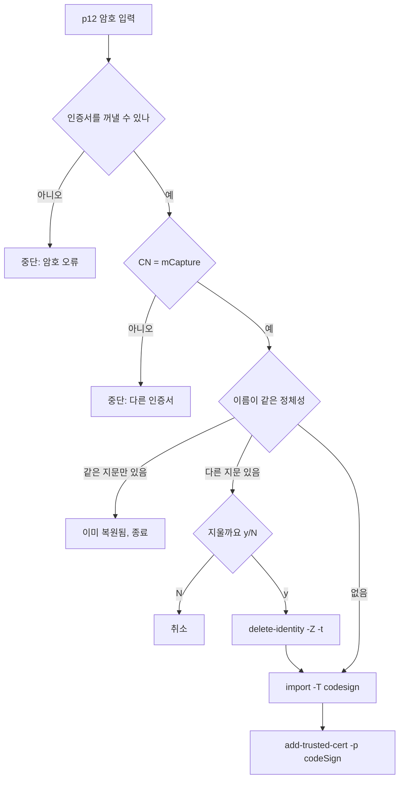
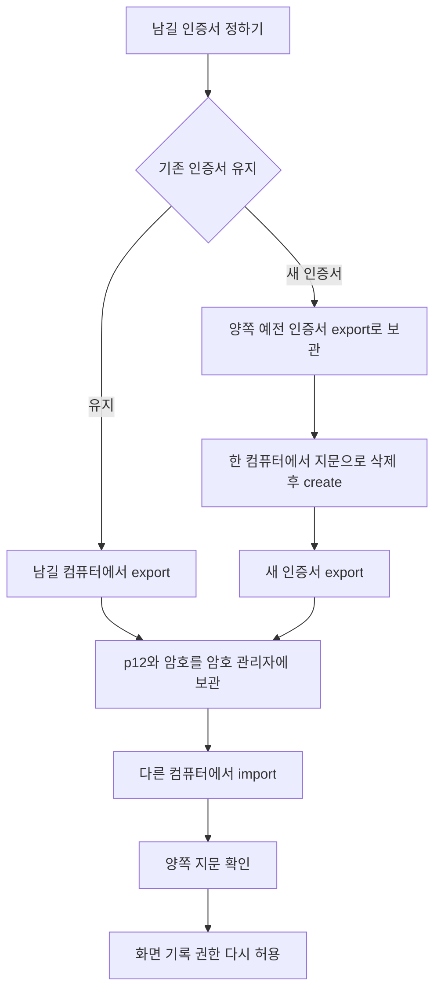

# 서명 인증서 관리
mCapture를 서명하는 `mCapture` 인증서의 생성·유효 기간·백업·복원·교체 방법.

> ℹ️ 대상 독자: 개발자(배포 담당) | 최종 수정: 2026-10-19

## 왜 인증서 하나를 지켜야 하나

화면 기록 권한(TCC)은 앱의 **지정 요구 사항**(designated requirement)에 묶인다. 자체 서명 인증서로 서명한 배포본의 지정 요구 사항에는 인증서 SHA-1 지문이 들어간다.

```bash
codesign -d -r- /Applications/mCapture.app 2>&1 | grep designated
# designated => identifier "com.motolies.mcapture" and certificate leaf = H"f706c512…"
```

- 인증서가 바뀌면 받는 사람 모두가 업데이트 뒤 화면 기록 권한을 다시 허용해야 한다
- 컴퓨터마다 `create-signing-identity.sh`로 따로 만든 인증서는 이름이 같아도 지문이 달라 다른 앱으로 취급된다. 배포하는 컴퓨터는 **모두 같은 인증서**를 쓴다
- 개발 빌드(mCapture Dev 앱)도 같은 인증서로 서명하므로, 인증서를 바꾸면 개발 빌드 권한도 한 번 다시 허용한다

## 인증서 구성

| 항목 | 값 |
|---|---|
| 이름(CN) | `mCapture` (`MCAPTURE_SIGN_IDENTITY`로 변경) |
| 이전 이름 | `mCapture Dev` (2026-10-19까지). 개발 빌드 앱 이름과 같아 헷갈려서 바꿨다. [이전 이름 정리](#이전-이름-정리) 참고 |
| 위치 | 로그인 키체인 `~/Library/Keychains/login.keychain-db` |
| 종류 | 자체 서명, RSA 2048, 확장 키 용도 `codeSigning` |
| 유효 기간 | 36500일(100년). 2026-10-19 이전에 만든 인증서는 3650일(10년) |
| 키 접근 | `/usr/bin/codesign`은 묻지 않고 사용 (`security import -T`) |
| 신뢰 설정 | 코드 서명 용도로 신뢰 (`add-trusted-cert -r trustRoot -p codeSign`) |
| 백업 파일 | 암호 건 PKCS#12(`.p12`). 기본 저장 위치 `signing/`(git 제외) |

현재 배포용 인증서는 지문 `F706C512F6D7EE79CC4089C861C17562184232E2`, 만료일 2126-09-25다.

## 스크립트

| 스크립트 | 하는 일 | 언제 |
|---|---|---|
| `scripts/create-signing-identity.sh` | 새 인증서를 만들어 키체인에 넣고 신뢰 설정 | 처음 한 번, 또는 교체할 때 |
| `scripts/export-signing-identity.swift` | 인증서 + 개인 키를 암호 건 p12로 백업 | 만든 직후, 교체하기 전 |
| `scripts/import-signing-identity.sh` | p12를 키체인에 복원하고 같은 이름의 다른 인증서를 교체 | 다른 컴퓨터, 새 컴퓨터, 재설치 |
| `scripts/build-app.sh` | 이름이 정확히 같은 인증서가 있으면 그것으로, 없으면 임시 서명 | 빌드할 때마다 |
| `scripts/make-dmg.sh` | 임시 서명이면 DMG를 만들지 않음 | 배포할 때 |

## 상태 확인

```bash
# 키체인의 mCapture 서명 정체성과 지문 (같은 줄이 두 번 나와 sort -u)
security find-identity -p codesigning | grep '"mCapture"' | sort -u

# 만료일과 지문. -c는 이름을 포함하는 인증서도 찾으므로 subject로 어느 것인지 확인한다
security find-certificate -c "mCapture" -p | /usr/bin/openssl x509 -noout -subject -enddate -fingerprint -sha1

# 설치한 앱이 어느 인증서로 서명됐는지
codesign -d -r- /Applications/mCapture.app 2>&1 | grep designated
```

배포하는 컴퓨터 모두에서 `find-identity`의 지문이 같아야 한다.

## 처음 만들기

```bash
./scripts/create-signing-identity.sh
./scripts/export-signing-identity.swift
```

- 이름이 정확히 같은 인증서가 이미 있으면 아무것도 만들지 않고 끝난다
- 신뢰 설정을 넣을 때 macOS가 암호를 물을 수 있다
- 만든 직후 지문, 만료일, 백업하라는 안내가 출력된다

## 백업

```bash
./scripts/export-signing-identity.swift                    # signing/mCapture-<SHA-1 앞 8자리>.p12
./scripts/export-signing-identity.swift ~/Desktop/mcap.p12 # 출력 경로 지정
```

1. 내보낼 인증서의 지문이 출력된다
2. p12 암호를 두 번 넣는다. **12자 이상**이어야 한다
3. 키체인이 개인 키 내보내기를 허락할지 물으면 로그인 암호를 넣는다
4. 파일은 권한 600으로 만들어지고, 폴더를 새로 만들면 700이다. 같은 경로에 파일이 있으면 덮어쓰지 않고 멈춘다

`security export`는 키체인의 서명 정체성을 모두 내보내므로, 이 스크립트는 Security 프레임워크(`SecItemExport`)로 이름이 정확히 같은 정체성 하나만 내보낸다. 같은 이름이 둘 이상이면 지문 목록을 보여 주고 멈춘다.

### 보관

키체인이 만드는 p12는 약하게 암호화된다(`openssl pkcs12 -info`로 확인).

| 부분 | 방식 |
|---|---|
| 무결성 MAC | 반복 1회 |
| 개인 키 | `pbeWithSHA1And3-KeyTripleDES-CBC`, 반복 2048회 |
| 인증서 | `pbeWithSHA1And40BitRC2-CBC`, 반복 2048회 |

파일만 손에 넣어도 암호를 빠르게 대입해 볼 수 있다. 그래서 다음을 지킨다.

- 암호는 길게 만든다 (단어 여러 개를 이은 문장 등)
- p12 파일과 암호를 **암호 관리자처럼 따로 암호화되는 곳**에 둔다. 클라우드 폴더에 p12만 그대로 두지 않는다
- 컴퓨터 안의 `signing/`은 작업용이다. 보관은 컴퓨터 밖에 한다

## 복원

```bash
./scripts/import-signing-identity.sh signing/mCapture-F706C512.p12
```



- 이름이 정확히 같은 인증서가 둘 있으면 `codesign`이 `ambiguous`로 실패한다. 그래서 다른 지문은 확인을 받고 지문(`-Z`)으로 지운다. `-t`로 그 인증서의 신뢰 설정도 함께 지운다
- 이름이 다른 인증서(예: 이전 이름 `mCapture Dev`)는 건드리지 않는다. [이전 이름 정리](#이전-이름-정리)에서 따로 지운다
- p12에는 키 접근 권한과 신뢰 설정이 들어 있지 않다. 그래서 `create-signing-identity.sh`와 같은 상태가 되도록 `-T /usr/bin/codesign`으로 가져오고 신뢰 설정을 다시 넣는다
- 신뢰 설정을 넣을 때 macOS가 암호를 물을 수 있다
- 복원한 컴퓨터에서 이전 인증서로 서명된 앱은 다시 빌드·설치한 뒤 화면 기록 권한을 한 번 다시 허용한다

> ⚠️ **주의**: 지운 인증서는 되돌릴 수 없다. 지울 인증서로 서명한 앱을 이미 배포했다면, 복원하기 전에 그 컴퓨터에서 `./scripts/export-signing-identity.swift`로 먼저 백업한다. 지문이 다르면 파일 이름도 달라 겹치지 않는다.

## 지울 때는 지문으로

`codesign --sign`과 `security delete-identity -c`는 이름에 그 문자열이 **들어간** 인증서를 찾는다. 2026-10-19 임시 키체인 시험 결과는 다음과 같다.

| 키체인 상태 | `codesign --sign "mCapture"` | `delete-identity -c "mCapture"` |
|---|---|---|
| `mCapture`와 `mCapture Dev` 둘 다 (가져온 순서 무관) | `mCapture`로 서명 | `mCapture`를 지움 |
| `mCapture Dev`만 | **`mCapture Dev`로 서명** | **`mCapture Dev`를 지움** |

- 이름이 정확히 같은 것이 있으면 그쪽을 고르지만, 없으면 이름을 포함하는 다른 인증서를 쓴다
- `build-app.sh`는 `codesign`을 부르기 전에 `"mCapture"`처럼 따옴표까지 붙여 이름이 정확히 같은지 확인한다. 그래서 `mCapture Dev`만 있으면 그 키로 서명하지 않고 임시 서명으로 넘어간다
- 키체인에서 지울 때는 항상 지문(`-Z`)을 쓴다. 이름이 정확히 같은 정체성만 지우는 명령은 다음과 같다

```bash
NAME="mCapture"
security find-identity -p codesigning | awk -v n="\"$NAME\"" 'index($0, n) { print $2 }' | sort -u \
    | while read -r SHA; do security delete-identity -Z "$SHA" -t; done
```

## 유효 기간과 만료

`create-signing-identity.sh`는 `DAYS=36500`(100년)으로 만든다. 2026-10-19에 임시 키체인으로 확인한 결과는 다음과 같다.

| 상황 | 결과 |
|---|---|
| 100년 인증서 (`notAfter` 2126년) | 가져오기, 서명, `codesign -v` 모두 정상 |
| 만료된 인증서로 새로 서명 | `<이름>: no identity found`로 실패. `find-identity`에 `CSSMERR_TP_CERT_EXPIRED` 표시 |
| 만료 전에 서명한 앱을 만료 뒤에 검증 | `valid on disk`, `satisfies its Designated Requirement` |

- 만료되면 **새 버전을 서명할 수 없다**. 이미 설치한 앱은 서명 검증과 지정 요구 사항 검사를 그대로 통과한다
- 화면 기록 권한이 만료 뒤에도 유지되는지는 TCC를 직접 시험하지 않았다(확인 필요). TCC가 비교하는 지정 요구 사항은 만족한다
- `build-app.sh`는 만료된 인증서도 `find-identity`에 나와 있다고 보고 `codesign`을 부른다. 그래서 임시 서명으로 넘어가지 않고 빌드가 실패한다
- 스크립트의 `DAYS`를 바꿔도 **이미 만든 인증서의 만료일은 바뀌지 않는다**. 만료일을 늘린 새 인증서는 지문이 달라 교체로 취급된다

> ℹ️ **참고**: X.509 인증서 날짜는 2049년까지 UTCTime, 2050년부터 GeneralizedTime 형식으로 적는다. 2126년 만료 인증서는 GeneralizedTime 형식인데, macOS 키체인과 `codesign` 모두 문제없이 처리했다.

## 이전 이름 정리

2026-10-19에 서명 인증서 이름을 `mCapture Dev`에서 `mCapture`로 바꿨다. 이름은 인증서 안(CN)에 들어 있어서 이름을 바꾸면 새 인증서가 되고, 받는 사람 모두가 다음 업데이트 때 권한을 한 번 다시 허용한다.

| 컴퓨터 | 상태 |
|---|---|
| MacBookPro-2 | 완료. 새 `mCapture`(`F706C512…`) 생성, 예전 `mCapture Dev`(`EE7A802F…`) 삭제 |
| 다른 컴퓨터 | 아래 절차로 진행 |

```bash
# 1. 스크립트 받기
git pull

# 2. (선택) 예전 인증서 보관
MCAPTURE_SIGN_IDENTITY="mCapture Dev" ./scripts/export-signing-identity.swift

# 3. 새 인증서 복원 (MacBookPro-2에서 백업한 p12를 signing/에 둔다)
./scripts/import-signing-identity.sh signing/mCapture-F706C512.p12

# 4. 예전 인증서 삭제 (이름이 정확히 "mCapture Dev"인 정체성만)
NAME="mCapture Dev"
security find-identity -p codesigning | awk -v n="\"$NAME\"" 'index($0, n) { print $2 }' | sort -u \
    | while read -r SHA; do security delete-identity -Z "$SHA" -t; done

# 5. 확인: "mCapture" 하나, 지문 F706C512…
security find-identity -p codesigning | grep ') ' | sort -u
```

그다음 개발 빌드를 다시 만들어(`./scripts/build-app.sh`) 화면 기록 권한을 한 번 다시 허용한다. 이미 설치한 mCapture는 예전 서명 그대로 계속 동작하고, 새 인증서로 만든 DMG로 업데이트할 때 권한을 다시 허용한다.

## 교체·통일

다음 경우에 진행한다.

- 두 컴퓨터가 각자 인증서를 만들어 지문이 다를 때
- 인증서가 만료됐거나 개인 키가 유출됐을 때



### 기존 인증서 하나를 남길 때

받는 사람이 가장 많이 설치한 버전에 서명된 인증서를 남긴다. 버린 인증서로 서명된 앱을 쓰는 사람만 다음 업데이트 때 권한을 다시 허용한다.

```bash
# 남길 컴퓨터
./scripts/export-signing-identity.swift

# 다른 컴퓨터: 예전 인증서를 먼저 백업하고, 남길 컴퓨터에서 가져온 p12를 signing/에 두고 복원
./scripts/export-signing-identity.swift
./scripts/import-signing-identity.sh signing/mCapture-F706C512.p12
```

### 새 인증서로 바꿀 때

모든 받는 사람이 다음 업데이트 때 권한을 한 번 다시 허용한다.

```bash
# 컴퓨터 A: 예전 인증서 보관 → 지문으로 지우기 → 새로 만들기 → 백업
./scripts/export-signing-identity.swift
NAME="mCapture"
security find-identity -p codesigning | awk -v n="\"$NAME\"" 'index($0, n) { print $2 }' | sort -u \
    | while read -r SHA; do security delete-identity -Z "$SHA" -t; done
./scripts/create-signing-identity.sh
./scripts/export-signing-identity.swift

# 컴퓨터 B: 예전 인증서 보관 → 새 인증서로 교체 (import가 같은 이름의 예전 인증서를 확인 후 지운다)
./scripts/export-signing-identity.swift
./scripts/import-signing-identity.sh signing/mCapture-<새 지문 앞 8자리>.p12
```

- 교체 뒤 양쪽에서 [상태 확인](#상태-확인) 명령으로 지문과 만료일을 확인한다
- `Resources/Info.plist`의 버전을 올려 DMG를 새로 배포한다

### 교체 뒤 권한 정리

시스템 설정의 화면 기록 목록에 예전 서명의 mCapture 항목이 남아 권한이 꼬이면 지우고 다시 허용한다.

```bash
tccutil reset ScreenCapture com.motolies.mcapture       # 설치한 mCapture
tccutil reset ScreenCapture com.motolies.mcapture.dev   # 개발 빌드
```

## 환경 변수

| 변수 | 적용 스크립트 | 기본값 | 설명 |
|---|---|---|---|
| `MCAPTURE_SIGN_IDENTITY` | create, export, import, build-app | `mCapture` | 인증서 이름(CN) |
| `MCAPTURE_KEYCHAIN` | export, import | 기본 검색 목록 / 로그인 키체인 | 대상 키체인. 임시 키체인으로 시험할 때 쓴다 |

`export-signing-identity.swift`의 `MCAPTURE_KEYCHAIN` 처리에 쓰는 `SecKeychainOpen`이 deprecated라서, 첫 줄 `#!/usr/bin/env -S swift -suppress-warnings`에서 컴파일 경고를 끈다.

## 트러블슈팅

| 증상 | 원인 | 해결 |
|---|---|---|
| `mCapture: ambiguous (matches "mCapture" and "mCapture" …)` | 이름이 정확히 같은 인증서가 둘 | `import-signing-identity.sh`로 하나만 남기거나 [지문으로 지우기](#지울-때는-지문으로) |
| 빌드 중 `mCapture: no identity found` | 인증서 만료 (`find-identity`에 `CSSMERR_TP_CERT_EXPIRED`) | [새 인증서로 바꿀 때](#새-인증서로-바꿀-때) |
| `build-app.sh`: "'mCapture' 인증서가 없어 임시 서명했습니다" | 키체인에 `mCapture`가 없음 (`mCapture Dev`만 있는 경우 포함) | 배포한 적이 있으면 import, 처음이면 create. 이전 이름이 남았으면 [이전 이름 정리](#이전-이름-정리) |
| `make-dmg.sh`: "임시 서명으로 빌드되어 DMG를 만들지 않습니다" | 위와 같음 | 위와 같음 |
| export: "인증서가 여러 개입니다" | 이름이 같은 정체성이 둘 이상 | 하나를 지문으로 지운 뒤 다시 실행 |
| export: "이미 파일이 있습니다" | 출력 경로에 파일이 있음 | 다른 경로를 지정 |
| import: "암호가 틀렸거나 p12 파일이 아닙니다" | 암호 오류, 다른 형식 | 암호 확인 |
| import: "'mCapture' 인증서가 아닙니다: CN=…" | 다른 이름 인증서의 p12 (예: 이전 이름 백업) | 올바른 백업 파일 사용 |
| 업데이트 뒤 화면 기록 권한을 다시 물음 | 서명 인증서가 바뀜 | 다시 허용. 꼬이면 [교체 뒤 권한 정리](#교체-뒤-권한-정리) |
